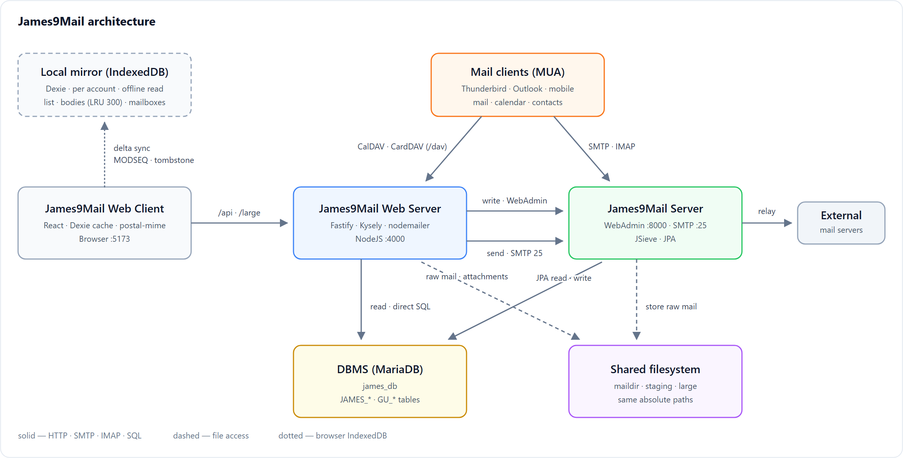

# James9Mail Webmail

[한국어](README_ko.md)

## Overview

- A webmail server for [**James9Mail**](https://github.com/gujc71/James9Mail), a fork of [Apache James](https://james.apache.org/).
- It is built around the idea of bringing the features of Thunderbird and Outlook to the web.

## Architecture



- **Reads**: the web server queries the DBMS directly and sends raw message files as-is; the browser parses the MIME.
- **Writes** go through James9Mail's WebAdmin. Never UPDATE the DB directly, or MODSEQ, listeners and quotas will drift out of sync.
- **Sending**: the web server assembles the MIME, submits it over SMTP port 25, and APPENDs the same raw message to the Sent mailbox.
- **Mail clients (MUAs) such as Thunderbird and Outlook** can be used alongside it. Mail connects to James9Mail over SMTP and IMAP;
  calendars and address books connect to the web server over CalDAV and CardDAV (`/dav`). Both see the same DB as the webmail,
  so a change made on either side shows up on the other.

## Key features

- **Mail is parsed on the client, not the server**, which reduces server load. The server sends the raw message
  as-is and the browser does the MIME parsing.
- **Key message-list data is cached on the client using Dexie and similar tools.** Only changes are requested
  from the server.
- **Filters, vacation replies and forwarding** are implemented with a modified version of Apache James's JSieve.
- **Conversation (thread) grouping is decided on the James side, where mail is stored.** `References` are expanded
  into rows (`JAMES_MAIL_REFERENCE`) and the root of each conversation is stored in `MAIL_THREAD_ID`, so the browser
  only has to group messages with the same value — lists drawn from the server and from the cache always group the same way.

## Layout

```
james9MailW/
  server/   NodeJS + TypeScript + Fastify + Kysely + nodemailer
  client/   Vite + React + TanStack Query + Dexie + postal-mime
```

## Running

### Prerequisites

| Item | Requirement |
|---|---|
| Node.js | 20 or later (with `npm`) |
| DBMS | **MariaDB** — **the same DB** James9Mail uses (per `james-database.properties`, default `james_db`) |
| James9Mail | WebAdmin at `http://localhost:8000` and SMTP at `127.0.0.1:25` must be reachable |

- The web server and James9Mail must see **the same filesystem**. `MAIL_STORE_DIR` and `MAIL_STAGING_DIR` in `.env`
  must be **the same absolute paths** as `james.mail.store.dir` and `james.mail.staging.dir` on the James side.
- WebAdmin has no authentication, so always bind it to `localhost` only.

### 0) Start dependencies

- Start the James9Mail server
- Start the DBMS (MariaDB)
- Set the MariaDB server's default character set to utf8mb4 (`my.ini` / `my.cnf`). James creates tables with the server's
  default character set, so without this setting emoji and similar characters are corrupted when stored
  (MariaDB before 11.6 defaults to latin1).

  ```ini
  [mysqld]
  character-set-server = utf8mb4
  collation-server     = utf8mb4_unicode_ci
  ```

```bash
mysql -uroot -p james_db < server/sql/01-gu-tables.sql
mysql -uroot -p james_db < server/sql/02-seed.sql
mysql -uroot -p james_db < server/sql/03-calendar-tables.sql   # Calendar and tasks (CAL_ tables)
mysql -uroot -p james_db < server/sql/04-caldav.sql            # CalDAV (manage events from other apps). Safe to run on an existing DB
mysql -uroot -p james_db < server/sql/05-carddav.sql           # CardDAV, detailed contact fields, groups. Safe to run on an existing DB
```

### 1) Server

```bash
cd server
cp .env.example .env        # adjust paths, DB and James addresses for your environment
npm install
npm run dev                 # http://127.0.0.1:4000
```

**You must set the DB connection details in `.env`.** `DB_USER` and `DB_NAME` have no defaults — the server
refuses to start without them. Point them at the **same DB** James9Mail uses (see `james-database.properties`).

```ini
DB_HOST=localhost
DB_PORT=3306
DB_USER=root
DB_PASSWORD=change-me      # the real password of the DB account
DB_NAME=james_db
DB_POOL_SIZE=10            # read-only pool size, kept apart from James's delivery transactions
```

### 2) Client

```bash
cd client
npm install
npm run dev                 # http://localhost:5173 (/api and /large are proxied to 4000)
```

### 3) Conversation (thread) backfill — run once if you have existing mail

James9Mail decides the conversation when it stores a message and records it in `JAMES_MAIL.MAIL_THREAD_ID`.
Mail that arrived before that has an empty value and shows up as single-message conversations, so fill it in once.

```bash
cd server
npm run backfill:thread -- --dry   # check first (writes nothing)
npm run backfill:thread
```

It reads only the headers of each raw message to recover `References` and `In-Reply-To`. It is safe to run again.

## Security settings for production

When started with `NODE_ENV=production`, the server refuses to start if `SESSION_SECRET` or `SECRET_KEY` is still the
example value or shorter than 32 characters. During development it only logs a warning.

| Setting | When to change it |
|---|---|
| `COOKIE_SECURE` | `1` when serving over HTTPS. Turns on the cookie Secure flag and HSTS together (defaults to `1` in production) |
| `TRUST_PROXY` | `1` or the proxy IP, only when there is a front proxy such as nginx. If not set correctly, login lockout is tied to the single proxy IP |
| `PUBLIC_BASE_URL` | Base address for large-attachment links. If empty, the request address is used |
| `LOGIN_MAX_FAILURES` · `LOGIN_LOCK_MINUTES` | Lockout after failed logins (default 5 attempts, 15 minutes) |
| `EXTERNAL_MAIL_ALLOW_PRIVATE` | `1` only when external mail must be fetched from an internal (private IP) server |
| `EXTERNAL_MAIL_TLS_INSECURE` | `1` only when the external mail server uses a self-signed certificate |

- `/api` requests that change state must carry the `X-Requested-With` header (CSRF protection). The UI adds it
  automatically; add it yourself when calling from scripts.
- The received-mail cache is kept in the browser's IndexedDB **per account**. On a shared PC, turn on
  "Preferences > Profile > Delete the mail cache stored on this PC when signing out".
- Server unit tests: `cd server && npm test` (runs without a DB).

## License

MIT
