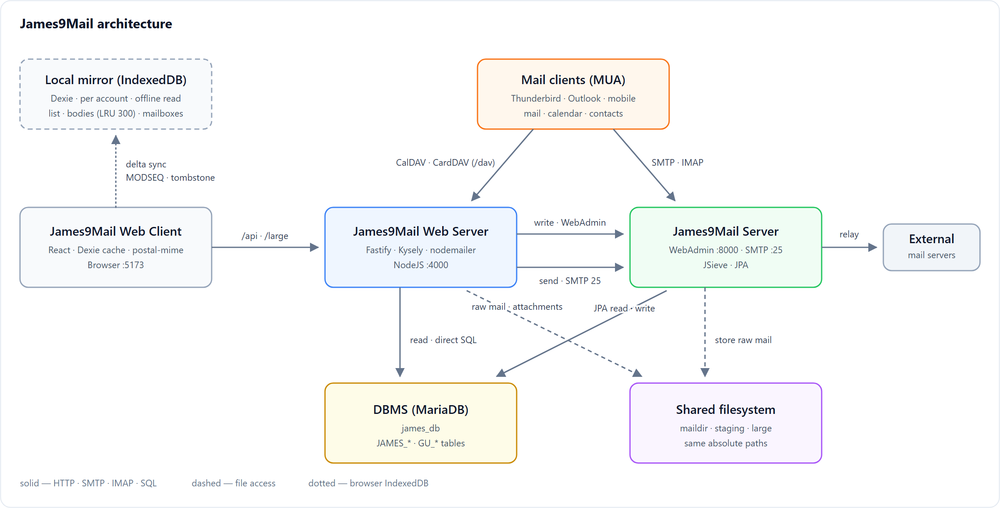

# James9Mail 웹메일

## 개념 소개

- [Apache James](https://james.apache.org/) 를 fork 하여 개발한 **James9Mail** 을 위한 웹 메일 서버입니다.
- 썬더버드 · 아웃룩의 기능을 웹으로 구축한다는 개념으로 개발하였습니다.

## 구조



- **읽기**는 웹서버가 DBMS 를 직접 조회하고, 원문 파일은 그대로 내려보내 브라우저가 MIME 을 파싱합니다.
- **쓰기**는 James9Mail 의 WebAdmin 을 경유합니다. DB 를 직접 UPDATE 하지 않아야 MODSEQ · 리스너 · 쿼터가 어긋나지 않습니다.
- **발송**은 웹서버가 MIME 을 조립해 SMTP 25 로 제출하고, 같은 원문을 보낸 편지함에 APPEND 합니다.
- **썬더버드 · 아웃룩 같은 메일 프로그램(MUA)** 도 함께 쓸 수 있습니다. 메일은 SMTP · IMAP 으로 James9Mail 에,
  일정 · 주소록은 CalDAV · CardDAV(`/dav`) 로 웹서버에 붙습니다. 웹메일과 같은 DB 를 보므로 어느 쪽에서 바꿔도 같이 보입니다.

## 주요 특징

- **메일 읽기를 서버가 아닌 클라이언트에서 처리**해 서버의 부하를 줄였습니다. 서버는 원문을 그대로
  내려주고, MIME 파싱은 브라우저가 합니다.
- **Dexie 등을 이용해 메일 리스트의 주요 정보를 클라이언트에 캐시**합니다. 서버에는 갱신된 정보만
  요청합니다.
- **자동분류 · 부재중 응답 · 포워딩은 Apache James 의 JSieve 를 수정**하여 구현하였습니다.
- **대화(스레드) 묶기는 메일을 저장하는 James 쪽에서 판정**합니다. `References` 를 행으로 풀어
  두고(`JAMES_MAIL_REFERENCE`) 대화의 뿌리를 `MAIL_THREAD_ID` 에 박아 두므로, 브라우저는 같은
  값끼리 모으기만 하면 됩니다 — 서버로 그린 목록과 캐시로 그린 목록의 묶음이 어긋나지 않습니다.

## 구성

```
james9MailW/
  server/   NodeJS + TypeScript + Fastify + Kysely + nodemailer
  client/   Vite + React + TanStack Query + Dexie + postal-mime
```

## 실행

### 사전 준비 사항

| 항목 | 요구 사항 |
|---|---|
| Node.js | 20 이상 (`npm` 포함) |
| DBMS | **MariaDB** — James9Mail 이 쓰는 것과 **같은 DB** (`james-database.properties` 기준, 기본 `james_db`) |
| James9Mail | WebAdmin `http://localhost:8000`, SMTP `127.0.0.1:25` 로 접근 가능해야 합니다 |

- 웹서버와 James9Mail 은 **같은 파일시스템**을 봐야 합니다. `.env` 의 `MAIL_STORE_DIR` ·
  `MAIL_STAGING_DIR` 은 James 쪽 `james.mail.store.dir` · `james.mail.staging.dir` 과
  **같은 절대경로**여야 합니다.
- WebAdmin 은 인증이 없으므로 반드시 `localhost` 에만 묶어 두십시오.

### 0) 사전 실행

- James9Mail 서버 실행
- DBMS (MariaDB) 실행
- MariaDB 서버 기본 문자셋을 utf8mb4 로 맞춰 둡니다 (`my.ini` / `my.cnf`). James 는 서버 기본 문자셋으로
  테이블을 만들므로, 이 설정이 없으면 이모지 등이 저장 시점에 깨집니다 (11.6 미만 MariaDB 기본값은 latin1).

  ```ini
  [mysqld]
  character-set-server = utf8mb4
  collation-server     = utf8mb4_unicode_ci
  ```

```bash
mysql -uroot -p james_db < server/sql/01-gu-tables.sql
mysql -uroot -p james_db < server/sql/02-seed.sql
mysql -uroot -p james_db < server/sql/03-calendar-tables.sql   # 캘린더 · 태스크 (CAL_ 테이블)
mysql -uroot -p james_db < server/sql/04-caldav.sql            # CalDAV (외부 프로그램에서 일정 관리). 기존 DB 에도 그대로 돌린다
mysql -uroot -p james_db < server/sql/05-carddav.sql           # CardDAV · 연락처 상세 필드 · 그룹. 기존 DB 에도 그대로 돌린다
```

### 1) 서버

```bash
cd server
cp .env.example .env        # 경로·DB·James 주소를 환경에 맞게 수정
npm install
npm run dev                 # http://127.0.0.1:4000
```

**`.env` 에 DB 접속 정보를 반드시 설정해야 합니다.** `DB_USER` · `DB_NAME` 은 기본값이 없어, 없으면 서버가
기동하지 않습니다. James9Mail 이 쓰는 것과 **같은 DB** 를 가리키게 합니다 (`james-database.properties` 참고).

```ini
DB_HOST=localhost
DB_PORT=3306
DB_USER=root
DB_PASSWORD=change-me      # DB 계정의 실제 비밀번호
DB_NAME=james_db
DB_POOL_SIZE=10            # 조회 전용 풀 크기. James 배달 트랜잭션과 커넥션을 다투지 않도록 분리합니다
```

### 2) 클라이언트

```bash
cd client
npm install
npm run dev                 # http://localhost:5173 (/api, /large 는 4000 으로 프록시)
```

### 3) 대화(스레드) 백필 — 기존 메일이 있을 때 한 번

James9Mail 은 메일을 저장할 때 대화를 정해 `JAMES_MAIL.MAIL_THREAD_ID` 에 남깁니다. 그 전에
들어온 메일은 값이 비어 있어 목록에서 한 통짜리 대화로 보이므로, 한 번 채워 줍니다.

```bash
cd server
npm run backfill:thread -- --dry   # 먼저 확인 (아무것도 쓰지 않습니다)
npm run backfill:thread
```

원문 앞머리만 읽어 `References` · `In-Reply-To` 를 되살립니다. 다시 돌려도 안전합니다.

## 운영 시 보안 설정

`NODE_ENV=production` 으로 띄우면 `SESSION_SECRET` · `SECRET_KEY` 가 예시 값이거나 32자보다 짧을 때
기동하지 않습니다. 개발 중에는 경고만 남깁니다.

| 설정 | 언제 바꾸나 |
|---|---|
| `COOKIE_SECURE` | HTTPS 로 서비스하면 `1`. 쿠키 Secure 와 HSTS 가 함께 켜집니다 (운영 기본 `1`) |
| `TRUST_PROXY` | nginx 등 앞단 프록시가 있을 때만 `1` 또는 프록시 IP. 맞추지 않으면 로그인 잠금이 프록시 IP 하나로 묶입니다 |
| `PUBLIC_BASE_URL` | 대용량 첨부 링크의 주소. 비우면 요청 주소를 씁니다 |
| `LOGIN_MAX_FAILURES` · `LOGIN_LOCK_MINUTES` | 로그인 실패 잠금 (기본 5회 · 15분) |
| `EXTERNAL_MAIL_ALLOW_PRIVATE` | 외부메일을 사내(사설 IP) 서버에서 가져와야 할 때만 `1` |
| `EXTERNAL_MAIL_TLS_INSECURE` | 외부메일 서버가 자체 서명 인증서를 쓸 때만 `1` |

- 상태를 바꾸는 `/api` 요청은 `X-Requested-With` 헤더가 있어야 합니다 (CSRF 방어). 화면은 자동으로
  붙이고, 스크립트로 호출할 때는 직접 붙입니다.
- 받은 메일 캐시는 브라우저 IndexedDB 에 **계정별로** 둡니다. 공용 PC 라면
  "환경 설정 > 개인 정보 관리 > 로그아웃할 때 이 PC 에 저장된 메일 캐시를 삭제" 를 켭니다.
- 서버 단위 테스트는 `cd server && npm test` 입니다 (DB 없이 돕니다).

## License

MIT
