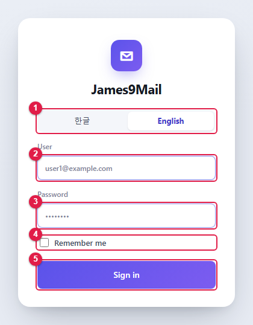
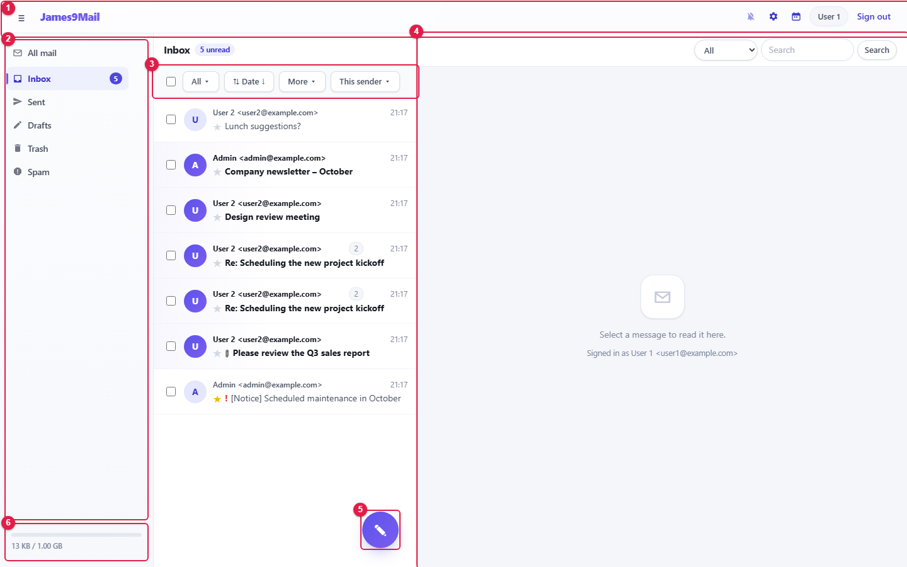
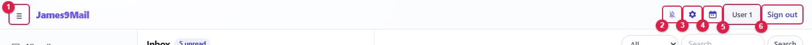
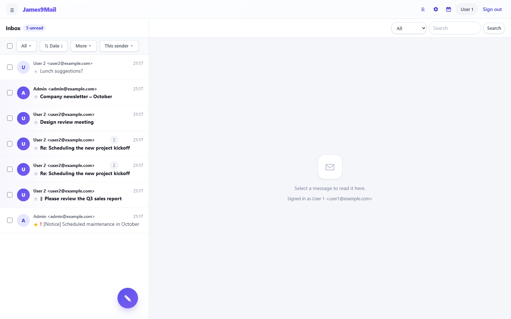
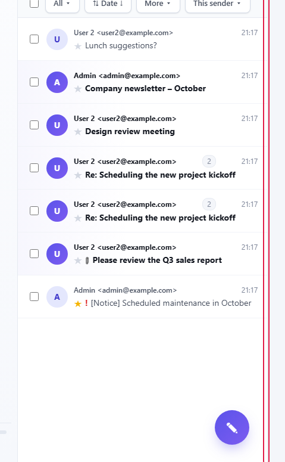

= 1. Getting started
:tip-caption: Good to know
:figure-caption!:
:table-caption!:

xref:README.adoc[← Contents] · xref:02-mail-read.adoc[2. Reading and managing mail →]

[[_11-signing-in]]
== 1.1 Signing in

. Open the webmail address in your web browser.
. ① Choose the screen language: **한글** or **English**. The screen switches as soon as you click.
. ② Enter your full mail address in **User** (for example `+user1@example.com+`).
. ③ Enter your **Password**.
. To skip typing your ID next time, tick ④ **Remember me**.
. Click ⑤ **Sign in** or press Enter.

[NOTE]
====
* **Remember me** stores only your ID in this browser, never your password.
* After several wrong passwords, signing in is blocked for a while. Try again later.
* If you forget your password, ask your administrator to reset it.
====

[[_12-screen-layout]]
== 1.2 Screen layout

After signing in, the mail screen opens.

[cols="1,2,8",options="header"]
|===
|No. |Area |Description

|① |Top bar |Side menu toggle, new-mail notifications, preferences, calendar, sign out (<<_13-top-bar,1.3>>)
|② |Side menu |Mailbox list (xref:02-mail-read.adoc#_21-mailboxes[2.1])
|③ |List tools |Select, filter, sort and bulk actions (xref:02-mail-read.adoc#_22-message-list[2.2])
|④ |Message list and reading pane |The list on the left, the selected message on the right. The search box is at the top right
|⑤ |New message button (✎) |Write a new message (xref:03-mail-compose.adoc[Chapter 3])
|⑥ |Usage |Storage used / quota. Unlimited quota shows as `+UNLIMIT+`
|===

[[_13-top-bar]]
== 1.3 Top bar

[cols="1,1,6",options="header"]
|===
|No. |Button |Description

|① |≡ |Hides or shows the side menu
|② |🔔 New-mail notifications |Turns desktop notifications for new mail on or off (<<_15-new-mail-notifications,1.5>>)
|③ |⚙ Preferences |Personal settings such as signatures, address book and filters (xref:05-settings.adoc[Chapter 5])
|④ |📅 Calendar |Opens the calendar. On the calendar screen the same button becomes ✉ **Mail** (xref:04-calendar.adoc[Chapter 4])
|⑤ |Photo · name |The signed-in user
|⑥ |**Sign out** |Signs you out
|===

[NOTE]
====
Administrator accounts have an extra **Admin** button to the left of ②. See the xref:admin.adoc[Administrator Guide].
====

Click the logo (**James9Mail**) on any screen to return to mail.

[[_14-adjusting-the-layout]]
== 1.4 Adjusting the layout

**Hide the side menu** — Click ≡ to collapse the side menu and widen the list and reading pane. Click again to bring it back.

**Resize the message list** — Drag the border (↔) between the message list and the reading pane.

* **Double-click** the border to return to the default width.
* After clicking the border you can also nudge it with the ← / → keys.
* The width is remembered in this browser.

[[_15-new-mail-notifications]]
== 1.5 New-mail notifications

Get a desktop notification when new mail arrives, even while the webmail window is behind other windows.

. Click the 🔔 button in the top bar.
. When the browser asks for permission, click **Allow**.
. "New-mail notifications turned on" confirms it. Click again to turn them off.

[NOTE]
====
* No notification appears while you are looking at the webmail window.
* Only mail arriving in the Inbox and your own mailboxes is announced. Sent, Drafts, Trash and Spam are not.
* When several messages arrive at once, up to three are announced individually and the rest are grouped as "\{n} more message(s) arrived".
* Clicking a notification opens that message.
* If you see "The browser is blocking notifications for this site", click the padlock to the left of the address bar and set notifications to **Allow**.
====

The browser tab title and icon also show the unread count (the icon counts up to 9+).

[[_16-new-mail-and-offline-use]]
== 1.6 New mail and offline use

* Webmail checks for new mail **every 30 seconds** while you are looking at it, and every 5 minutes while it is in a background tab. It checks once more as soon as you return to the tab.
* The message list and the messages you have opened are kept on this PC, so they open faster next time.
* When the network drops, "Offline — showing mail saved on this device" appears above the list and only saved mail can be viewed.
** A message you have never opened cannot be opened offline.
** File-name search is not available offline.
* On a shared PC, tick **Delete the mail cache stored on this PC when I sign out** in xref:05-settings.adoc#_51-profile[Preferences › Profile].

[[_17-screen-size]]
== 1.7 Screen size

[cols="2,8",options="header"]
|===
|Window width |What changes

|1180px or less |There is no separate reading pane; a message opens over the list. Use **← List** to go back
|720px or less (phone) |The side menu is hidden; open it with ≡. It closes automatically when you pick a mailbox
|===

[[_18-opening-a-screen-by-address]]
== 1.8 Opening a screen by address

The part of the address after `+#+` changes as you move between screens. Refreshing (F5) reopens the same screen, and the browser's Back / Forward buttons move between screens.

[cols="1,3",options="header"]
|===
|Screen |Address

|Mail |`+#/mail+`
|Calendar / tasks |`+#/calendar+` / `+#/calendar/tasks+`
|Preferences |`+#/settings/profile+`, `+#/settings/signature+` …
|===

[[reading-mail-in-thunderbird-or-outlook]]
== Reading mail in Thunderbird or Outlook

🔗 Your webmail account also works in mail apps such as Thunderbird and Outlook.

* When adding the account in the app, set the incoming server to **IMAP** and the outgoing server to **SMTP**.
* The user name is your webmail ID (full mail address) and the password is your webmail password.
* Ask your administrator for the server addresses and ports.
* Webmail and the app share the same mailbox: reading, starring, moving or deleting on one side shows up on the other.
* Connect events with xref:04-calendar.adoc#connecting-other-calendar-apps-caldav[CalDAV] and the address book with xref:05-settings.adoc#connecting-other-address-book-apps-carddav[CardDAV].

xref:README.adoc[← Contents] · xref:02-mail-read.adoc[2. Reading and managing mail →]
