= 2. Reading and managing mail
:tip-caption: Good to know
:figure-caption!:
:table-caption!:

xref:01-getting-started.adoc[← 1. Getting started] · xref:README.adoc[Contents] · xref:03-mail-compose.adoc[3. Writing and sending mail →]

[[_21-mailboxes]]
== 2.1 Mailboxes

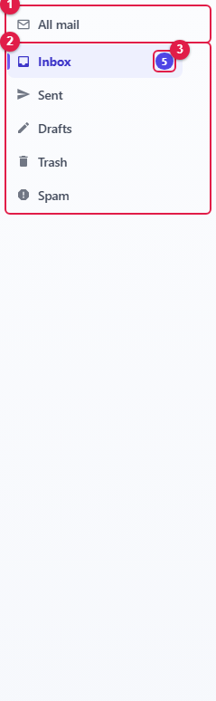

[cols="1,1,6",options="header"]
|===
|No. |Item |Description

|① |**All mail** |Shows mail from every mailbox together
|② |Mailbox list |The standard mailboxes (Inbox, Sent, Drafts, Trash, Spam) and the mailboxes you create
|③ |Unread count |Number of unread messages in that mailbox
|===

Click a mailbox to show its messages in the list. Sub-mailboxes are indented.

[[mailbox-options]]
=== Mailbox options

Hover over a mailbox to reveal the **⋯** button on its right.

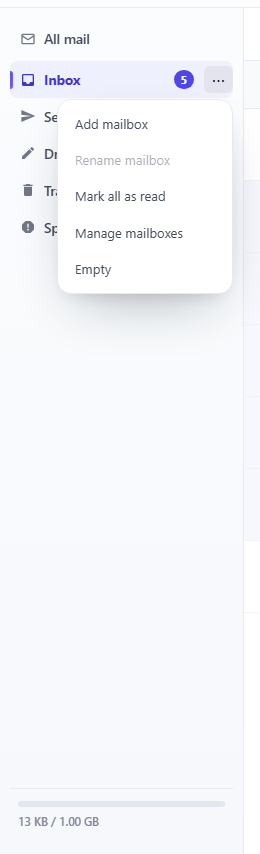

[cols="2,7",options="header"]
|===
|Menu |Action

|**Add mailbox** |Creates a sub-mailbox under this one. You are asked for its name
|**Rename mailbox** |Renames the mailbox. Standard mailboxes cannot be renamed
|**Mark all as read** |Marks every message in this mailbox as read
|**Manage mailboxes** |Opens xref:05-settings.adoc#_54-mailboxes[Preferences › Mailboxes]
|**Empty** |Removes every message. In Trash and Spam they are **deleted permanently**; in other mailboxes they are moved to Trash
|===

[NOTE]
====
🔗 Mailboxes are the same as folders in Thunderbird or Outlook. Folders created in a mail app appear here too.
====

[[_22-message-list]]
== 2.2 Message list

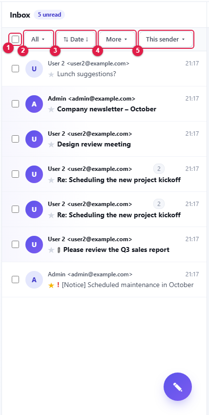

[cols="1,2,6",options="header"]
|===
|No. |Tool |Description

|① |Select all |Selects or clears every message in the list
|② |**All ▾** (filter) |Shows only messages that match a condition
|③ |**⇅ Date ↓** (sort) |Chooses the sort order and conversation grouping
|④ |**More ▾** |Moves, copies, deletes or marks the selected messages
|⑤ |**This sender ▾** |Adds the sender of the selected message to contacts, or shows only that sender's mail (Inbox only)
|===

[[reading-a-list-row]]
=== Reading a list row

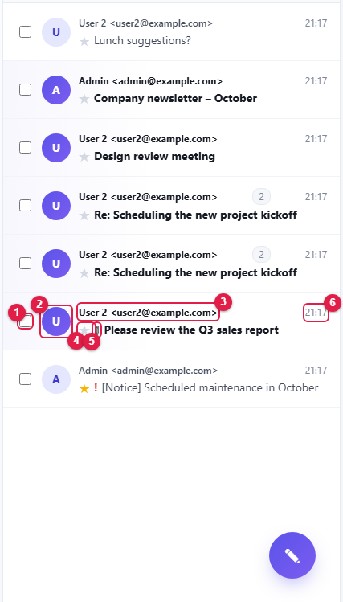

[cols="1,1,4",options="header"]
|===
|No. |Shown |Meaning

|① |Checkbox |Select the message
|② |Circle |Sender's photo or initial
|③ |Name · address |Sender. In Sent, the recipient is shown instead
|④ |★ |Star. Click to toggle
|⑤ |📎 |The message has attachments
|⑥ |Time |Date and time received. When sorting by size, the message size is shown here
|===

* **Bold** rows are unread.
* A red **!** means the sender marked the message **High importance**.
* Click a message to open it on the right; it is marked as read.
* Scroll to the end of the list to load the next 50 messages automatically.

[NOTE]
====
🔗 Read and starred states change together with Thunderbird and Outlook (the star is the mail app's "flag").
====

[[filter]]
=== Filter

Click **All ▾** and tick any of **Unread**, **Starred**, **High importance** and **Attachment**. With a condition set, the button reads **Filter n ▾**.

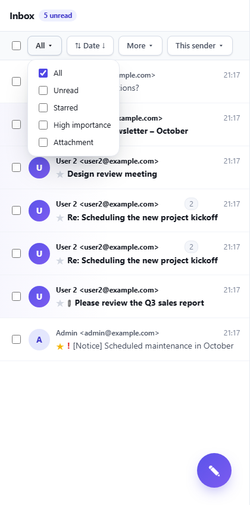

[NOTE]
====
**Starred** is a mark you set yourself; **High importance** is set by the sender.
====

[[sorting-and-conversations]]
=== Sorting and conversations

Click the **⇅** button to open the sort menu.

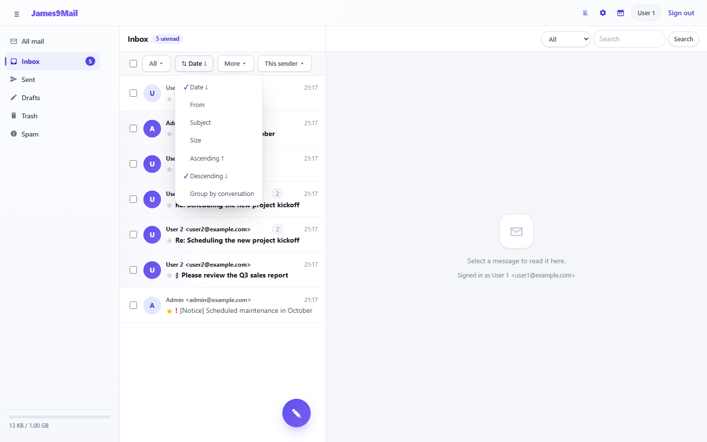

* Order by: **Date**, **From** (in Sent: **To**), **Subject**, **Size**
* Direction: **Ascending ↑** / **Descending ↓**. Choosing the same order again reverses it.
* **Group by conversation**: groups messages connected by replies into one row (<<_24-conversations,2.4>>).
* Switching to another mailbox resets the sort to the default (Date ↓).

[[_23-handling-several-messages-at-once]]
== 2.3 Handling several messages at once

. Tick the checkboxes of the messages. The button changes to **More ▾ (n)**.
. Click **More ▾** and pick an action.

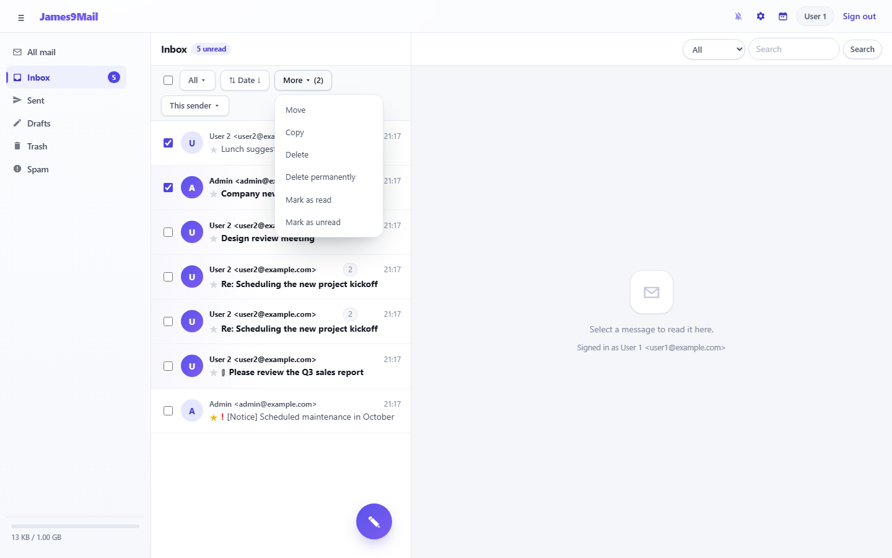

[cols="3,7",options="header"]
|===
|Menu |Action

|**Move** / **Copy** |Moves or copies to a mailbox you choose
|**Delete** |Moves to Trash. Deleting inside Trash removes the message for good
|**Delete permanently** |Deletes immediately. **This cannot be undone**
|**Mark as read** / **Mark as unread** |Changes the read state
|**Block as spam** / **Not spam** |Moves to Spam and adds the sender to your blocked senders. Shown only when xref:05-settings.adoc#_57-blocked-senders[Blocked senders] is in use
|===

**Move** and **Copy** open a mailbox picker. Choose a mailbox and click **Select** (double-clicking a mailbox selects it at once).

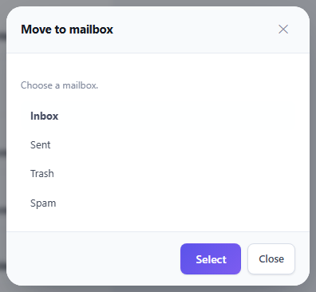

[[drag-to-move]]
=== Drag to move

Drag messages onto a mailbox on the left to move them there. Mailboxes you can drop onto are outlined with a dashed line.

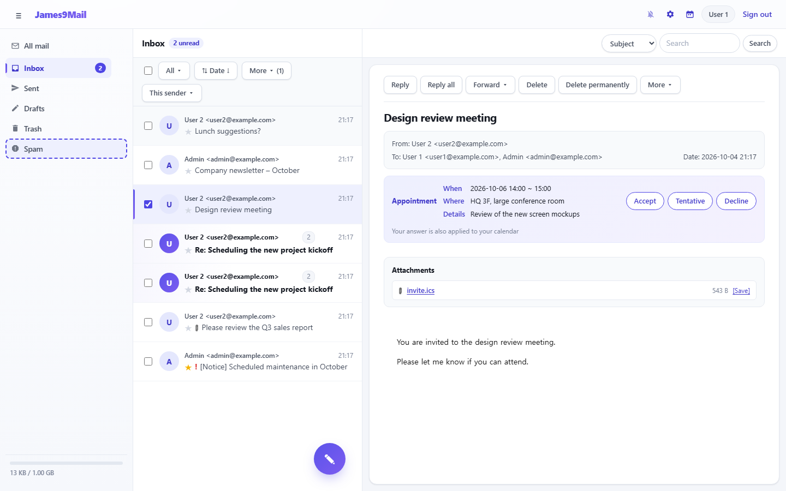

* If messages are ticked, all ticked messages move.
* You cannot drop onto **All mail** or **Drafts**.

[[this-sender]]
=== This sender

Select a message in the Inbox and click **This sender ▾**.

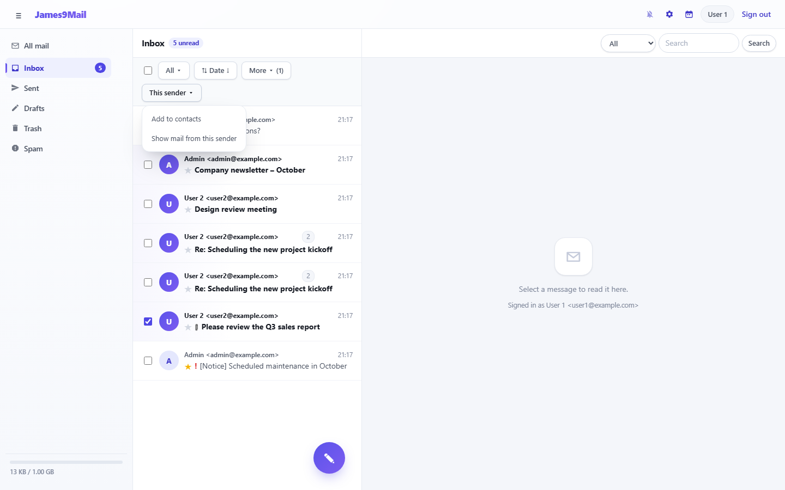

* **Add to contacts** — adds the sender to your address book.
* **Show mail from this sender** — searches for and shows only that sender's mail.

[[_24-conversations]]
== 2.4 Conversations

Turn on **⇅ › Group by conversation** to group messages connected by replies into a single row.

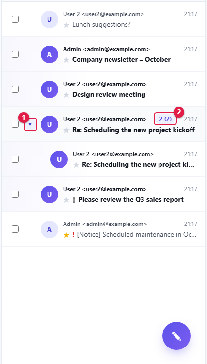

* ① Click **▸** to expand the grouped messages below.
* ② The badge shows how many messages are in the conversation; the number in parentheses is the unread count.

Click the badge to see the whole conversation like a chat. Your own messages appear on the right, the other person's on the left.

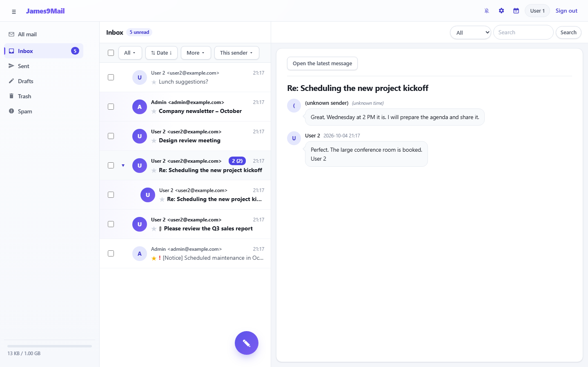

* **Open the latest message** opens the last message of the conversation in its normal form.
* Each bubble shows the first 100 characters; hover to see the full text.

[NOTE]
====
Conversations are grouped by reply relationship (the References header), not by subject. 🔗 This is the same rule Thunderbird uses.
====

[[_25-search]]
== 2.5 Search

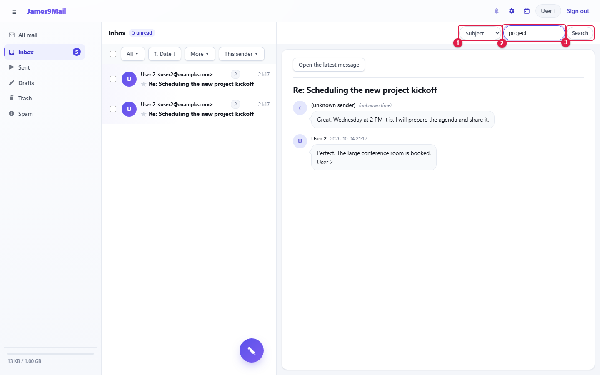

. ① Choose where to search: **All**, **From**, **To**, **Subject**, **File name**
. ② Enter a search word.
. ③ Click **Search** or press Enter.

//

* The search runs inside the mailbox you are viewing. To search every mailbox, pick **All mail** first.
* Picking another mailbox clears the search, filter and sort.

[[_26-reading-mail]]
== 2.6 Reading mail

Click a message in the list to open it on the right.

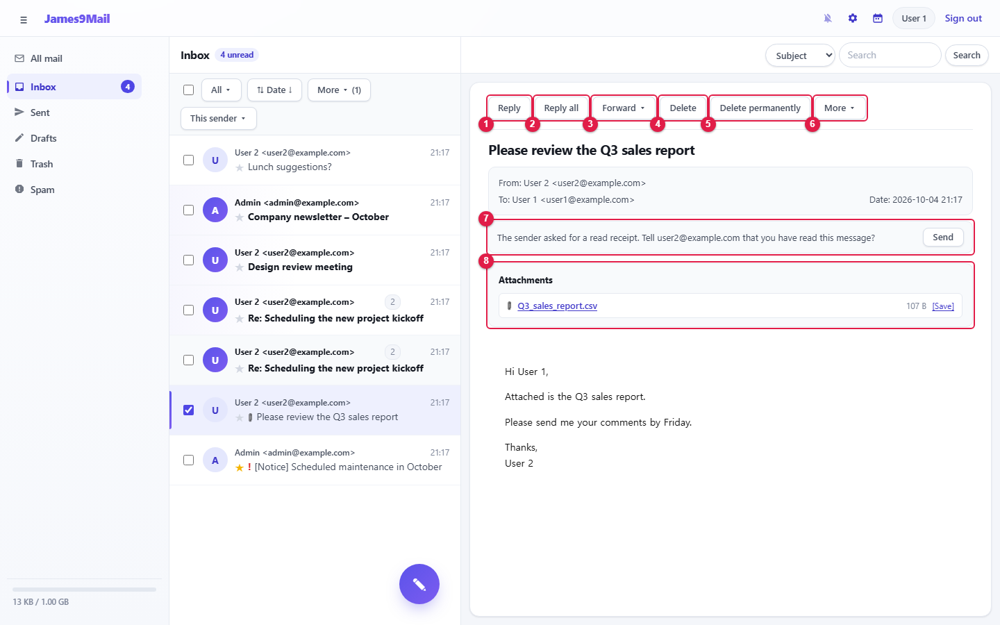

[cols="1,2,5",options="header"]
|===
|No. |Button / area |Description

|① |**Reply** |Replies to the sender
|② |**Reply all** |Replies to the sender and puts the other recipients in Cc
|③ |**Forward ▾** |Forwards to someone else
|④ |**Delete** |Moves to Trash
|⑤ |**Delete permanently** |Deletes for good
|⑥ |**More ▾** |Move, copy, save to PC, view source, convert to an event or task
|⑦ |Read receipt request |Shown only when the sender asked for a read receipt (<<_28-answering-a-read-receipt-request,2.8>>)
|⑧ |**Attachments** |Click the file name or **[Save]** to download
|===

* Opening a message in Drafts shows **Continue writing** instead of these buttons.
* Large attachments are marked **· large file** and can be downloaded only during their storage period.

[[forward]]
=== Forward

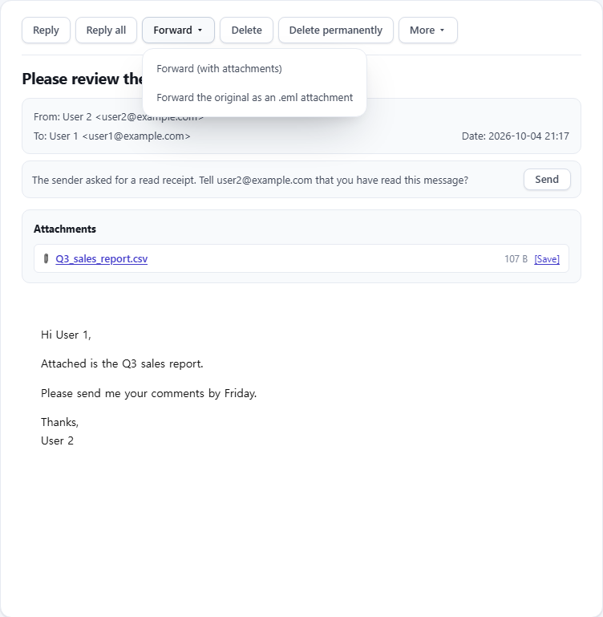

* **Forward (with attachments)** — quotes the body and sends the original attachments too.
* **Forward the original as an .eml attachment** — attaches the whole original message as an `+.eml+` file.

[[more-menu]]
=== More menu

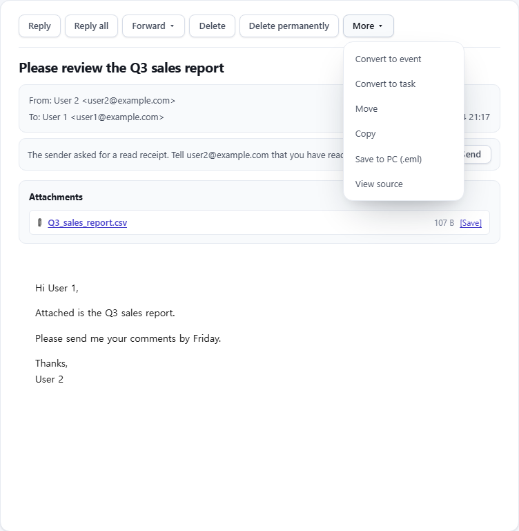

[cols="3,6",options="header"]
|===
|Menu |Action

|**Convert to event** / **Convert to task** |Creates a new calendar event or task from this message (xref:04-calendar.adoc[Chapter 4])
|**Move** / **Copy** |Moves or copies to another mailbox
|**Save to PC (.eml)** |Downloads the message as an `+.eml+` file. 🔗 Thunderbird and Outlook can open it
|**View source** |Shows the raw headers and body
|===

In **View source** you can **Copy** the source or **Save to PC (.eml)**.

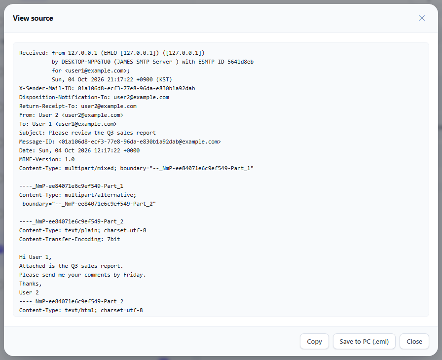

[[blocked-remote-images]]
=== Blocked remote images

Pictures loaded from outside servers are not shown right away, because loading them would tell the sender you opened the message (tracking).

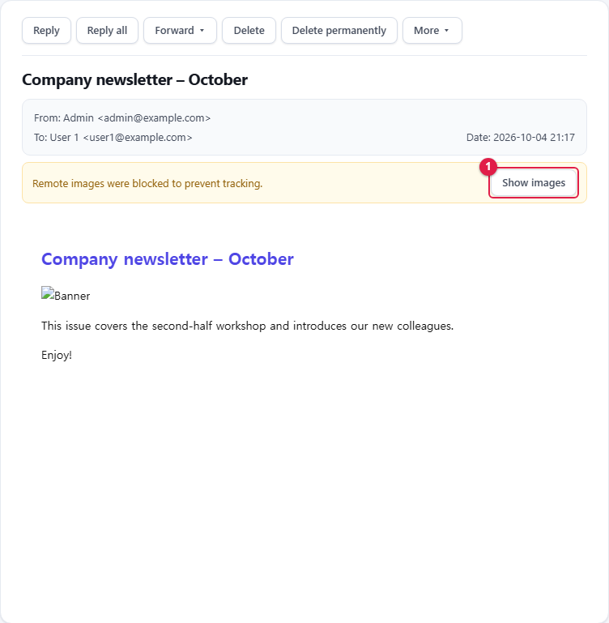

If you trust the message, click ① **Show images**. The pictures are shown only while you view that message.

[[contact-cards-vcard]]
=== Contact cards (vCard)

When a `+.vcf+` contact file is attached, it is shown as a contact card below the body, with name, company, phone, address and so on. Phone numbers and mail addresses can be clicked directly.

[[messages-that-cannot-be-opened]]
=== Messages that cannot be opened

[cols="5,5",options="header"]
|===
|Notice |Meaning

|winmail.dat (TNEF) attachments cannot be previewed |An Outlook-only format. Download the attachment instead
|S/MIME encrypted or signed mail cannot be opened in the browser |🔗 Open it in Thunderbird or Outlook with your certificate set up
|===

[[_27-answering-appointment-mail]]
== 2.7 Answering appointment mail

When you receive appointment mail such as a meeting invitation, the date, place and details appear above the body together with answer buttons.

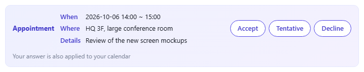

. Click **Accept**, **Tentative** or **Decline**.
. Your answer goes to the sender, and the event is added to your calendar.

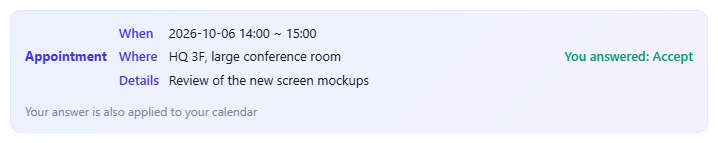

* The sender sees the answers under xref:03-mail-compose.adoc#_39-read-receipts-and-recall[Read receipts].
* If the organizer cancels the event, a **Remove from my calendar** button appears; when an attendee's answer arrives, an **Update attendee status in my event** button appears.

[NOTE]
====
🔗 Appointment mail uses the standard iCalendar format, so recipients using Thunderbird or Outlook can answer it directly too.
====

[[_28-answering-a-read-receipt-request]]
== 2.8 Answering a read receipt request

When you open a message whose sender asked for a read receipt, this notice appears.

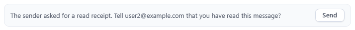

* To confirm that you read it, click **Send**. "Read receipt sent" appears.
* If you would rather not, just leave it. Nothing is sent automatically.

xref:01-getting-started.adoc[← 1. Getting started] · xref:README.adoc[Contents] · xref:03-mail-compose.adoc[3. Writing and sending mail →]
