= 3. Writing and sending mail
:tip-caption: Good to know
:figure-caption!:
:table-caption!:

xref:02-mail-read.adoc[← 2. Reading and managing mail] · xref:README.adoc[Contents] · xref:04-calendar.adoc[4. Calendar and tasks →]

[[_31-opening-the-compose-window]]
== 3.1 Opening the compose window

[cols="5,5",options="header"]
|===
|How |What opens

|The **✎** button at the bottom right of the message list |An empty message
|**Reply** / **Reply all** in the reading pane |A message with the recipients, `+Re:+` subject and the original quoted
|**Forward ▾** in the reading pane |A message with a `+Fwd:+` subject and the original body and attachments
|**Continue writing** on a message in Drafts |The saved draft
|**Send email to attendees** on a calendar event |A message with the attendees and subject filled in
|===

The compose window opens in the middle of the screen. Drag its title bar (**New mail**) to move it.

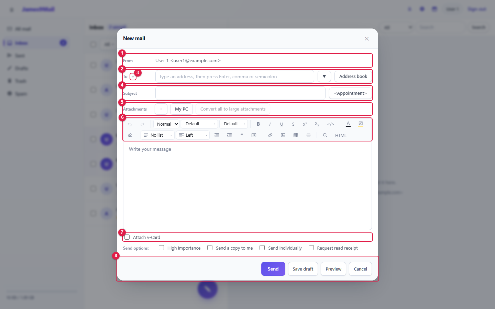

[cols="1,2,5",options="header"]
|===
|No. |Item |Description

|① |**From** |Your address. If you have alias addresses, you can choose one
|② |**To** |Recipient addresses (<<_32-entering-recipients,3.2>>)
|③ |**+** |Shows the Cc and Bcc fields
|④ |**Subject** · **<Appointment>** |The subject, and creating appointment mail (<<_36-sending-appointment-mail,3.6>>)
|⑤ |**Attachments** |Attach files (<<_33-attaching-files,3.3>>)
|⑥ |Editor toolbar |Text formatting (<<_34-the-editor,3.4>>)
|⑦ |Signature · v-Card · send options |(<<_35-signature-and-send-options,3.5>>)
|⑧ |**Send** · **Save draft** · **Preview** · **Cancel** |(<<_37-preview-save-draft-send,3.7>>)
|===

[[_32-entering-recipients]]
== 3.2 Entering recipients

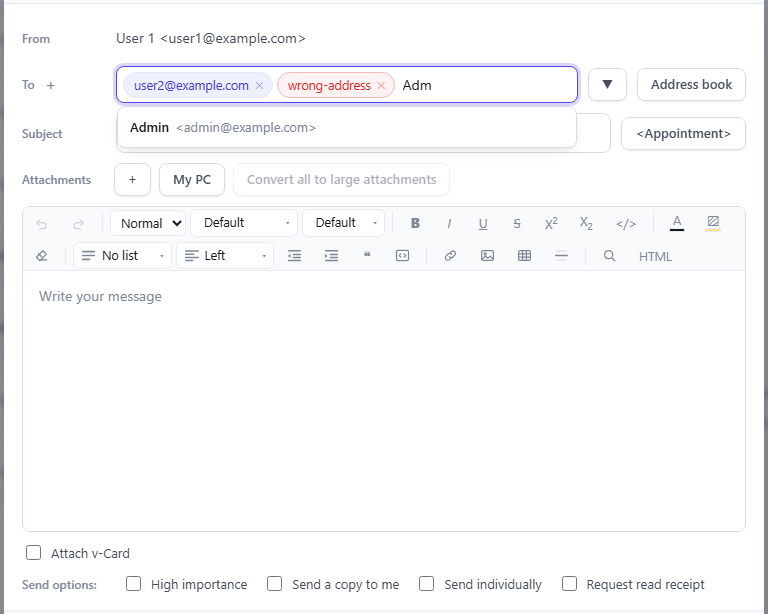

* Type an address and press **Enter**, **comma (,)** or **semicolon (;)** to turn it into a chip. Pasting several addresses at once splits them too.
* A chip with an invalid address turns red (`+wrong-address+` in the picture). Remove it with its **×**.
* Type part of a name or address to get **suggestions** from your address book and the users on this server. Suggestions start after 1 Korean character or 2 Latin characters. Use ↑↓ to choose and Enter to insert.
* Picking a **group** from the suggestions adds all of its members.

**Working with chips**

[cols="3,3",options="header"]
|===
|Action |Result

|Click a chip → Delete / Backspace |Remove
|Double-click a chip (or F2) |Turn it back into text to edit
|Drag a chip |Reorder, or move between To, Cc and Bcc
|Backspace in an empty field |Select the last chip (press again to remove it)
|===

[[cc-and-bcc]]
=== Cc and Bcc

Click **+** next to **To** to show the **Cc** and **Bcc** fields. Recipients in Bcc are hidden from the other recipients.

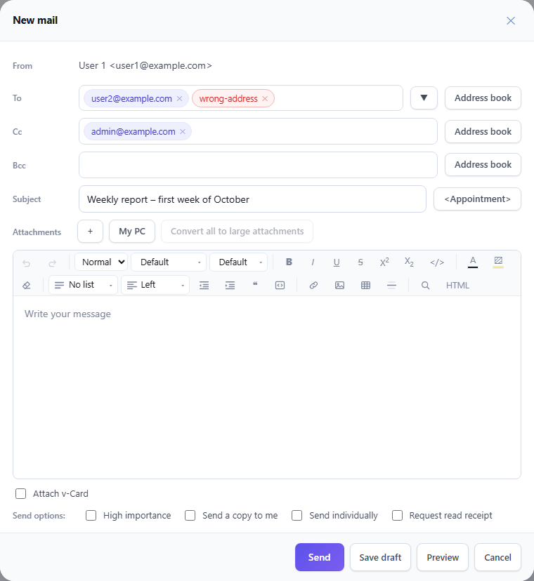

[[recently-used-addresses]]
=== Recently used addresses

The **▼** button lists the last 10 addresses you sent to. Choosing one adds it to the recipients.

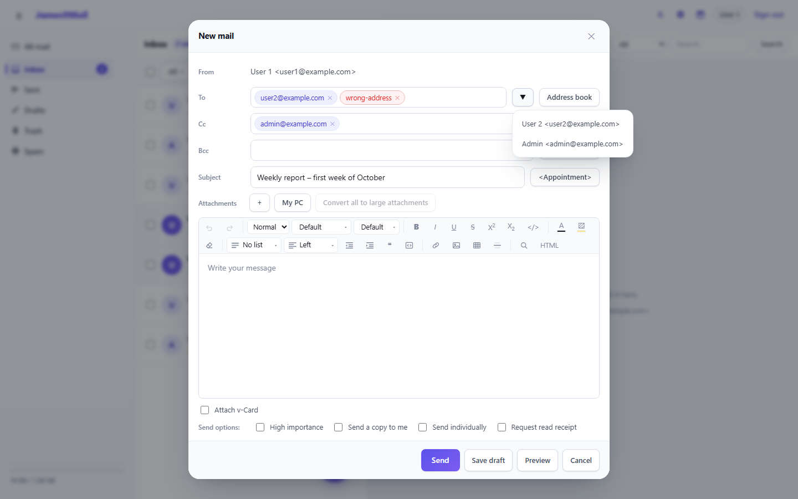

[[choosing-from-the-address-book]]
=== Choosing from the address book

**Address book** opens the address book window. Tick the people and click **OK**; they are added to the field whose button you clicked (To, Cc or Bcc).

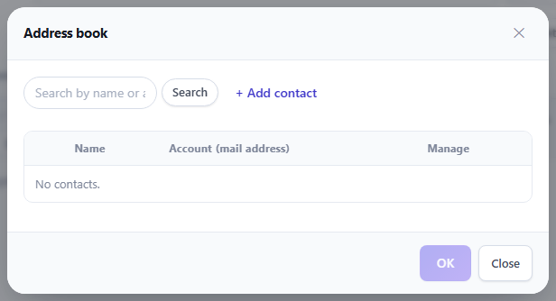

* Use the search box at the top to find names and addresses.
* **+ Add contact** registers a contact right there.
* Ticking a group adds all of its members.

[[_33-attaching-files]]
== 3.3 Attaching files

Click **My PC** to choose files, or drag files onto the compose window.

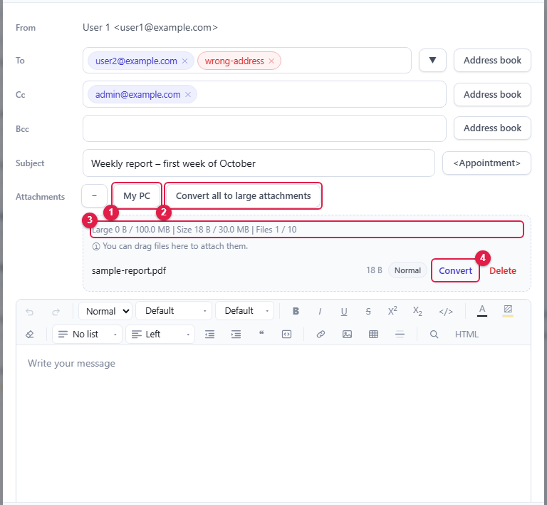

[cols="1,2,5",options="header"]
|===
|No. |Item |Description

|① |**My PC** |Choose files (several at once is fine)
|② |**Convert all to large attachments** |Turns every normal attachment into a large attachment
|③ |Usage |Large and normal attachment sizes and the attachment count limit
|④ |**Convert** |Turns just this file into a large attachment
|===

**Normal and large attachments**

[cols="1,2,6",options="header"]
|===
|Type |Default limit |What the recipient gets

|Normal |30MB in total, 10 files |The file is attached to the message
|Large |100MB per upload |A download link at the end of the body. It stops working after **30 days**
|===

* A file that would exceed the normal limits automatically becomes a large attachment.
* Your administrator can change the limits. The usage line in the window shows the actual limits.
* Expand and collapse the attachment list with **+** / **−**.

[[_34-the-editor]]
== 3.4 The editor

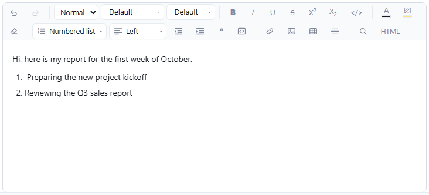

The toolbar offers the following.

[cols="1,8",options="header"]
|===
|Group |Tools

|Editing |Undo (Ctrl+Z), Redo (Ctrl+Shift+Z), Find and replace (Ctrl+F)
|Paragraph |Normal / Heading 1–6 / Quote / Code, lists (bullets, numbers, checklist), alignment, indent and outdent
|Text |Font, font size, bold (Ctrl+B), italic (Ctrl+I), underline (Ctrl+U), strikethrough, superscript / subscript, clear formatting
|Color |Text color, highlight — standard colors, recently used colors, more colors
|Insert |Link (Ctrl+K), image, table, horizontal line
|Advanced |**HTML** — edit the HTML source directly
|===

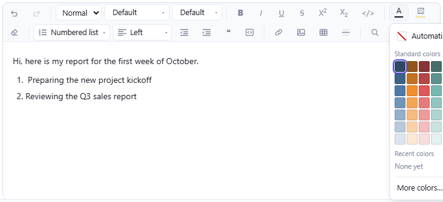

[NOTE]
====
* Put pictures in the body by pasting, dragging, or using the image button. Photos over 1MB are shrunk automatically. Pictures in the body may total 6MB; attach larger ones as files.
* To paste without formatting, press Ctrl+Shift+V.
====

[[_35-signature-and-send-options]]
== 3.5 Signature and send options

[cols="2,7",options="header"]
|===
|Item |Description

|**Signature** |Picks the signature to add. Shown only after you turn on and register signatures in xref:05-settings.adoc#_52-signatures[Signatures]
|**Attach v-Card** |Attaches your contact card (.vcf)
|**High importance** |Recipients see a red **!** in their list
|**Send a copy to me** |Sends a copy to yourself as well
|**Send individually** |Sends a separate message to each recipient, so they cannot see each other's addresses
|**Request read receipt** |Asks recipients, when they open the message, whether to tell you they read it
|===

[NOTE]
====
For people on the same company mail server, you can see whether they read your mail under <<_39-read-receipts-and-recall,Read receipts>> even without **Request read receipt**. The request is useful for outside addresses, and you get no receipt if the recipient declines.
====

[[_36-sending-appointment-mail]]
== 3.6 Sending appointment mail

Mail that recipients can answer with attend / decline, like a meeting invitation.

. Enter the recipients and the subject (it becomes the event title).
. Click **<Appointment>**.
. Enter the **Start** and **End** date and time, **Location** and **Description**, then click **OK**.

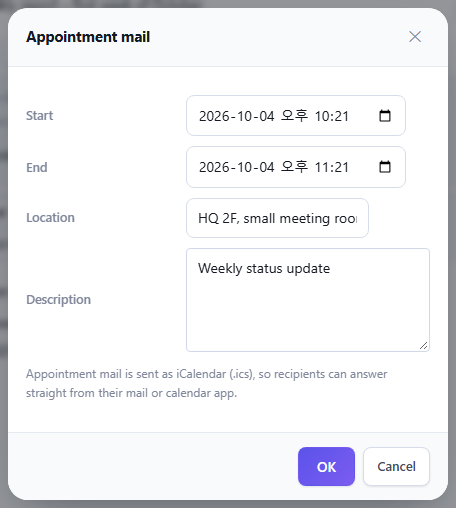

[start=4]
. A summary appears below the subject. Change it with **Edit** or remove it with **Delete**.

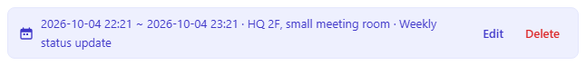

[start=5]
. **Send** the message. Recipients in To and Cc become attendees, and their answers show under <<_39-read-receipts-and-recall,Read receipts>>.

[NOTE]
====
🔗 Appointment mail is sent in iCalendar (.ics) format, so recipients using Thunderbird or Outlook can answer directly from the message.
====

[[_37-preview-save-draft-send]]
== 3.7 Preview, save draft, send

[cols="1,5",options="header"]
|===
|Button |Action

|**Preview** |Shows how the message will look to recipients (signature included)
|**Save draft** |Saves to Drafts and closes the window. Reopen it later with **Continue writing**
|**Send** |Sends the message
|**Cancel** |Closes the window
|===

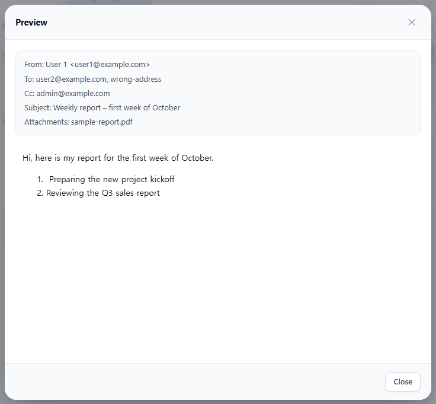

* With no recipient, "Enter at least one recipient" appears.
* If some recipients could not be reached, the result window lists them and a notice arrives in your Inbox.
* Sending more than 60 messages a minute blocks sending for a short while.

[NOTE]
====
🔗 Sent mail is stored in Sent, so it also appears in Sent in Thunderbird or Outlook.
====

[[_38-auto-save-and-continuing-a-message]]
== 3.8 Auto-save and continuing a message

While you write, the message is saved **in this browser** every 5 seconds. The time of the last save is shown at the bottom of the window.

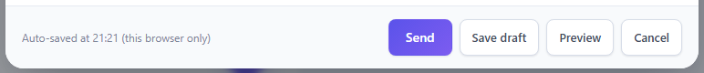

If the browser closes unexpectedly or you close the window by mistake, the next new message shows this notice at the top.

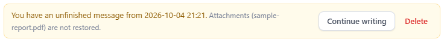

* **Continue writing** — refills the window with what you were writing.
* **Delete** — discards the saved text.

[CAUTION]
====
* Auto-save stays in this browser only. To continue on another PC, use **Save draft**.
* **Attachments are not auto-saved.** Attach them again after continuing.
* Sending or saving a draft clears the auto-saved copy.
====

[[replying]]
=== Replying

**Reply** opens a window with the recipient, `+Re:+` subject and the original message quoted.

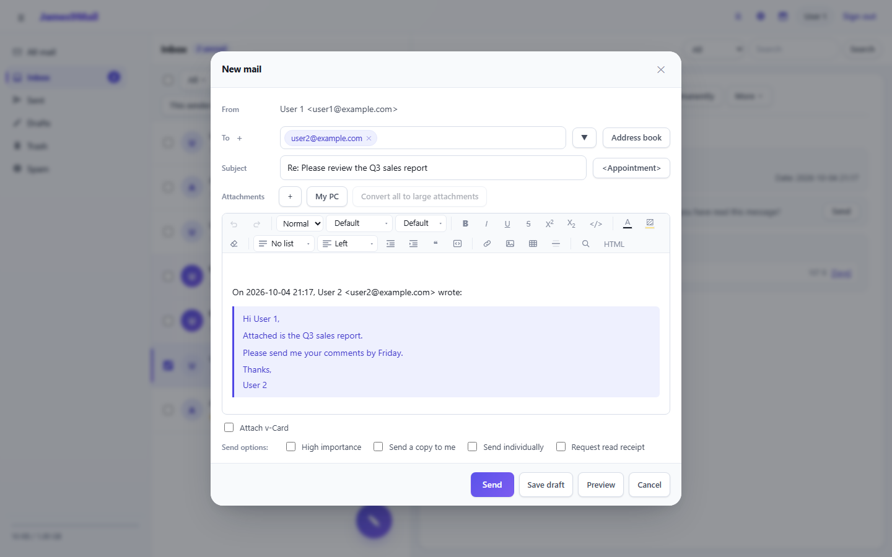

* When you reply to mail that arrived at one of your alias addresses, that alias is selected as the sender automatically.

[[_39-read-receipts-and-recall]]
== 3.9 Read receipts and recall

See who read the mail you sent and when, and recall it from people who have not read it yet.

. Open the message in **Sent**.
. Click ① **Read receipts** at the right end of the From line.

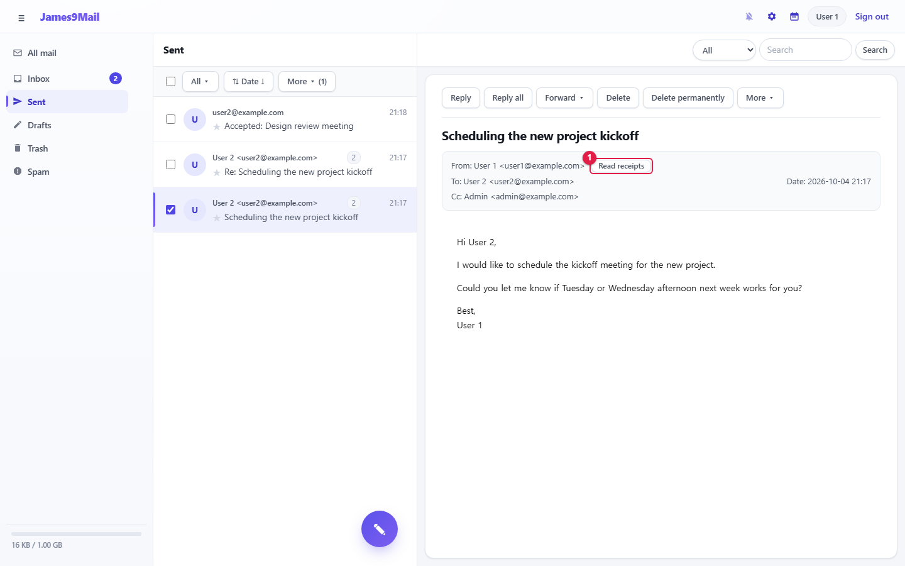

[start=3]
. The read time is shown for each recipient. `+-+` means not read yet.

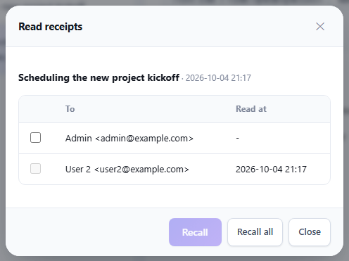

In the picture, User 2 has read the message and Admin has not, so only the Admin row can be ticked.

**Recalling**

* Tick the recipients and click **Recall** to remove the message from their mailboxes.
* **Recall all** recalls it from everyone who has not read it yet.

.When you cannot recall
[NOTE]
====
* Mail that has already been read cannot be recalled (its checkbox is disabled).
* Recipients on outside domains (other companies) cannot be tracked or recalled. They show as "Not trackable (external)".
====

**Answers to appointment mail**

For appointment mail, a **Response** column is added and the numbers who accepted, are tentative, declined or have not answered are summarized above the table.

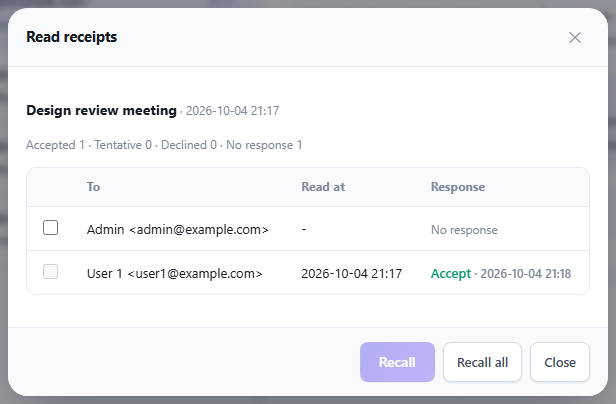

xref:02-mail-read.adoc[← 2. Reading and managing mail] · xref:README.adoc[Contents] · xref:04-calendar.adoc[4. Calendar and tasks →]
