= 4. Calendar and tasks
:tip-caption: Good to know
:figure-caption!:
:table-caption!:

xref:03-mail-compose.adoc[← 3. Writing and sending mail] · xref:README.adoc[Contents] · xref:05-settings.adoc[5. Preferences →]

Click the 📅 **Calendar** button in the top bar to open the calendar. To return to mail, click the ✉ **Mail** button in the same place.

[[_41-screen-layout]]
== 4.1 Screen layout

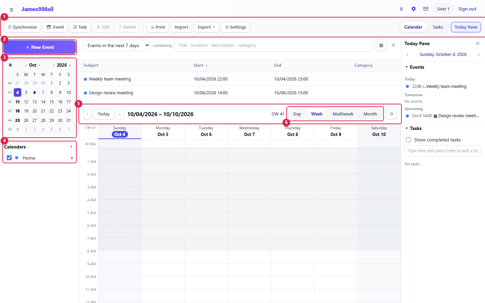

[cols="1,1,8",options="header"]
|===
|No. |Area |Description

|① |Toolbar |**Synchronize**, **Event**, **Task**, **Edit**, **Delete**, **Print**, **Import**, **Export**, **Settings**; on the right the **Calendar / Tasks** tabs and **Today Pane**
|② |**+ New Event** |Creates a new event (**+ New Task** on the Tasks tab)
|③ |Mini month |Click a date to jump to it. Use ‹ › to change month and year
|④ |Calendar list |Untick a calendar to hide its events. ★ marks the default calendar
|⑤ |View bar |‹ **Today** › to move through time, the title and week number
|⑥ |View switch |**Day**, **Week**, **Multiweek**, **Month**
|===

The table at the top is the **event list**, and the panel on the right is the **Today Pane** (<<_46-today-pane-and-event-list,4.6>>).

**Month view**

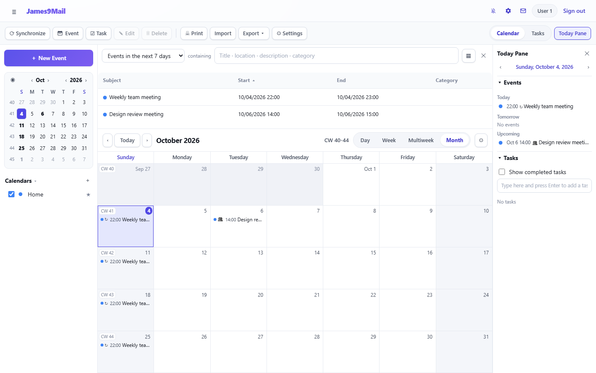

**Day view**

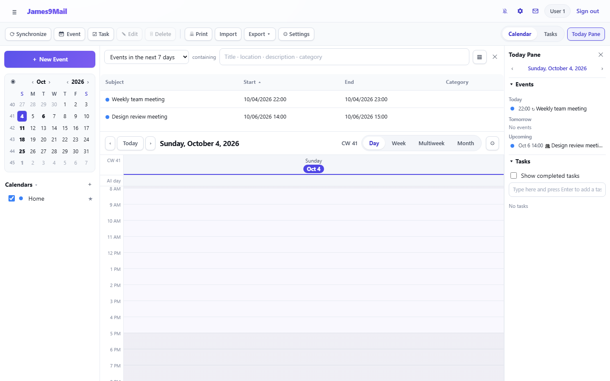

**View options** — The ⚙ at the right of the view bar turns **Workdays only**, **Show tasks in view**, **Show completed tasks** and **Show event list** on and off.

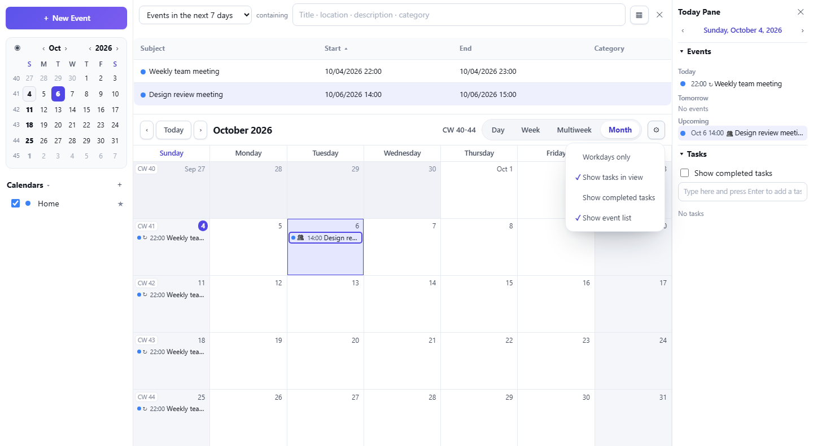

[[_42-creating-events]]
== 4.2 Creating events

**Option 1 — with a button**

. Click **+ New Event** (or **Event** in the toolbar, Ctrl+I).
. Fill in the fields and click **Save and Close**.

**Option 2 — straight on the calendar**

* In Day or Week view, **drag** across empty time to open a new event for that time.
* **Double-click** an empty slot to create an event at that time (snapped to 30 minutes). Double-click the **All day** row at the top for an all-day event.
* In Month or Multiweek view, double-click a date cell.

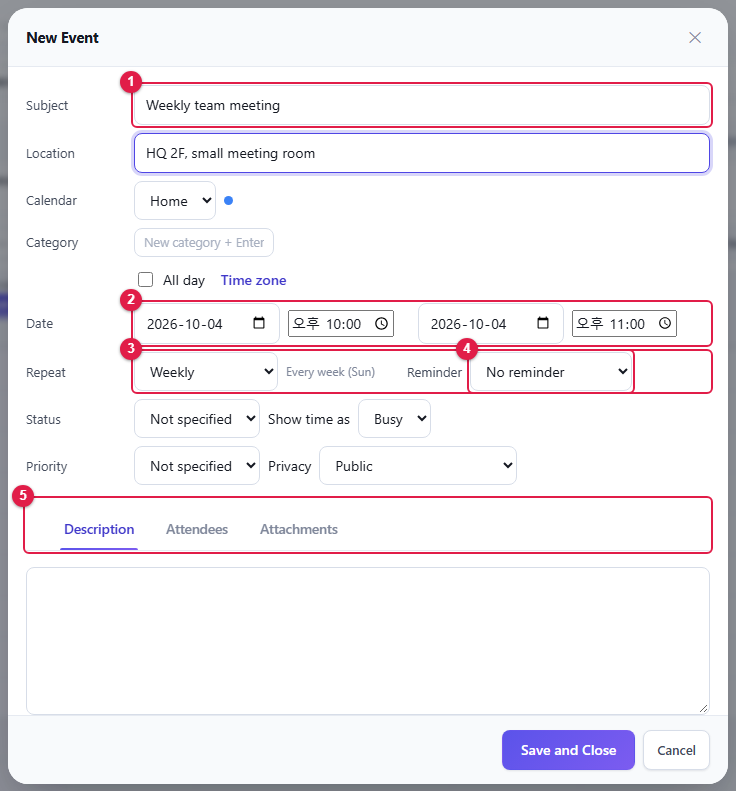

[cols="1,1,10",options="header"]
|===
|No. |Item |Description

|① |**Subject** · **Location** |Event name and place. Below them: **Calendar** and **Category** (type a new category and press Enter)
|② |**Date** |Start and end date and time. Ticking **All day** removes the times. **Time zone** lets you choose another time zone
|③ |**Repeat** |Does not repeat, Daily, Every weekday, Weekly, Every 2 weeks, Monthly, Yearly, **Custom…**
|④ |**Reminder** |How many minutes/hours/days before the start to remind you. You can add several
|⑤ |Lower tabs |**Description** (notes and link), **Attendees**, **Attachments** (web addresses)
|===

You can also set **Status** (Tentative, Confirmed, Cancelled), **Show time as** (Busy, Free), **Priority** and **Privacy** (Public, Show time and date only, Private).

[[recurring-events]]
=== Recurring events

Choose **Custom…** in **Repeat** to define a detailed rule.

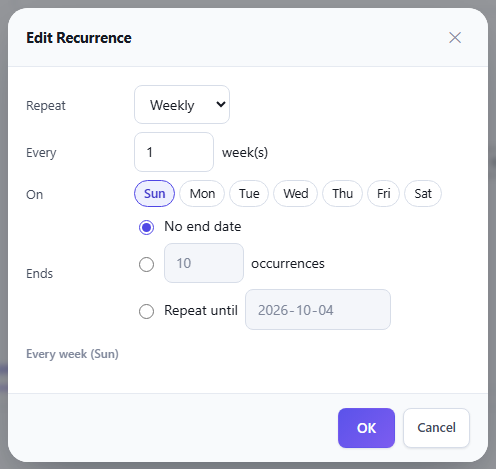

* Choose the frequency (daily, weekly, monthly, yearly), the interval and the weekdays.
* Monthly and yearly rules can use a date such as "the 15th" or a weekday such as "the third Tuesday".
* **Ends**: never, after n occurrences, or on a date

When you change, move or delete a recurring event you are asked how far it applies: **Only this occurrence**, **This and all future occurrences** or **All occurrences**.

[[inviting-attendees]]
=== Inviting attendees

On the **Attendees** tab, type a name or mail address to get suggestions from the address book. Add people with **Add** or **Address book**.

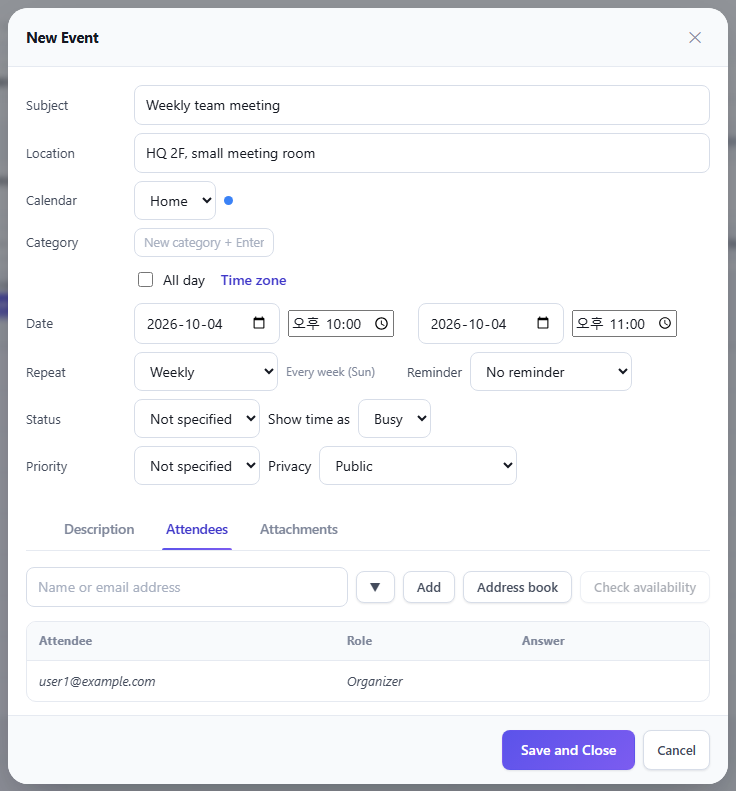

* Give each attendee a role (Required, Optional, For information, Chair).
* If **Send invitations to attendees** is ticked when you save, invitation mail is sent. The **Response** column updates as attendees answer.
* **Check availability** shows the busy times of users on the same server as a grid, so you can move the event to a free slot.
* When you move or delete an event with attendees, you are asked whether to send them an update or cancellation.

[NOTE]
====
Accepting an invitation received by mail adds the event to your calendar automatically (xref:02-mail-read.adoc#_27-answering-appointment-mail[2.7]).
====

[[_43-changing-moving-and-deleting-events]]
== 4.3 Changing, moving and deleting events

[cols="1,7",options="header"]
|===
|To |Do this

|Open and edit |Double-click the event, or select it and press Enter / click **Edit** in the toolbar
|Move to another time or date |Drag the event
|Copy |In Month or Multiweek view, drag while holding Ctrl (or Alt); or Ctrl+C → choose a date → Ctrl+V
|Change the length |In Day or Week view, drag the top or bottom edge of the event
|Delete |Select it and press Delete, or click **Delete** in the toolbar
|===

Right-click an event to open its menu.

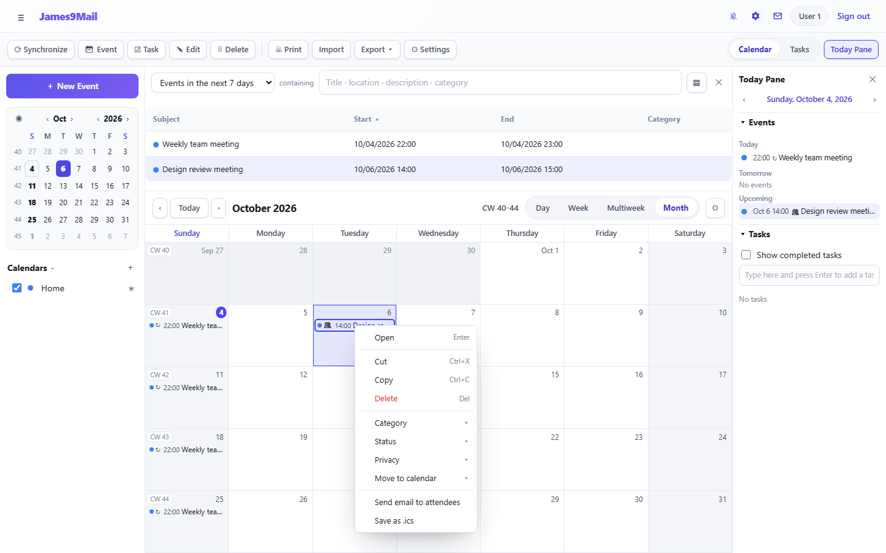

* **Open**, **Cut**, **Copy**, **Delete**
* **Category**, **Status**, **Privacy**, **Move to calendar**
* **Send email to attendees** — opens a compose window addressed to the attendees
* **Save as .ics** — downloads the event as a file

**Shortcuts**: Ctrl+I new event, Ctrl+D new task, Ctrl+PageUp/PageDown previous/next period, arrow keys to move between dates, F11 Today Pane

[NOTE]
====
Events in a read-only calendar cannot be changed. Changing an event organized by someone else only affects your own calendar.
====

[[_44-tasks]]
== 4.4 Tasks

Click the **Tasks** tab at the top right.

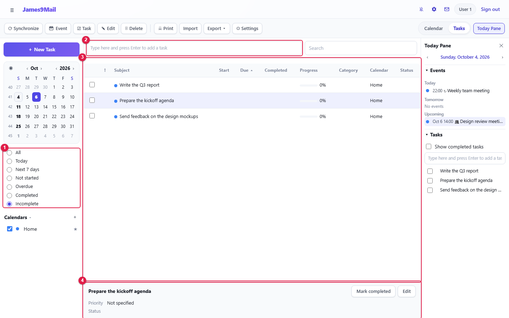

[cols="1,1,6",options="header"]
|===
|No. |Area |Description

|① |Filter |All, Today, Next 7 days, Not started, Overdue, Completed, Incomplete
|② |Quick add |Type a task and press Enter to create it immediately
|③ |Task list |Tick a task to complete it. Click a column header to sort
|④ |Details |Details of the selected task, with **Mark completed** and **Edit**
|===

* To set a start date, due date, progress (%), priority or reminder, open the window with **+ New Task** or **Edit**.
* Overdue tasks are shown in a different color.
* Turn on **Show tasks in view** in the view options to show tasks on the calendar too.

[[_45-reminders]]
== 4.5 Reminders

When an event has a reminder, a reminder window opens at the set time.

* In the reminder window, postpone it with **Snooze…** (5 minutes to 1 week) or turn it off with **Dismiss**.
* To be reminded while you are not looking at the webmail window, turn on 🔔 xref:01-getting-started.adoc#_15-new-mail-notifications[new-mail notifications] in the top bar. Reminders then appear as desktop notifications.
* Reminder sound, the reminder window and missed reminders are set in <<_48-calendar-settings,Calendar Settings>> › **Reminders**.

[[_46-today-pane-and-event-list]]
== 4.6 Today Pane and event list

**Today Pane** — Click **Today Pane** (F11) in the toolbar to show today's, tomorrow's and upcoming events and your tasks on the right. You can add and tick off tasks right there.

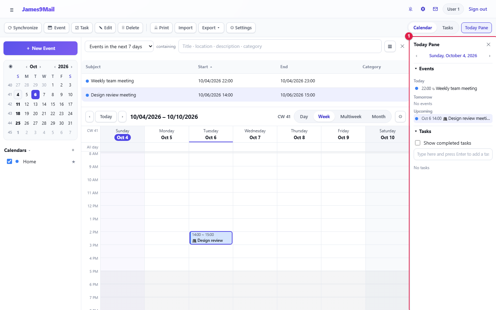

**Event list** — The table above the calendar. Choose a period (today, the next 7 days, this month …) and type in the **containing** box to search titles, locations, descriptions and categories. Use ▦ to choose columns and ✕ to close it. To show it again, turn on **Show event list** in the view options.

[[_47-managing-calendars]]
== 4.7 Managing calendars

[[new-calendar]]
=== New calendar

Click **+** at the right of the calendar list.

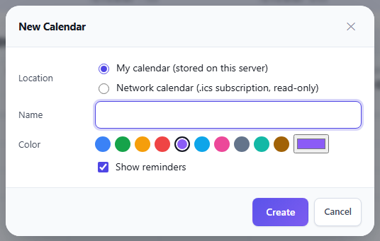

* **My calendar (stored on this server)** — a calendar you add events to yourself.
* **Network calendar (.ics subscription, read-only)** — subscribes to an `+.ics+` address such as public holidays or another service. Choose how often to refresh it.
* Choose a name and a color, then click **Create**.

[[calendar-menu]]
=== Calendar menu

Right-click a calendar name to open its menu.

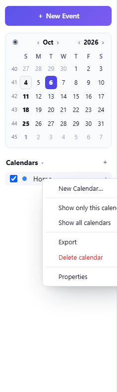

[cols="2,5",options="header"]
|===
|Menu |Action

|**Show only this calendar** / **Show all calendars** |Changes which calendars are shown
|**Refresh now** |Downloads a network calendar again right away
|**Export** |Downloads the calendar as an `+.ics+` file
|**Make default calendar** |The calendar that receives new events and accepted invitations
|**Delete calendar** |Deletes the calendar and every event in it
|**Properties** |Name, color, read-only, show reminders, **Publish as a subscription URL**
|===

**Publish as a subscription URL** creates an `+.ics+` address that can be viewed without signing in. Anyone who knows the address can see your events, so take care. Turning it off revokes the address.

[[import-export-and-print]]
=== Import, export and print

* **Import** — imports an `+.ics+` file into the default calendar.
* **Export ▾** — choose a calendar to download as `+.ics+`. 🔗 Thunderbird, Outlook and Google Calendar can import it.
* **Print** — prints the calendar as shown.
* **Synchronize** — downloads all network calendars again.

[[_48-calendar-settings]]
== 4.8 Calendar Settings

Click **Settings** in the toolbar.

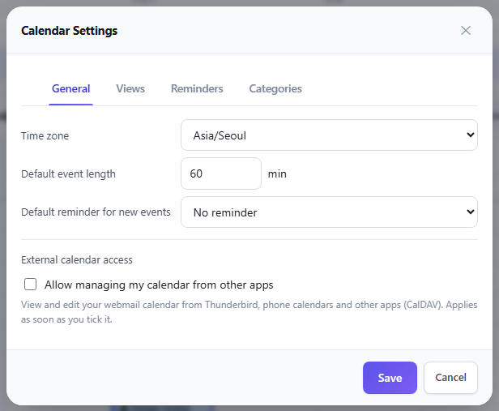

[cols="1,8",options="header"]
|===
|Tab |Items

|**General** |Time zone, default event length, default reminder for new events, **External calendar access** (CalDAV)
|**Views** |Start of the week, days off, work hours, hours visible at a time, number of weeks in Multiweek view, show week numbers
|**Reminders** |Play a sound, show the reminder window, show missed reminders (last 7 days)
|**Categories** |Category names and colors
|===

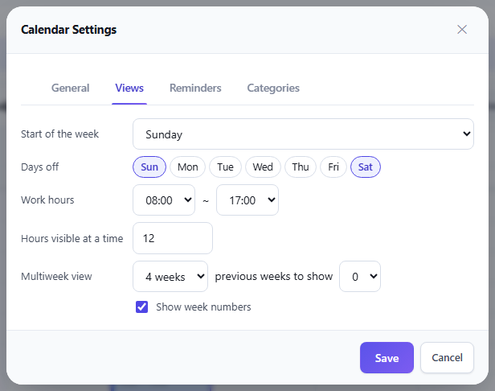

[[connecting-other-calendar-apps-caldav]]
== Connecting other calendar apps (CalDAV)

🔗 You can use your webmail calendar from Thunderbird, phone calendars and other apps. Changes made on one side appear on the other.

. In toolbar **Settings** › **General**, tick ① **Allow managing my calendar from other apps**. It applies as soon as you tick it.

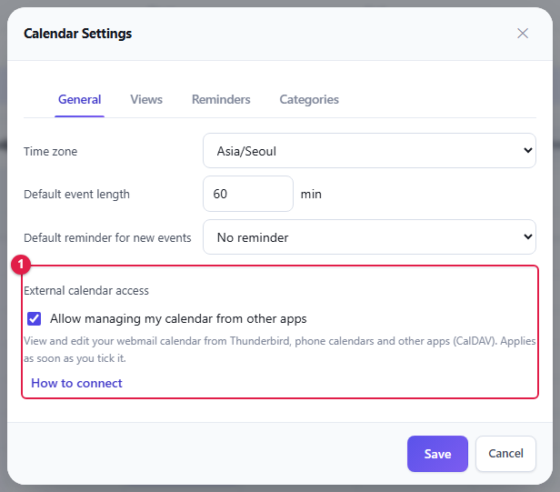

[start=2]
. A connection guide opens. To see it again later, click **How to connect**.

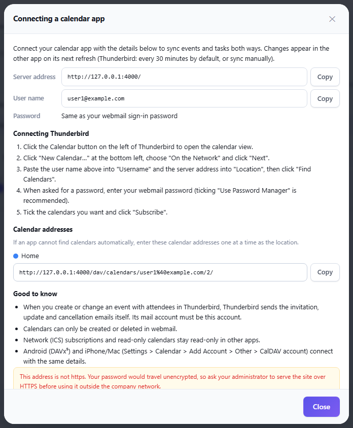

[start=3]
. **Copy** the **Server address** and **User name** from the guide into your calendar app. The password is the same as your webmail password.

**Connecting Thunderbird**

. Click the Calendar button on the left of Thunderbird to open the calendar view.
. Click **New Calendar…** at the bottom left, choose **On the Network** and click **Next**.
. Paste the user name into **Username** and the server address into **Location**, then click **Find Calendars**.
. When asked for a password, enter your webmail password.
. Tick the calendars you want and click **Subscribe**.

[TIP]
====
* If an app cannot find calendars automatically, enter the **Calendar addresses** from the guide one at a time.
* Android uses DAVx⁵; iPhone and Mac use Settings › Calendar › Add Account › Other › CalDAV account with the same details.
* Thunderbird fetches changes every 30 minutes by default. Synchronize in Thunderbird to fetch them now.
* When you create an event with attendees in Thunderbird, Thunderbird sends the invitation mail itself.
* Calendars can only be created or deleted in webmail. Network calendars and read-only calendars stay read-only in other apps.
* If the guide warns that the address is not https, your password travels unencrypted. Ask your administrator for HTTPS access.
* Unticking the option blocks access from other apps.
====

xref:03-mail-compose.adoc[← 3. Writing and sending mail] · xref:README.adoc[Contents] · xref:05-settings.adoc[5. Preferences →]
