= 5. Preferences
:tip-caption: Good to know
:figure-caption!:
:table-caption!:

xref:04-calendar.adoc[← 4. Calendar and tasks] · xref:README.adoc[Contents] · xref:06-faq.adoc[6. FAQ →]

Click the ① ⚙ **Preferences** button in the top bar.

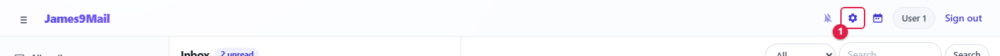

Choose a tab at the top.

[cols="3,5",options="header"]
|===
|Tab |Description

|<<_51-profile,Profile>> |Name, photo, password, mail cache on this PC
|<<_52-signatures,Signatures>> |Signatures added to the end of your mail
|<<_53-address-book,Address book>> |Contacts and groups, import and export, connecting other apps (CardDAV)
|<<_54-mailboxes,Mailboxes>> |Create, rename and delete your own mailboxes
|<<_55-filters,Filters>> |Automatically file matching mail into a mailbox
|<<_56-vacation-reply,Vacation reply>> |Automatic replies while you are away
|<<_57-blocked-senders,Blocked senders>> |Block unwanted senders
|<<_58-forwarding,Forwarding>> |Automatically forward incoming mail to another address
|<<_59-external-mail,External mail>> |Fetch mail from another mail service
|<<_510-mail-upload,Mail upload>> |Upload saved EML files
|===

[NOTE]
====
🔗 Filters, vacation reply, blocked senders and forwarding run **on the mail server**. They apply even when webmail is closed, and even if you receive mail only through Thunderbird or Outlook.
====

[[_51-profile]]
== 5.1 Profile

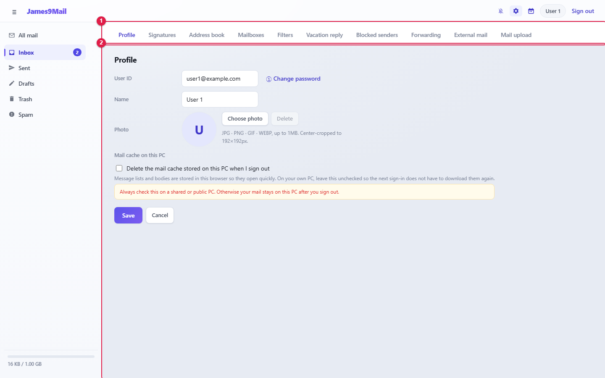

[cols="1,9",options="header"]
|===
|Item |Description

|**User ID** |Cannot be changed. Use **① Change password** next to it to change your password
|**Name** |Used as your sender name, in address suggestions and in signatures (up to 30 characters)
|**Photo** |Add one with **Choose photo**. JPG, PNG, GIF or WEBP, up to 1MB. It is center-cropped to a square
|**Mail cache on this PC** |**Delete the mail cache stored on this PC when I sign out** — applies to this PC as soon as you tick it
|===

After changing the name or photo, click **Save**.

[NOTE]
====
**On a shared or public PC (shared desk, internet café, library), always tick the cache option.** Otherwise your mail stays on that PC after you sign out.
====

[[change-password]]
=== Change password

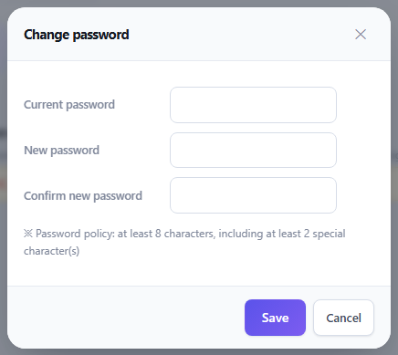

. Enter the **Current password**, the **New password** and **Confirm new password**.
. Click **Save**.

//

* The new password must follow the policy shown in the window (by default **at least 8 characters, including at least 2 special characters**).
* Changing your password signs you out on every other PC and browser.
* 🔗 Update the password saved in Thunderbird, Outlook and on your phone as well.

[[_52-signatures]]
== 5.2 Signatures

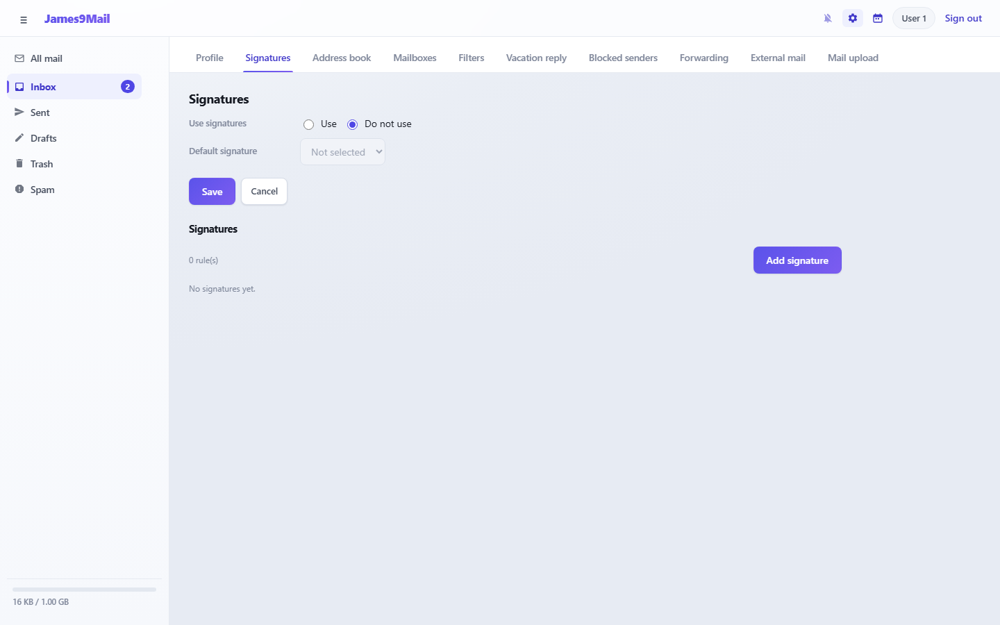

. Set **Use signatures** to **Use**.
. Click **Add signature**, enter a name and the content, and click **Save**.

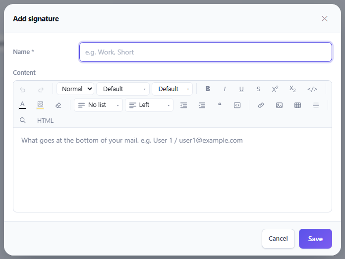

[start=3]
. Choose the **Default signature** to be selected automatically when you write mail, and click **Save**.

//

* You can create several signatures and pick one in the compose window under **Signature**.
* The content uses the same editor as the compose window, so pictures, tables and links are fine.
* Click a signature in the list to edit it; **Delete** removes it.

[[_53-address-book]]
== 5.3 Address book

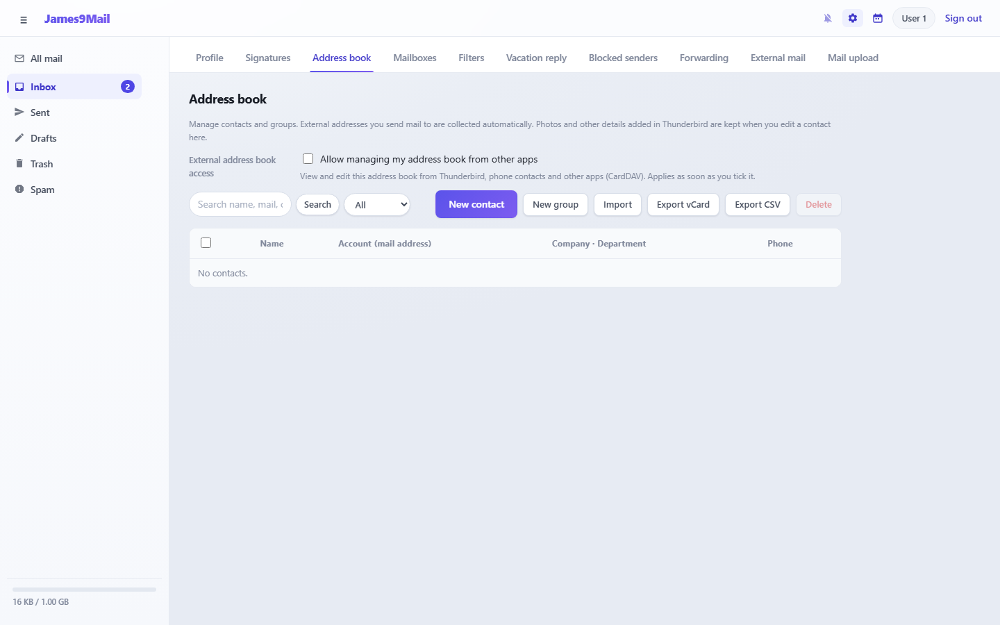

* External addresses you send mail to are collected in the address book automatically.
* Search by name, mail, company or phone, and filter by **All / Contacts / Groups**.
* Click a contact to edit it. Tick several and click **Delete** to remove them together.

[[new-contact]]
=== New contact

Click **New contact**.

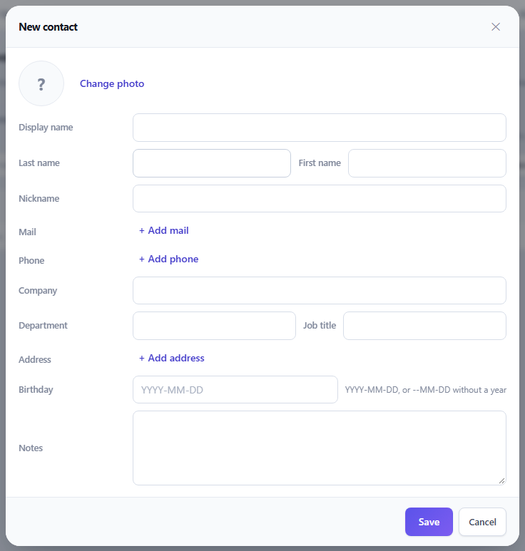

* You can enter display name, last name, first name, nickname, mail addresses (several), phones (mobile, work, home, fax …), company, department, job title, addresses, birthday and notes.
* When there are several mail addresses, the first is the **Primary** one.
* At least a name, mail address or phone number is required.

[[groups]]
=== Groups

Click **New group**, enter a group name, and add members under **Add member** by searching your contacts or typing a mail address.

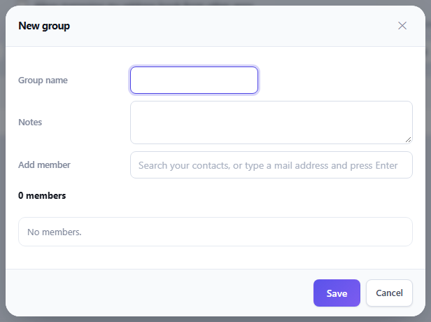

Choosing a group in the compose window adds every member as a recipient. Deleting a group keeps its member contacts.

[[import-and-export]]
=== Import and export

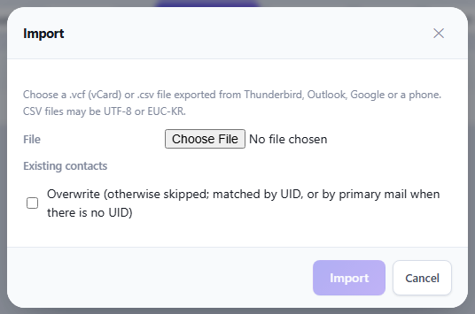

* **Import** — upload a `+.vcf+` (vCard) or `+.csv+` file 🔗 exported from Thunderbird, Outlook, Google or a phone. CSV files may be UTF-8 or EUC-KR (up to 10MB).
** Tick **Overwrite** to replace existing contacts with the new data; untick it to skip them.
* **Export vCard** / **Export CSV** — download the whole address book as a file.

[[connecting-other-address-book-apps-carddav]]
=== Connecting other address book apps (CardDAV)

🔗 View and edit this address book from Thunderbird, phone contacts and other apps.

. Tick **Allow managing my address book from other apps**. It applies at once and a connection guide opens.
. **Copy** the **Server address** (or **Address book URL**) and the **User name** from the guide into your contacts app. The password is the same as your webmail password.

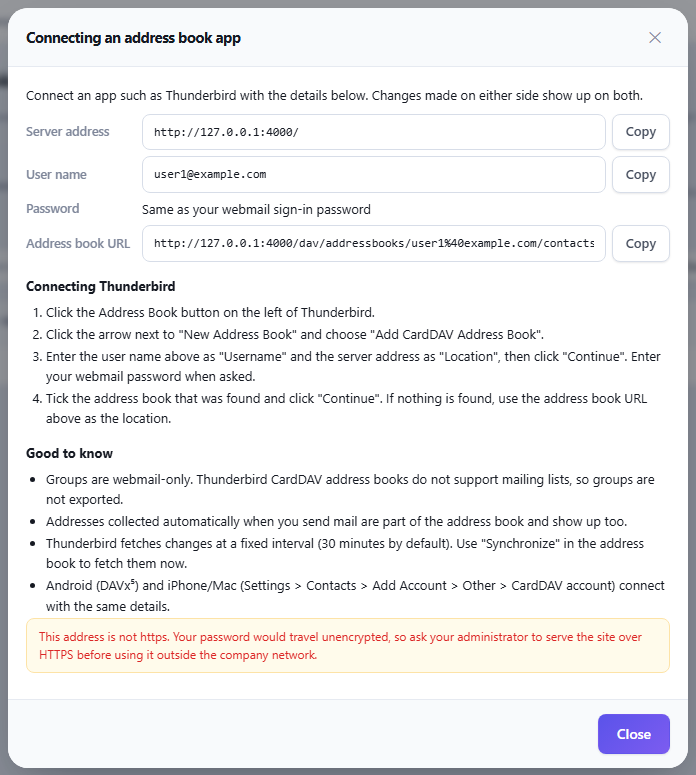

[TIP]
====
* Groups are not exported to other apps.
* Addresses collected automatically when you send mail show up too.
* Thunderbird fetches changes every 30 minutes by default.
* Android uses DAVx⁵; iPhone and Mac connect through Add Account in the system settings.
* To see the guide again, click **How to connect**.
====

[[_54-mailboxes]]
== 5.4 Mailboxes

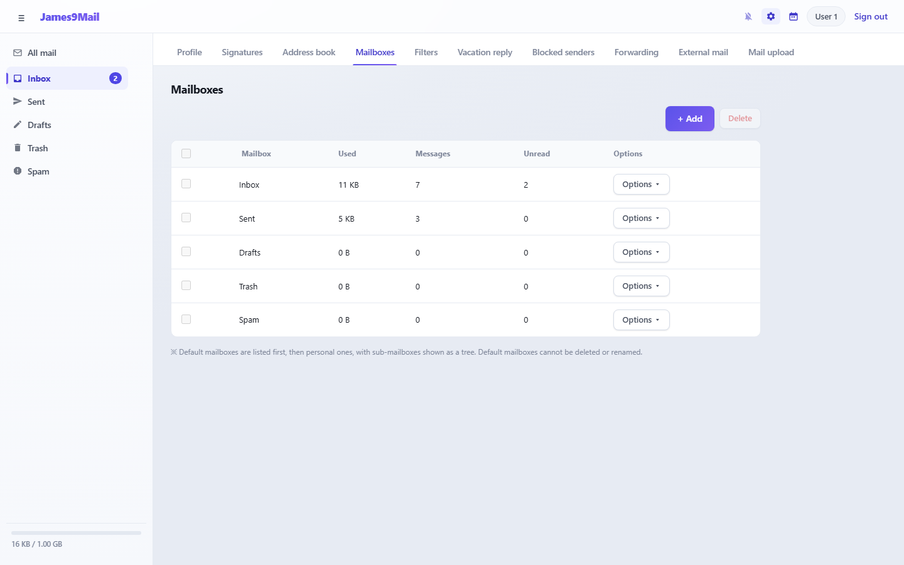

Each mailbox shows its size, message count and unread count.

**Create a mailbox** — Click **+ Add**, enter a name, choose the **Parent mailbox** (top level or under another mailbox) and click **Save**.

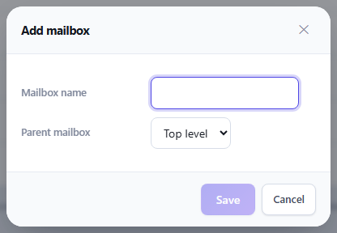

**Options ▾** menu

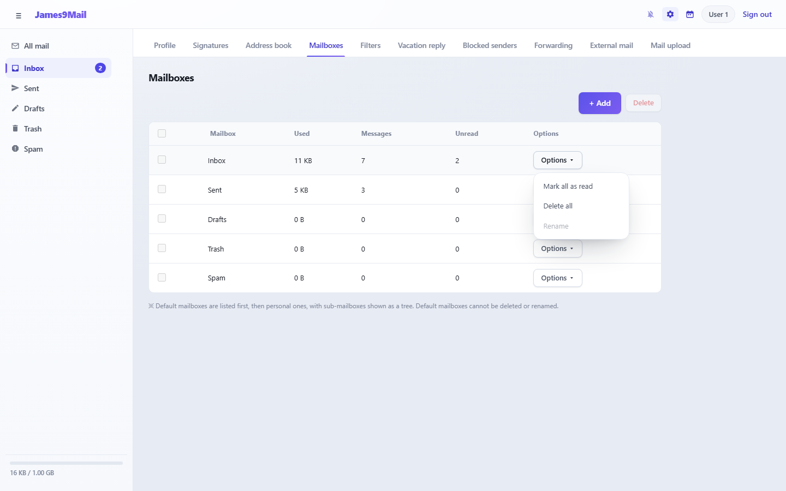

[cols="2,3",options="header"]
|===
|Menu |Action

|**Mark all as read** |Marks every message in the mailbox as read
|**Delete all** |Deletes every message in the mailbox
|**Rename** |Renames a personal mailbox
|===

**Delete a mailbox** — Tick a personal mailbox and click **Delete**.

[NOTE]
====
The standard mailboxes (Inbox, Sent, Drafts, Trash, Spam) cannot be deleted or renamed.
====

[[_55-filters]]
== 5.5 Filters

Automatically file incoming mail that matches your conditions into the mailbox you choose.

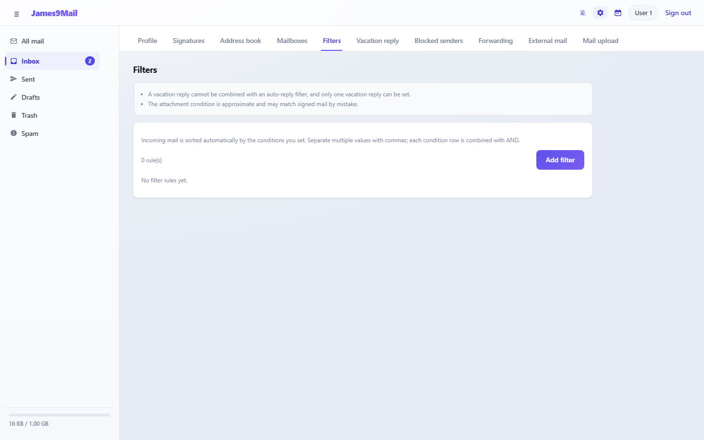

. Click **Add filter**.

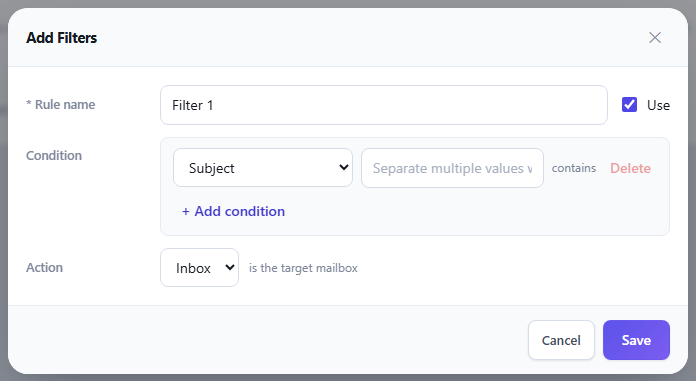

[start=2]
. Enter a **Rule name**.
. Set the **Condition**.
** Fields: Subject (contains) / Subject is / Recipient address is / Recipient domain is / Sender name (contains) / Sender address is / Sender domain is / Mail with an attachment
** Separate several values with commas; matching any one of them is enough.
** Add more conditions with **+ Add condition**; then **all conditions** must match (up to 5).
. Choose the target mailbox under **Action**.
. Click **Save**.

//

* The **In use** checkbox in the list switches a rule off and on (applies immediately).
* Rules are checked from the top, and only the first matching rule is applied.
* The **Mail with an attachment** condition is approximate and may also match mail that only has a signature image.

[[_56-vacation-reply]]
== 5.6 Vacation reply

Automatically reply to mail you receive while on holiday or a business trip.

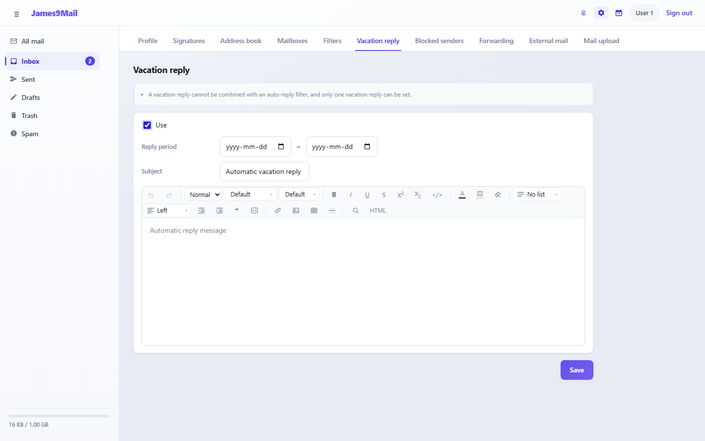

. Tick **Use**.
. Set the **Reply period**. Leave it empty to keep replying until you turn it off.
. Enter the **Subject** and the reply message.
. Click **Save**.

//

* Each sender gets an automatic reply at most once every 3 days.
* Only one vacation reply can be set.

[[_57-blocked-senders]]
== 5.7 Blocked senders

Block mail from the addresses or domains you list.

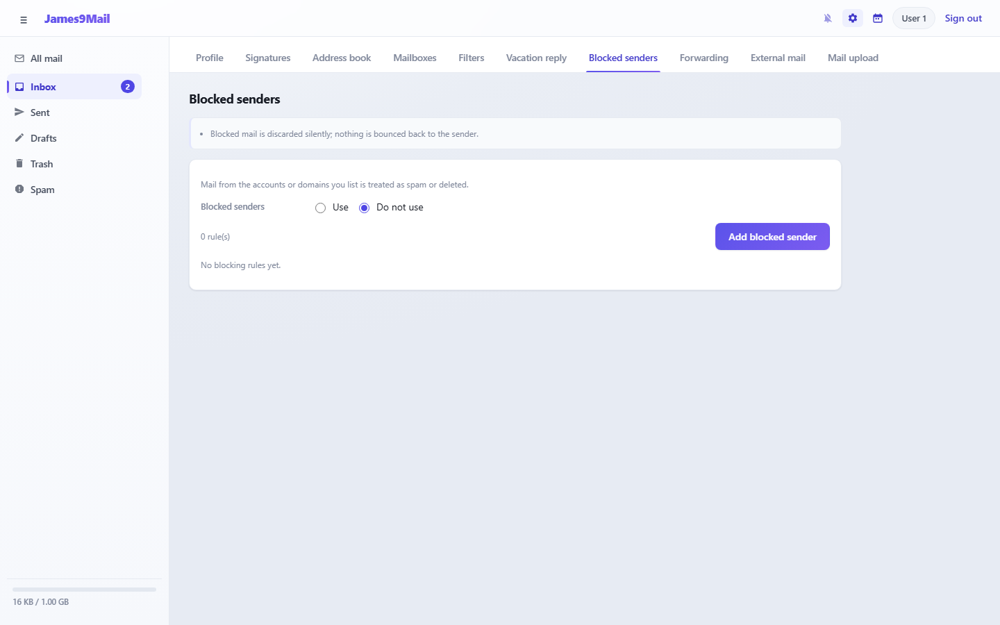

. Set **Blocked senders** at the top to **Use** (applies immediately).
. Click **Add blocked sender** and enter a condition (for example **Sender address is** `+spam@example.org+`, **Sender domain is** `+example.org+`).
. Choose the **Action**: **Delete permanently**, **Move to trash** or **Move to spam**.
. Click **Save**.

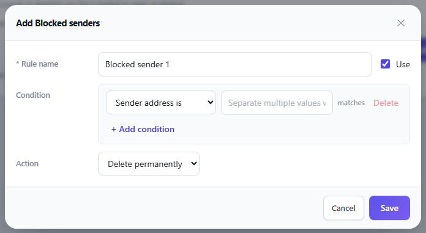

* Blocked mail is not bounced back to the sender.
* While blocked senders is in use, the message list and reading pane show a **Block as spam** button. Senders you block that way are added here automatically.

[[_58-forwarding]]
== 5.8 Forwarding

Automatically forward incoming mail to another mail address.

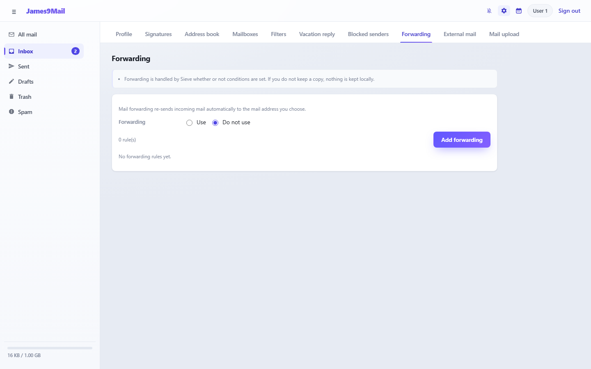

. Set **Forwarding** at the top to **Use** (applies immediately).
. Click **Add forwarding**.

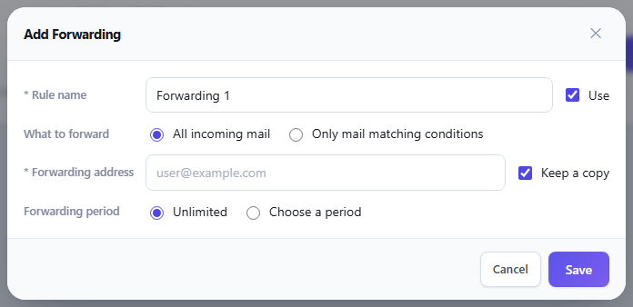

[start=3]
. **What to forward**: **All incoming mail** or **Only mail matching conditions** (enter conditions)
. Enter the **Forwarding address**.
** With **Keep a copy** ticked, the message also stays in your Inbox. Untick it to forward without keeping a copy.
. **Forwarding period**: **Unlimited** or **Choose a period**
. Click **Save**.

[[_59-external-mail]]
== 5.9 External mail

Fetch mail from the inbox of another mail service (IMAP or POP3) and store it in one of your mailboxes.

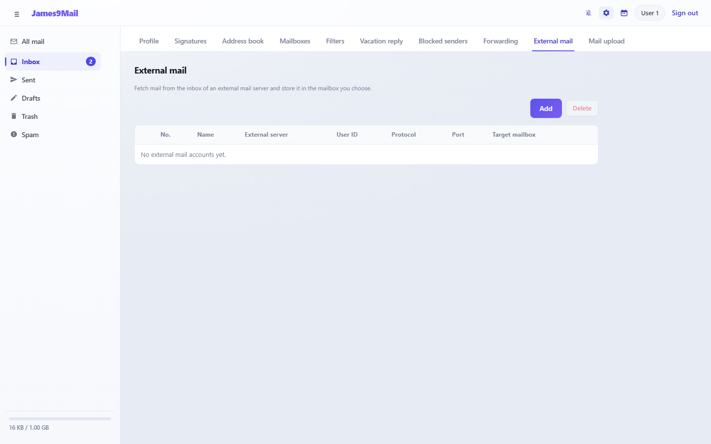

. Click **Add**.

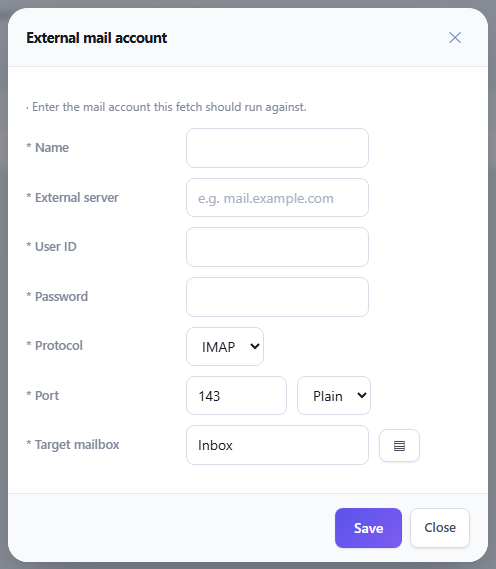

[start=2]
. Enter the name, external server (for example `+mail.example.com+`), user ID, password, protocol (IMAP or POP3), port and security (Plain or SSL), and the target mailbox, then click **Save**.
** Default ports: IMAP 143 / 993 (SSL), POP3 110 / 995 (SSL)
. Click **Run** in the list to fetch mail. The number of messages fetched is shown when it finishes.
. **History** shows the results of earlier runs.

[TIP]
====
* **Mail is not fetched automatically on a schedule.** Click **Run** each time you want to fetch.
* Each run fetches up to the 200 most recent messages. Mail on the external server is not deleted.
* Running the same account again may bring in messages that were already fetched.
* If the external service requires an app password (for example with two-step verification), create one there and use it.
====

[[_510-mail-upload]]
== 5.10 Mail upload

Upload mail you have kept on a PC or phone (EML files) into a mailbox.

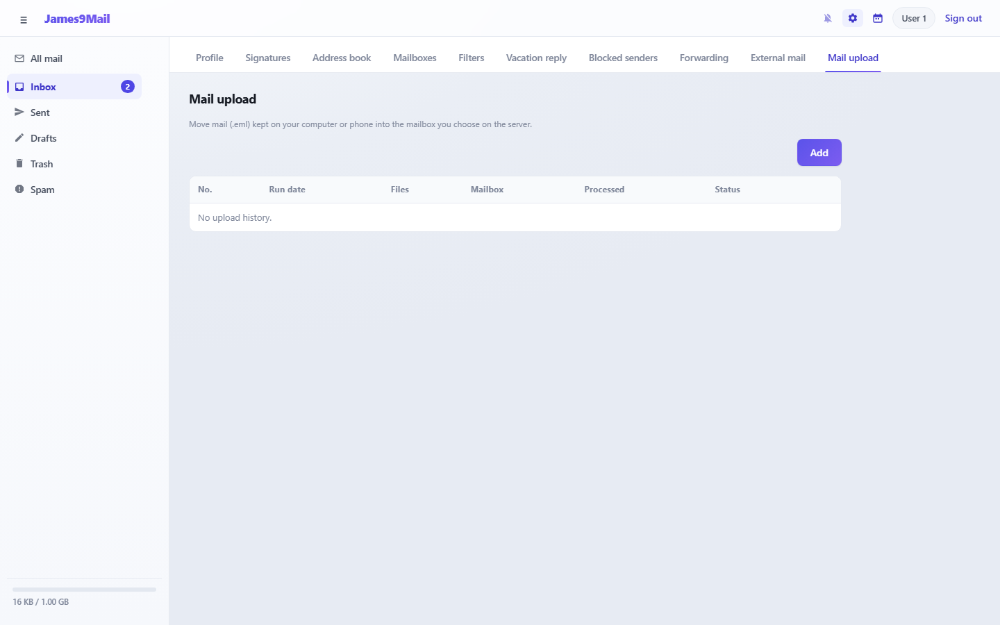

. Click **Add**.

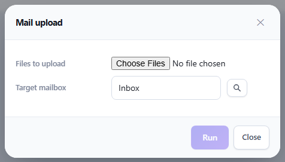

[start=2]
. Choose `+.eml+` files under **Files to upload** (several at once is fine).
. Choose the **Target mailbox** with the button next to it.
. Click **Run**. The result is recorded in the history.

//

* Up to 100 files per upload, 50MB per file.
* **Only the EML format** is supported. 🔗 In Thunderbird, "Save As" on a message produces an EML file. Outlook's own formats (.msg, .pst) and mbox files cannot be uploaded.
* Deleting a history entry keeps the uploaded mail.

xref:04-calendar.adoc[← 4. Calendar and tasks] · xref:README.adoc[Contents] · xref:06-faq.adoc[6. FAQ →]
