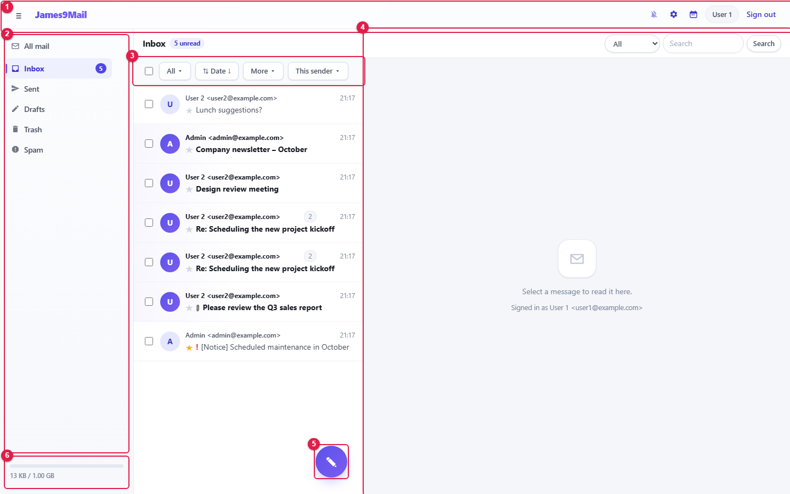

= James9Mail Webmail User Guide
:tip-caption: Good to know
:figure-caption!:
:table-caption!:

This guide explains how to use James9Mail webmail: mail, calendar and preferences.
Administrator menus are covered separately in the xref:admin.adoc[Administrator Guide].

[[contents]]
== Contents

[[user-guide]]
=== User guide

[cols="4,9",options="header"]
|===
|Chapter |Topics

|xref:01-getting-started.adoc[1. Getting started] |Signing in, screen layout, top bar, new-mail notifications, offline use
|xref:02-mail-read.adoc[2. Reading and managing mail] |Mailboxes, message list, search, conversations, reading mail, answering invitations
|xref:03-mail-compose.adoc[3. Writing and sending mail] |Recipients, attachments, editor, send options, appointment mail, auto-save, read receipts and recall
|xref:04-calendar.adoc[4. Calendar and tasks] |Events, recurrence, reminders, tasks, calendar management, connecting other apps (CalDAV)
|xref:05-settings.adoc[5. Preferences] |Profile, signatures, address book (CardDAV), mailboxes, filters, vacation reply, blocked senders, forwarding, external mail, mail upload
|xref:06-faq.adoc[6. FAQ] |Troubleshooting
|===

[[administrator-guide]]
=== Administrator guide

[cols="2,4",options="header"]
|===
|Chapter |Topics

|xref:admin.adoc[Administrator Guide] |Overview, site settings, users, aliases, mail log, blocklist
|===

[[how-to-read-this-guide]]
== How to read this guide

* Button and menu names are shown in **bold**, exactly as they appear on screen.
* The red numbers (①②③…) in the pictures match the numbers in the text.
* The pictures were taken with the test account `+user1@example.com+` (User 1). Administrator screens use `+admin@example.com+`.
* The screen size is 1440×900. In a narrower window the layout changes (see xref:01-getting-started.adoc#_17-screen-size[1.7 Screen size]).
* The webmail is shown in English. Pick **English** on the sign-in screen to get the same labels (see xref:01-getting-started.adoc#_11-signing-in[1.1]).

[[using-thunderbird-or-outlook-alongside-webmail]]
== Using Thunderbird or Outlook alongside webmail

Webmail and mail apps such as Thunderbird and Outlook use **the same mailbox**. Reading, starring, moving or deleting a
message on one side shows up on the other. Each chapter marks these points with 🔗.

[cols="1,2,8",options="header"]
|===
|What |How it connects |Where to look

|Mail |IMAP (receive) · SMTP (send) |xref:01-getting-started.adoc#reading-mail-in-thunderbird-or-outlook[Chapter 1]
|Events and tasks |CalDAV |xref:04-calendar.adoc#connecting-other-calendar-apps-caldav[Chapter 4 — Connecting other apps]
|Address book |CardDAV |xref:05-settings.adoc#connecting-other-address-book-apps-carddav[Chapter 5 — Address book]
|===
