= James9Mail Webmail Administrator Guide
:tip-caption: Good to know
:figure-caption!:
:table-caption!:

xref:README.adoc[← User guide contents]

This guide covers the management menus available to administrator accounts. For mail, calendar and preferences, see the xref:README.adoc[User guide].

[[a1-opening-the-administrator-screens]]
== A.1 Opening the administrator screens

When you sign in with an administrator account, an ① **Admin** button appears in the top bar. Regular users do not see it.

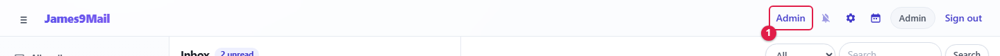

* **Admin** opens the administrator screens. There the same button becomes **Mail**, which takes you back to mail.
* Menu on the left: **Overview**, **Site settings**, **Users**, **Aliases**, **Mail log**, **Blocklist**
* You can also open them by address: `+#/admin/overview+`, `+#/admin/site+`, `+#/admin/users+`, `+#/admin/aliases+`, `+#/admin/mails+`, `+#/admin/droplist+`
* A non-administrator account that opens these addresses is sent back to mail.

[NOTE]
====
Preferences (⚙) are the administrator account's own personal settings, separate from the administrator menus.
====

[[a2-overview]]
== A.2 Overview

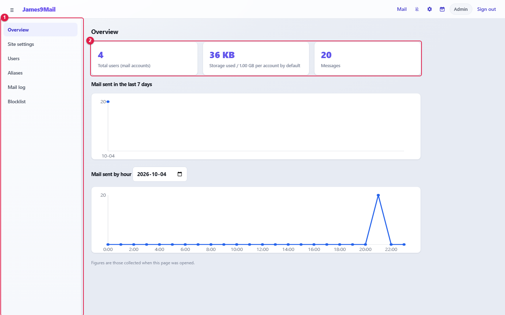

[cols="1,1,5",options="header"]
|===
|No. |Item |Description

|① |Menu |Administrator menu
|② |Summary cards |**Total users (mail accounts)**, **Storage used** (/ default quota per account), **Messages**
|===

* **Mail sent in the last 7 days** — sent messages per day.
* **Mail sent by hour** — choose a date to see that day's sent messages per hour.
* Figures are those collected when the page was opened. Open it again for the latest values.

[[a3-site-settings]]
== A.3 Site settings

Settings that apply to the whole site.

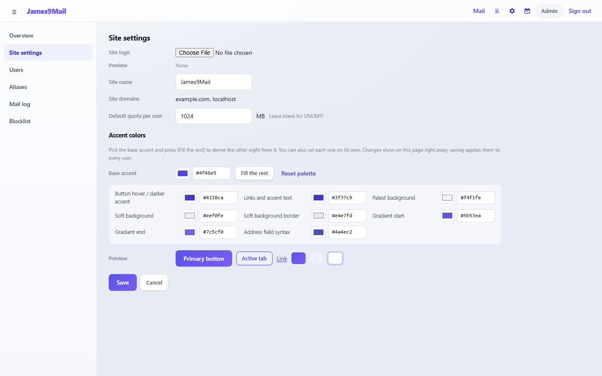

[[site-information]]
=== Site information

[cols="2,10",options="header"]
|===
|Item |Description

|**Site logo** |Logo shown at the top left. PNG, JPEG, GIF or WEBP up to 2MB (SVG is refused for security reasons). Remove it with **Remove logo**
|**Site name** |The name shown at the top and in the browser tab. Leave blank for `+James9Mail+`
|**Site domains** |Domains registered on the mail server (read-only). Domains are added on the mail server (James) side
|**Default quota per user** |Mailbox size (MB) given to new accounts. Leave blank for unlimited (UNLIMIT)
|===

[NOTE]
====
The **Default quota per user** applies only to **accounts created after you save**. Change existing accounts with <<change-quota,Change quota>>. Domains that have their own quota ignore this default, and a notice says so.
====

[[accent-colors]]
=== Accent colors

Changes the color of buttons, links and selection marks throughout webmail.

. Choose the **Base accent**, or type a 6-digit color code (for example `+#4f46e5+`).
. **Fill the rest** derives the other eight colors from it. You can also change each one on its own.
. Check buttons, tabs and links under **Preview**.
. Click **Save**.

//

* Changes show on the administrator screen as you pick them. Leaving without saving restores the original colors.
* Saving applies the colors to every user. Users who are already signed in see them after a refresh.
* A very light base accent triggers a warning that text on it will be hard to read.
* **Reset palette** returns to the original colors.

[NOTE]
====
The password policy (default: at least 8 characters, including at least 2 special characters) and the attachment limits (normal 30MB / 10 files, large 100MB / kept 30 days) cannot be changed on this screen. Ask your system operator if they need changing.
====

[[a4-users]]
== A.4 Users

Create and manage mail accounts.

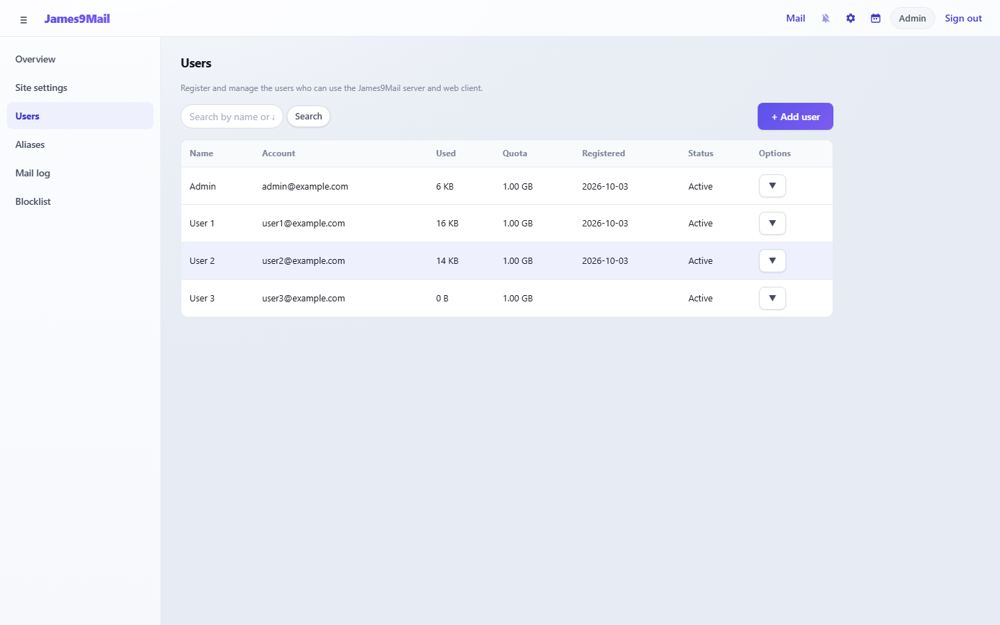

* Search by name or account with the box at the top.
* The list shows name, account, used space, quota, registration date and status (**Active** / **Suspended**).
* Click a row to edit the user. 50 users are shown at a time; **More** loads the rest.

[[add-user]]
=== Add user

Click **+ Add user**.

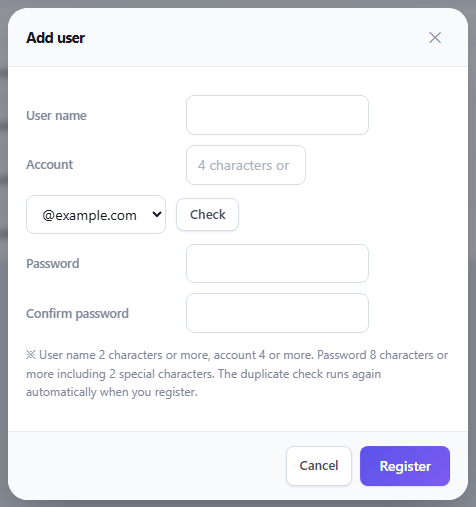

. Enter the **User name** (2 characters or more).
. Enter the first part of the **Account** (4 characters or more), choose the domain and click **Check**.
. Enter the **Password** and **Confirm password** (at least 8 characters, including 2 special characters).
. Click **Register**.

//

* The standard mailboxes (Inbox, Sent, Drafts, Trash, Spam) are created automatically.
* The duplicate check runs once more automatically on registration.

[[edit-user]]
=== Edit user

Click a user in the list.

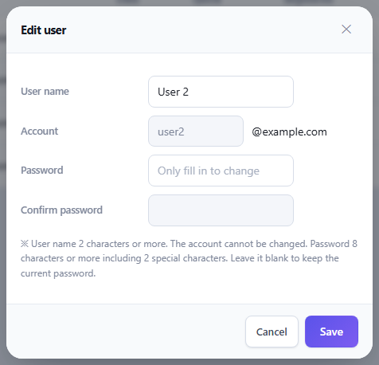

* You can change the name and password. The account (mail address) cannot be changed.
* Leave the password empty to keep the current password.
* Changing the password signs that user out everywhere. 🔗 Remind the user to update the password saved in Thunderbird, Outlook and on their phone.

[[options-menu]]
=== Options menu

Click **▼** at the end of a row.

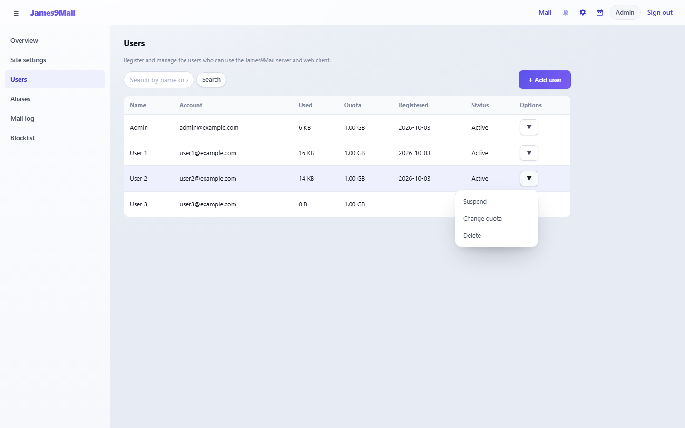

[cols="2,7",options="header"]
|===
|Menu |Action

|**Suspend** / **Activate** |A suspended account cannot sign in, and its open sessions are ended immediately
|**Change quota** |Changes this user's mailbox size
|**Delete** |Deletes the account together with **all its mail, large attachments and settings**. **This cannot be undone**
|===

[NOTE]
====
When mail must be kept, for example for someone who has left the company, **suspend** the account instead of deleting it.
====

[[change-quota]]
=== Change quota

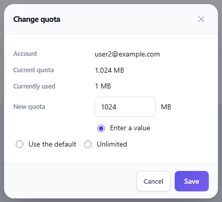

* The current quota and the space already used are shown.
* Choose **Enter a value** (MB), **Use the default** (the default quota per user from Site settings) or **Unlimited**, then click **Save**.
* The quota cannot be smaller than the space already used.

[[a5-aliases]]
== A.5 Aliases

An alias is a virtual mail address. Mail sent to the alias is received by the real accounts you choose, and those accounts can send mail from the alias address (for example, everyone in the sales team receives mail sent to `+sales@+`).

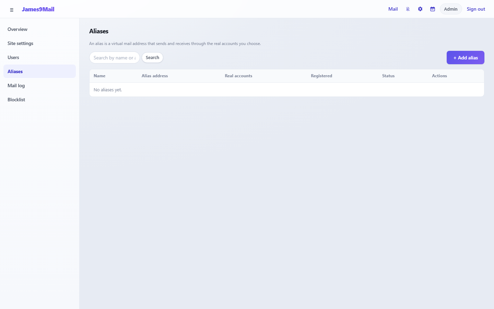

[[add-alias]]
=== Add alias

Click **+ Add alias**.

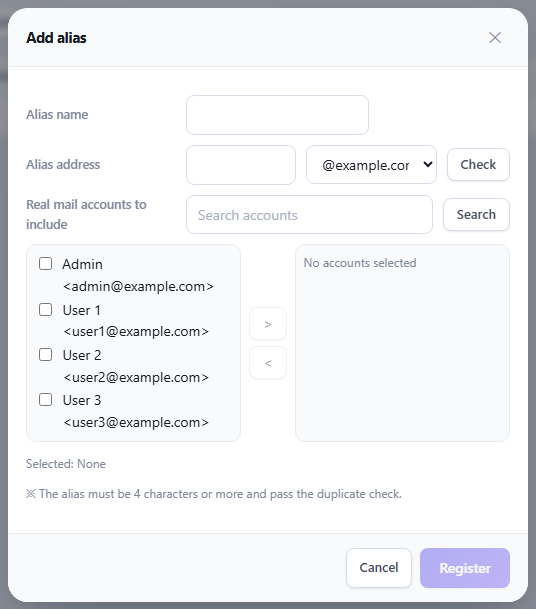

. Enter the **Alias name**.
. Enter the **Alias address** (4 characters or more), choose the domain and click **Check**. An address that matches a real account or an existing alias cannot be used.
. Under **Real mail accounts to include**, tick accounts and move them to the right with **>**. To remove them, tick them on the right and click **<**.
. Click **Register**.

//

* Click a name in the list to edit it. The alias address cannot be changed; only the included accounts can.
* Use the **▼** menu to **Suspend**, **Activate** or **Delete** an alias. Deleting an alias does not affect the real accounts.
* Included users can choose the alias in **From** when writing mail, and replies to mail received at the alias pick the alias automatically (xref:03-mail-compose.adoc#replying[User guide 3.8]).

[[a6-mail-log]]
== A.6 Mail log

Look up the mail sent and received through the server.

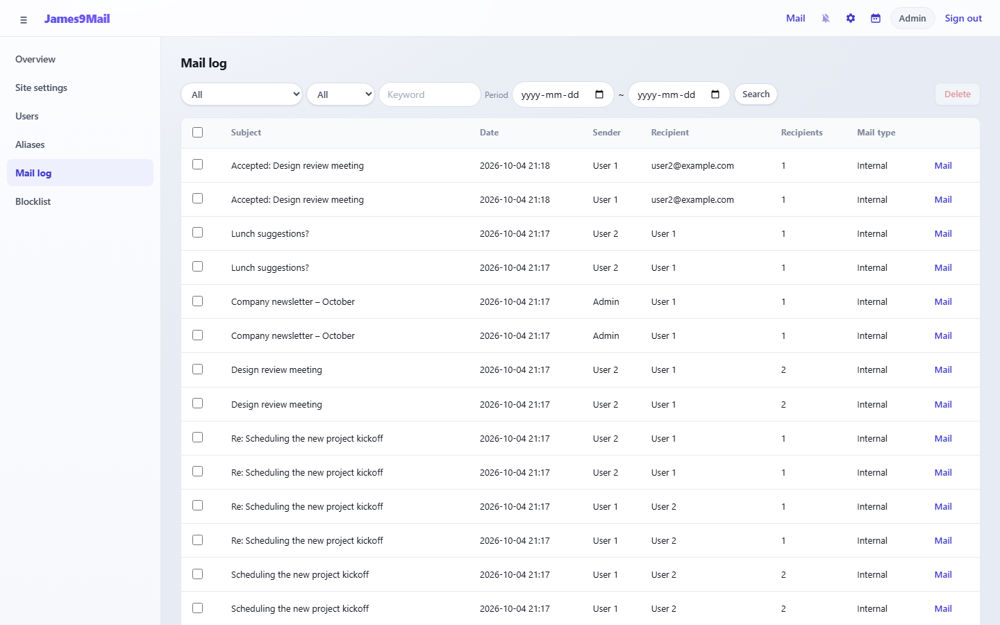

**Search**

[cols="1,4",options="header"]
|===
|Item |Choices

|Type |All, Internal, Sent outside, Received from outside
|Search in |All, Sender, Recipient, Subject
|Keyword · period |A keyword and a start ~ end date
|===

Set the conditions and click **Search**. 50 entries are shown at a time; **More** loads the rest.

**Viewing a message** — Click **Mail** at the end of a row to see the message and its attachments, and download it with **Save to PC (.eml)**.

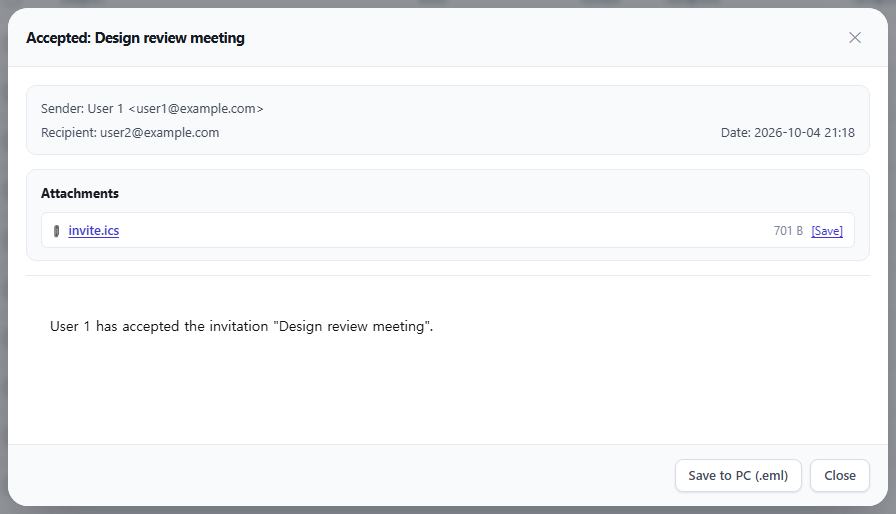

**Deleting messages** — Tick rows and click **Delete** to **delete the messages, attachments included, from every recipient's mailbox**. Use it to remove mis-sent or malicious mail in one go. **This cannot be undone.** Up to 200 messages can be deleted at once.

[NOTE]
====
Viewing and deleting messages in the mail log gives access to users' personal mail. Use it only when your company's policy allows.
====

[[a7-blocklist-server-wide]]
== A.7 Blocklist (server-wide)

Blocks mail from the listed accounts or domains **for the whole server**. This is separate from each user's own xref:05-settings.adoc#_57-blocked-senders[Blocked senders].

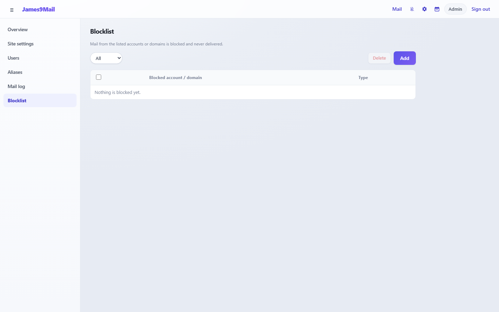

. Click **Add**.
. Enter the mail address (`+test@example.com+`) or domain (`+example.com+`) to block and click **Save**. Whether it is an account or a domain is detected automatically.

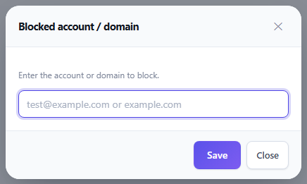

* Use the filter at the top to show **All**, **Domain** or **Account** entries.
* Tick entries and click **Delete** to unblock them.

[[a8-notes-for-administrators]]
== A.8 Notes for administrators

[cols="2,14",options="header"]
|===
|Topic |Notes

|Forgotten passwords |Set a new password in Edit user and ask the user to change it after signing in
|Connecting mail apps |🔗 The IMAP and SMTP server addresses and ports for Thunderbird and Outlook are not in the user guide. Share them in your own internal notice. Calendar (CalDAV) and address book (CardDAV) details can be copied by users from the guides in webmail
|HTTPS |When webmail is opened over http, the CalDAV and CardDAV guides warn that passwords are not encrypted. HTTPS is recommended even on the internal network
|External mail |Users' external mail fetching has no automatic schedule; users must click **Run**
|===

xref:README.adoc[← User guide contents]
