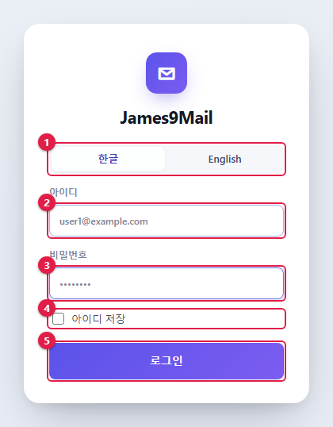
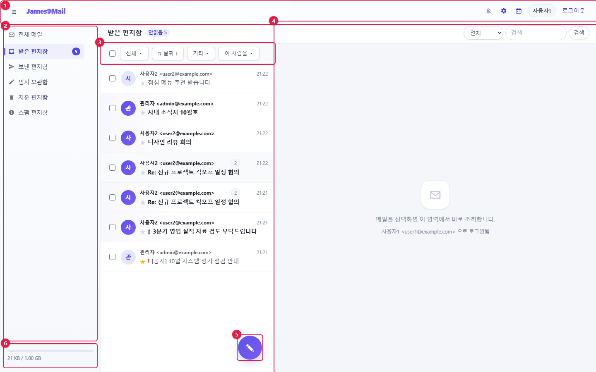
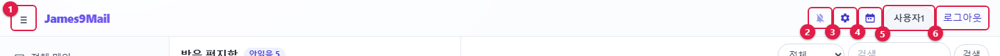
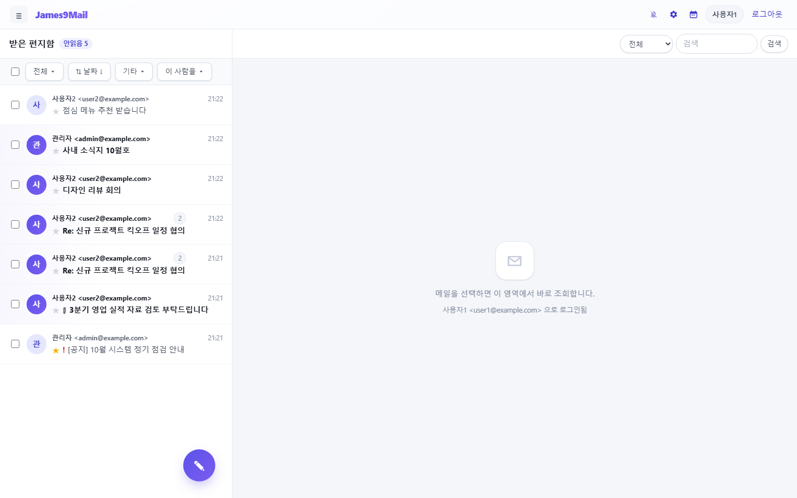
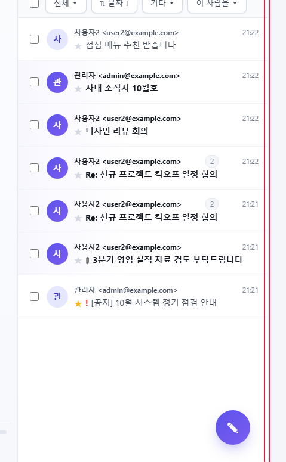

= 1장. 시작하기
:note-caption: 참고
:caution-caption: 주의
:tip-caption: 알아 두기
:figure-caption!:
:table-caption!:

xref:README.adoc[← 목차] · xref:02-mail-read.adoc[2장. 메일 읽기와 관리 →]

[[_11-로그인]]
== 1.1 로그인

. 웹 브라우저에서 웹메일 주소로 접속합니다.
. ① **한글** / **English** 중 화면 언어를 고릅니다. 누르는 즉시 화면 언어가 바뀝니다.
. ② **아이디**에 메일 주소 전체(예: `+user1@example.com+`)를 입력합니다.
. ③ **비밀번호**를 입력합니다.
. 다음에 아이디를 다시 입력하지 않으려면 ④ **아이디 저장**을 체크합니다.
. ⑤ **로그인**을 누르거나 Enter 를 누릅니다.

[NOTE]
====
* **아이디 저장**은 이 브라우저에 아이디만 저장합니다. 비밀번호는 저장하지 않습니다.
* 비밀번호를 여러 번 틀리면 잠시 로그인할 수 없습니다. 시간이 지난 뒤 다시 시도하세요.
* 비밀번호를 잊어버리면 관리자에게 재설정을 요청하세요.
====

[[_12-화면-구성]]
== 1.2 화면 구성

로그인하면 메일 화면이 열립니다.

[cols="1,1,5",options="header"]
|===
|번호 |영역 |설명

|① |상단 메뉴 |사이드 메뉴 숨김, 새 메일 알림, 개인환경설정, 캘린더, 로그아웃 (<<_13-상단-메뉴,1.3>>)
|② |사이드 메뉴 |편지함 목록 (xref:02-mail-read.adoc#_21-편지함[2장 2.1])
|③ |목록 도구 |선택 · 필터 · 정렬 · 일괄 처리 (xref:02-mail-read.adoc#_22-메일-목록[2장 2.2])
|④ |메일 목록과 읽기 화면 |왼쪽은 메일 목록, 오른쪽은 고른 메일의 내용입니다. 검색창은 오른쪽 위에 있습니다
|⑤ |메일쓰기 버튼(✎) |새 메일을 씁니다 (xref:03-mail-compose.adoc[3장])
|⑥ |사용량 |사용 중인 용량 / 할당 용량. 무제한이면 `+UNLIMIT+` 로 표시됩니다
|===

[[_13-상단-메뉴]]
== 1.3 상단 메뉴

[cols="1,1,3",options="header"]
|===
|번호 |버튼 |설명

|① |≡ |사이드 메뉴를 숨기거나 다시 표시합니다
|② |🔔 새 메일 알림 |새 메일 데스크톱 알림을 켜고 끕니다 (<<_15-새-메일-알림,1.5>>)
|③ |⚙ 개인환경설정 |서명 · 주소록 · 자동분류 등 개인 설정 (xref:05-settings.adoc[5장])
|④ |📅 캘린더 |캘린더로 이동합니다. 캘린더 화면에서는 같은 자리가 ✉ **메일**로 바뀝니다 (xref:04-calendar.adoc[4장])
|⑤ |사진 · 이름 |로그인한 사용자입니다
|⑥ |**로그아웃** |로그아웃합니다
|===

[NOTE]
====
관리자 계정에는 ② 왼쪽에 **설정** 버튼이 하나 더 있습니다. xref:admin.adoc[관리자 매뉴얼]을 참고하세요.
====

로고(**James9Mail**)를 누르면 어느 화면에서든 메일 화면으로 돌아옵니다.

[[_14-화면-너비-조절]]
== 1.4 화면 너비 조절

**사이드 메뉴 숨기기** — ≡ 를 누르면 사이드 메뉴가 접혀 메일 목록과 읽기 화면이 넓어집니다. 한 번 더 누르면 다시 나타납니다.

**메일 목록 너비 조절** — 메일 목록과 읽기 화면 사이의 경계선(↔)을 마우스로 끌면 목록 너비가 바뀝니다.

* 경계선을 **두 번 누르면** 기본 너비로 돌아갑니다.
* 경계선을 누른 뒤 키보드 ← / → 로도 조금씩 조절할 수 있습니다.
* 조절한 너비는 이 브라우저에 기억됩니다.

[[_15-새-메일-알림]]
== 1.5 새 메일 알림

브라우저를 다른 창 뒤에 두어도 새 메일이 오면 바탕화면 알림으로 알려 줍니다.

. 상단의 🔔 버튼을 누릅니다.
. 브라우저가 알림 권한을 물으면 **허용**을 누릅니다.
. "새 메일 알림을 켰습니다" 가 표시되면 완료입니다. 다시 누르면 꺼집니다.

[NOTE]
====
* 웹메일 창을 보고 있을 때는 알림이 뜨지 않습니다.
* 받은 편지함과 개인 편지함에 온 메일만 알립니다. 보낸 · 임시 · 지운 · 스팸 편지함은 알리지 않습니다.
* 한 번에 여러 통이 오면 3통까지 따로 알리고, 나머지는 "그 밖에 n통이 더 도착했습니다" 로 묶어 알립니다.
* 알림을 누르면 그 메일이 열립니다.
* "브라우저가 이 사이트의 알림을 막고 있습니다" 가 나오면 주소창 왼쪽 자물쇠 아이콘에서 알림을 **허용**으로 바꾸세요.
====

브라우저 탭 제목과 아이콘에도 안 읽은 메일 수가 표시됩니다(아이콘은 9+ 까지).

[[_16-새-메일-받기와-오프라인]]
== 1.6 새 메일 받기와 오프라인

* 웹메일은 화면을 보고 있으면 **30초마다**, 다른 탭에 있으면 5분마다 새 메일을 확인합니다. 탭으로 돌아오는 즉시 한 번 더 확인합니다.
* 메일 목록과 열어 본 메일은 이 PC 에 저장해 두므로 다음에 더 빨리 열립니다.
* 네트워크가 끊기면 목록 위에 "오프라인 — 이 기기에 받아 둔 메일을 보고 있습니다" 가 표시되고, 받아 둔 메일만 볼 수 있습니다.
** 한 번도 열어 보지 않은 메일은 오프라인에서 열 수 없습니다.
** 파일이름 검색은 오프라인에서 할 수 없습니다.
* 공용 PC 라면 xref:05-settings.adoc#_51-개인-정보-관리[5장 개인 정보 관리]에서 **로그아웃할 때 이 PC 에 저장된 메일 캐시를 삭제**를 체크하세요.

[[_17-화면-크기에-따른-변화]]
== 1.7 화면 크기에 따른 변화

[cols="1,4",options="header"]
|===
|창 너비 |변화

|1180px 이하 |읽기 화면이 따로 보이지 않고, 메일을 누르면 목록 위에 열립니다. **← 목록**으로 돌아갑니다
|720px 이하(휴대폰) |사이드 메뉴가 숨겨지고 ≡ 로 엽니다. 편지함을 고르면 자동으로 닫힙니다
|===

[[_18-주소로-화면-바로-열기]]
== 1.8 주소로 화면 바로 열기

화면을 옮기면 주소창의 `+#+` 뒷부분이 바뀝니다. 새로고침(F5)해도 보던 화면이 그대로 열리고, 브라우저의 뒤로 · 앞으로 가기로 화면을 오갈 수 있습니다.

[cols="1,3",options="header"]
|===
|화면 |주소

|메일 |`+#/mail+`
|캘린더 / 태스크 |`+#/calendar+` / `+#/calendar/tasks+`
|개인환경설정 |`+#/settings/profile+`, `+#/settings/signature+` …
|===

[[썬더버드-아웃룩에서-메일-보기]]
== 썬더버드 · 아웃룩에서 메일 보기

🔗 웹메일 계정은 썬더버드 · 아웃룩 같은 메일 프로그램에서도 그대로 쓸 수 있습니다.

* 메일 프로그램에 계정을 추가할 때 받는 서버는 **IMAP**, 보내는 서버는 **SMTP** 로 설정합니다.
* 사용자 이름은 웹메일 아이디(메일 주소 전체), 비밀번호는 웹메일 비밀번호와 같습니다.
* 서버 주소와 포트는 관리자에게 문의하세요.
* 웹메일과 메일 프로그램은 같은 메일함을 봅니다. 한쪽에서 읽음 · 별표 · 이동 · 삭제한 결과가 다른 쪽에도 보입니다.
* 일정은 xref:04-calendar.adoc#외부-프로그램과-일정-연결-caldav[CalDAV], 주소록은 xref:05-settings.adoc#외부-프로그램과-주소록-연결-carddav[CardDAV]로 따로 연결합니다.

xref:README.adoc[← 목차] · xref:02-mail-read.adoc[2장. 메일 읽기와 관리 →]
