= 2장. 메일 읽기와 관리
:note-caption: 참고
:caution-caption: 주의
:tip-caption: 알아 두기
:figure-caption!:
:table-caption!:

xref:01-getting-started.adoc[← 1장. 시작하기] · xref:README.adoc[목차] · xref:03-mail-compose.adoc[3장. 메일 쓰기와 발송 →]

[[_21-편지함]]
== 2.1 편지함

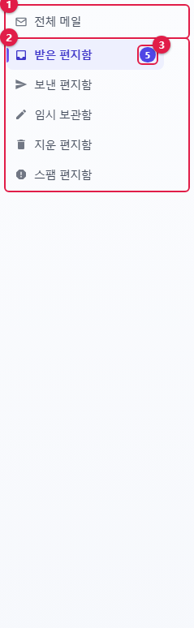

[cols="1,1,3",options="header"]
|===
|번호 |항목 |설명

|① |**전체 메일** |모든 편지함의 메일을 한꺼번에 봅니다
|② |편지함 목록 |기본 편지함(받은 · 보낸 · 임시 보관 · 지운 · 스팸)과 내가 만든 개인 편지함
|③ |안 읽은 수 |그 편지함의 안 읽은 메일 수
|===

편지함을 누르면 그 편지함의 메일이 목록에 나옵니다. 하위 편지함은 들여쓰기로 표시됩니다.

[[편지함-옵션]]
=== 편지함 옵션

편지함에 마우스를 올리면 오른쪽에 **⋯** 버튼이 나옵니다.

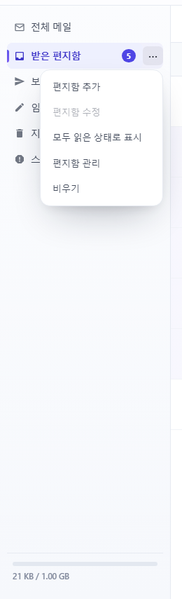

[cols="1,4",options="header"]
|===
|메뉴 |동작

|**편지함 추가** |이 편지함 아래에 하위 편지함을 만듭니다. 이름을 묻는 창이 뜹니다
|**편지함 수정** |편지함 이름을 바꿉니다. 기본 편지함은 바꿀 수 없습니다
|**모두 읽은 상태로 표시** |이 편지함의 메일을 모두 읽음으로 처리합니다
|**편지함 관리** |xref:05-settings.adoc#_54-편지함-관리[개인환경설정 › 편지함 관리]로 이동합니다
|**비우기** |편지함의 메일을 모두 지웁니다. 지운 · 스팸 편지함은 **완전 삭제**, 그 밖의 편지함은 지운 편지함으로 이동합니다
|===

[NOTE]
====
🔗 편지함은 썬더버드 · 아웃룩의 폴더와 같습니다. 메일 프로그램에서 만든 폴더도 여기에 보입니다.
====

[[_22-메일-목록]]
== 2.2 메일 목록

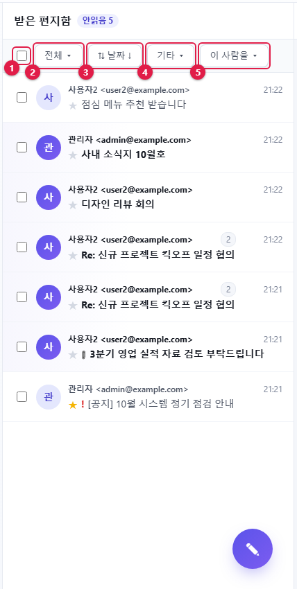

[cols="1,1,3",options="header"]
|===
|번호 |도구 |설명

|① |전체 선택 |목록의 메일을 모두 선택하거나 해제합니다
|② |**전체 ▾** (필터) |조건에 맞는 메일만 봅니다
|③ |**⇅ 날짜 ↓** (정렬) |정렬 기준과 방향, 대화 묶기를 고릅니다
|④ |**기타 ▾** |선택한 메일을 이동 · 복사 · 삭제 · 읽음 처리합니다
|⑤ |**이 사람을 ▾** |선택한 메일의 보낸 사람을 연락처에 추가하거나, 그 사람이 보낸 메일만 봅니다 (받은 편지함에서만 보임)
|===

[[목록-한-줄-읽는-법]]
=== 목록 한 줄 읽는 법

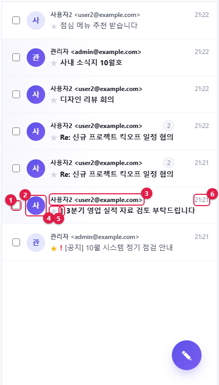

[cols="1,1,2",options="header"]
|===
|번호 |표시 |의미

|① |체크 상자 |메일 선택
|② |동그라미 |보낸 사람 사진 또는 이름 첫 글자
|③ |이름 · 주소 |보낸 사람. 보낸 편지함에서는 받는 사람이 표시됩니다
|④ |★ |별표. 누르면 켜고 끕니다
|⑤ |📎 |첨부파일이 있는 메일
|⑥ |시각 |받은 날짜 · 시각. 크기순으로 정렬하면 이 자리에 메일 크기가 나옵니다
|===

* **굵은 글씨**는 안 읽은 메일입니다.
* 빨간 **!** 는 보낸 사람이 **중요도 높음**으로 보낸 메일입니다.
* 메일을 누르면 오른쪽에 내용이 열리고 읽음으로 바뀝니다.
* 목록 끝까지 내리면 다음 메일 50통을 자동으로 불러옵니다.

[NOTE]
====
🔗 읽음 · 별표 상태는 썬더버드 · 아웃룩과 함께 바뀝니다(별표는 메일 프로그램의 '깃발/플래그'입니다).
====

[[필터]]
=== 필터

**전체 ▾** 를 누르고 **안읽음** · **별표** · **중요도 높음** · **첨부** 중 원하는 조건을 체크합니다. 조건이 걸리면 버튼이 **필터 n ▾** 로 바뀝니다.

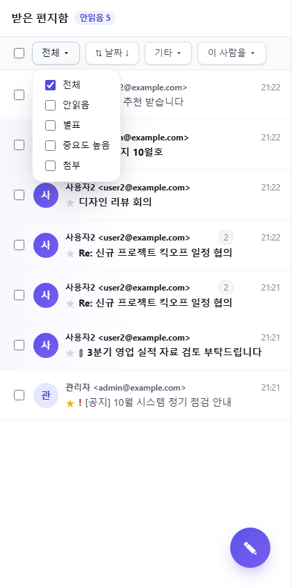

[NOTE]
====
**별표**는 내가 붙인 표시이고, **중요도 높음**은 보낸 사람이 붙인 표시입니다.
====

[[정렬과-대화-묶기]]
=== 정렬과 대화 묶기

**⇅** 버튼을 누르면 정렬 메뉴가 열립니다.

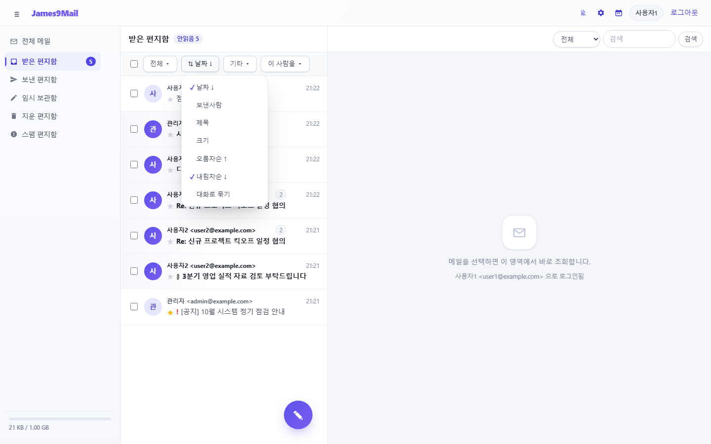

* 기준: **날짜** · **보낸사람**(보낸 편지함에서는 받는사람) · **제목** · **크기**
* 방향: **오름차순 ↑** / **내림차순 ↓**. 같은 기준을 다시 고르면 방향이 바뀝니다.
* **대화로 묶기**: 답장으로 이어진 메일을 한 줄로 묶습니다(<<_24-대화-묶기와-대화-보기,2.4>>).
* 다른 편지함으로 옮기면 정렬은 기본값(날짜 ↓)으로 돌아갑니다.

[[_23-여러-메일-한꺼번에-처리]]
== 2.3 여러 메일 한꺼번에 처리

. 처리할 메일의 체크 상자를 체크합니다. 버튼이 **기타 ▾ (n)** 으로 바뀝니다.
. **기타 ▾** 를 누르고 원하는 작업을 고릅니다.

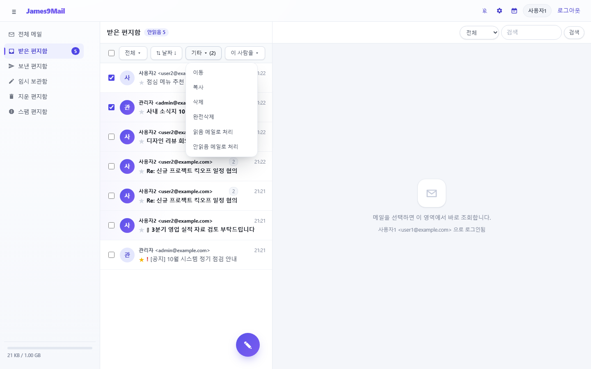

[cols="2,4",options="header"]
|===
|메뉴 |동작

|**이동** / **복사** |편지함을 골라 옮기거나 복사합니다
|**삭제** |지운 편지함으로 옮깁니다. 지운 편지함에서 삭제하면 완전히 지워집니다
|**완전삭제** |바로 영구 삭제합니다. **복원할 수 없습니다**
|**읽음 메일로 처리** / **안읽음 메일로 처리** |읽음 상태를 바꿉니다
|**스팸차단** / **스팸 해제** |스팸 편지함으로 옮기고 보낸 사람을 수신거부에 등록합니다. xref:05-settings.adoc#_57-수신거부[수신거부]를 사용할 때만 보입니다
|===

**이동** · **복사**를 고르면 편지함 선택 창이 뜹니다. 편지함을 고르고 **선택**을 누르세요(편지함을 두 번 누르면 바로 선택됩니다).

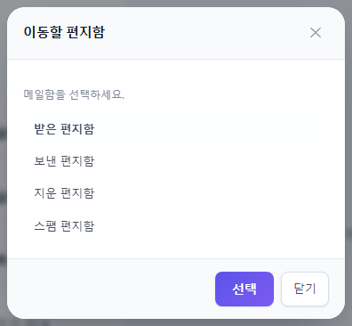

[[끌어서-옮기기]]
=== 끌어서 옮기기

메일을 마우스로 끌어 왼쪽 편지함 위에 놓으면 그 편지함으로 옮겨집니다. 놓을 수 있는 편지함은 점선으로 표시됩니다.

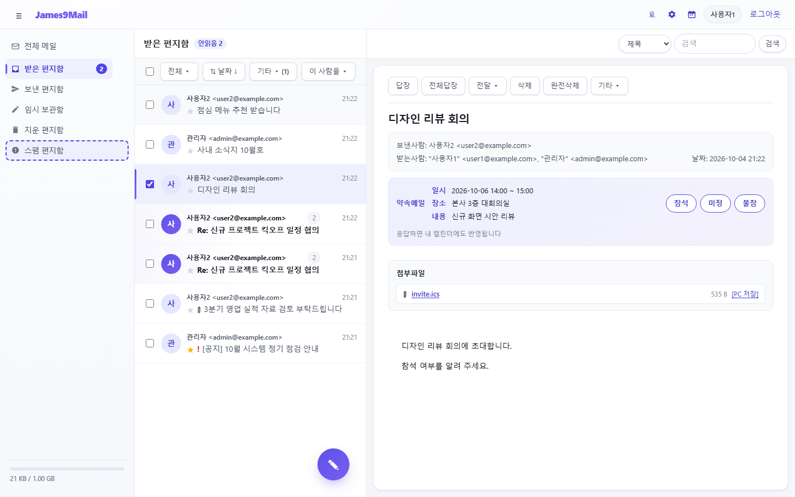

* 체크한 메일이 있으면 체크한 메일 전부가 옮겨집니다.
* **전체 메일**과 **임시 보관함**에는 놓을 수 없습니다.

[[이-사람을]]
=== 이 사람을

받은 편지함에서 메일을 하나 선택하고 **이 사람을 ▾** 를 누릅니다.

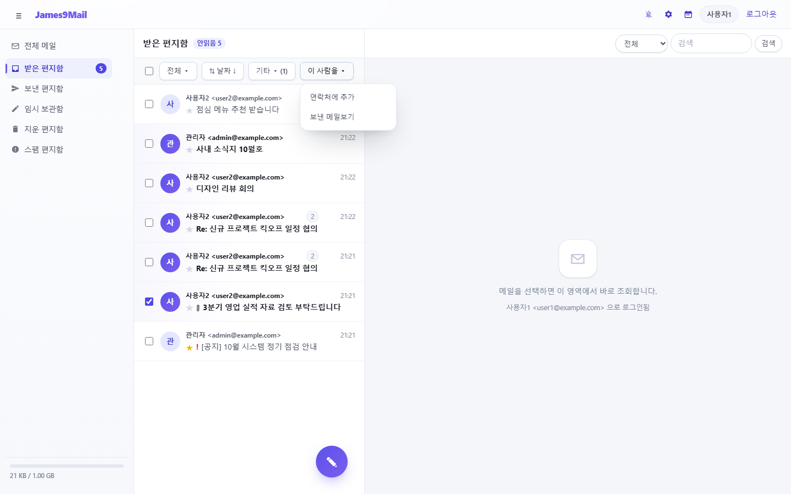

* **연락처에 추가** — 보낸 사람을 주소록에 넣습니다.
* **보낸 메일보기** — 그 사람이 보낸 메일만 검색해서 보여 줍니다.

[[_24-대화-묶기와-대화-보기]]
== 2.4 대화 묶기와 대화 보기

**⇅ › 대화로 묶기**를 켜면, 답장으로 이어진 메일이 한 줄로 묶입니다.

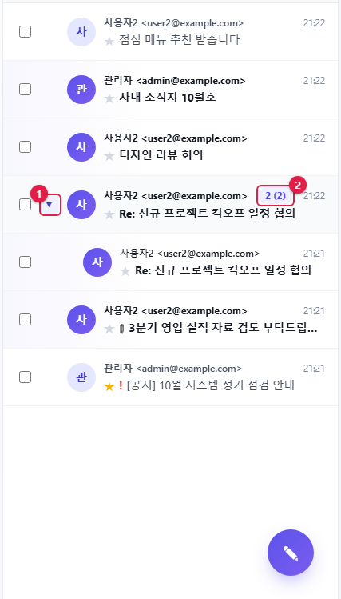

* ① **▸** 를 누르면 묶인 메일이 아래로 펼쳐집니다.
* ② 숫자 배지는 대화에 든 메일 수입니다. 괄호 안 숫자는 안 읽은 메일 수입니다.

숫자 배지를 누르면 대화 내용을 메신저처럼 한눈에 볼 수 있습니다. 내가 쓴 말은 오른쪽에, 상대가 쓴 말은 왼쪽에 놓입니다.

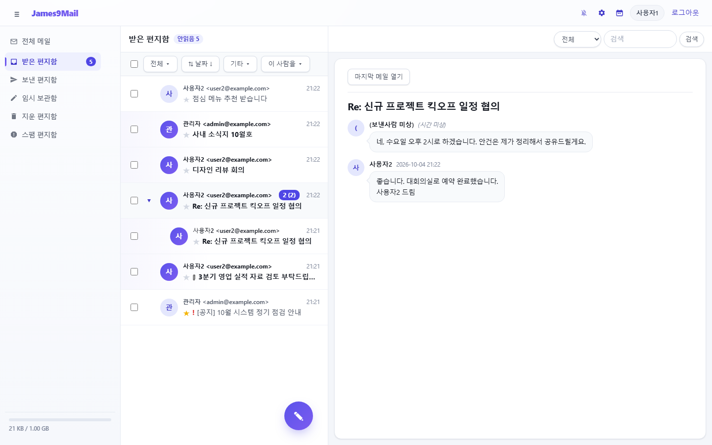

* **마지막 메일 열기**를 누르면 대화의 마지막 메일이 원래 모양으로 열립니다.
* 말풍선은 100자까지만 보이고, 마우스를 올리면 전체 내용이 보입니다.

[NOTE]
====
대화는 제목이 아니라 답장 관계(메일 머리의 References)로 묶습니다. 🔗 썬더버드의 대화 묶기와 같은 규칙입니다.
====

[[_25-검색]]
== 2.5 검색

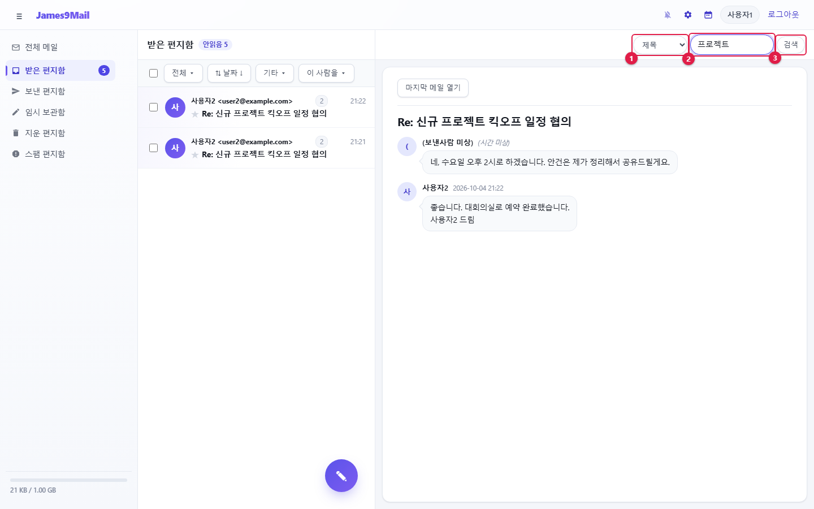

. ① 검색 범위를 고릅니다: **전체** · **보낸사람** · **받는사람** · **제목** · **파일이름**
. ② 검색어를 입력합니다.
. ③ **검색**을 누르거나 Enter 를 누릅니다.

//

* 지금 보고 있는 편지함 안에서 찾습니다. 모든 편지함에서 찾으려면 **전체 메일**을 먼저 고르세요.
* 다른 편지함을 누르면 검색어 · 필터 · 정렬이 초기화됩니다.

[[_26-메일-읽기]]
== 2.6 메일 읽기

목록에서 메일을 누르면 오른쪽에 열립니다.

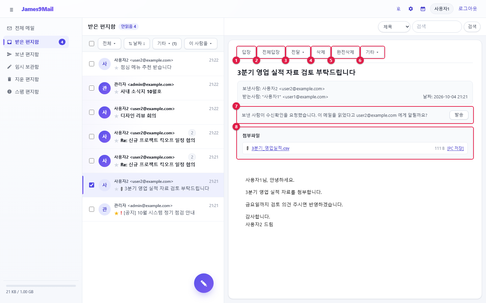

[cols="1,1,3",options="header"]
|===
|번호 |버튼 / 영역 |설명

|① |**답장** |보낸 사람에게 답장합니다
|② |**전체답장** |보낸 사람에게 답장하고, 나머지 받는 사람 · 참조는 참조로 넣습니다
|③ |**전달 ▾** |다른 사람에게 전달합니다
|④ |**삭제** |지운 편지함으로 옮깁니다
|⑤ |**완전삭제** |영구 삭제합니다
|⑥ |**기타 ▾** |이동 · 복사 · PC 저장 · 원문보기 · 일정으로 변환
|⑦ |수신확인 요청 |보낸 사람이 수신확인을 요청한 메일에만 나옵니다 (<<_28-수신확인-요청에-답하기,2.8>>)
|⑧ |**첨부파일** |파일 이름이나 **[PC 저장]**을 누르면 내려받습니다
|===

* 임시 보관함의 메일을 열면 버튼 대신 **이어서 작성**이 나옵니다.
* 대용량 첨부는 이름 옆에 **· 대용량**이 붙고, 보관 기간 안에만 내려받을 수 있습니다.

[[전달]]
=== 전달

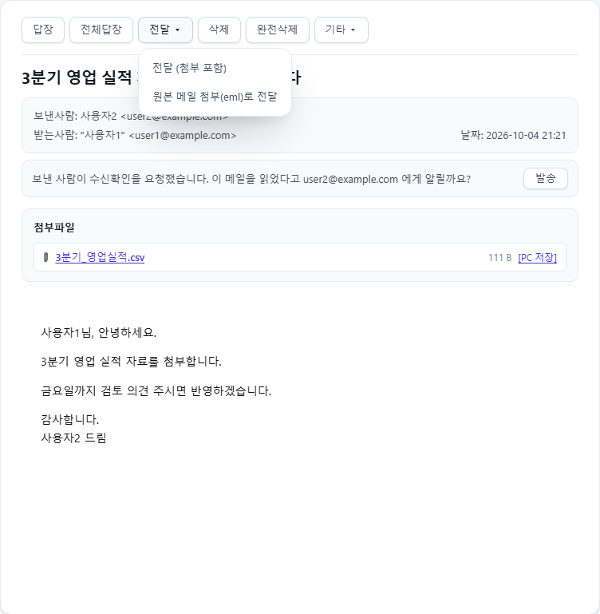

* **전달 (첨부 포함)** — 본문을 인용하고 원래 첨부도 함께 보냅니다.
* **원본 메일 첨부(eml)로 전달** — 원래 메일을 통째로 `+.eml+` 파일로 붙여 보냅니다.

[[기타-메뉴]]
=== 기타 메뉴

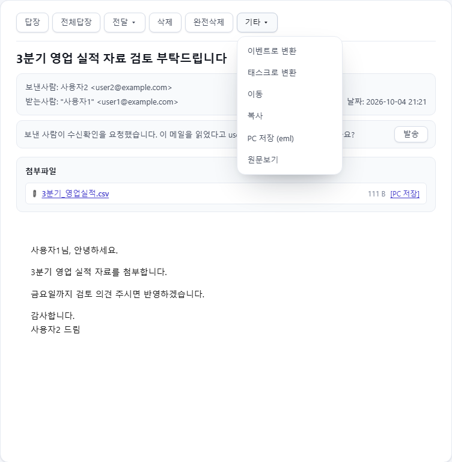

[cols="2,3",options="header"]
|===
|메뉴 |동작

|**이벤트로 변환** / **태스크로 변환** |이 메일 내용으로 캘린더에 새 일정이나 할 일을 만듭니다 (xref:04-calendar.adoc[4장])
|**이동** / **복사** |다른 편지함으로 옮기거나 복사합니다
|**PC 저장 (eml)** |메일을 `+.eml+` 파일로 내려받습니다. 🔗 썬더버드 · 아웃룩에서 열 수 있습니다
|**원문보기** |메일 머리와 본문 원문을 봅니다
|===

**원문보기**에서는 원문을 **복사**하거나 **PC 저장 (eml)** 할 수 있습니다.

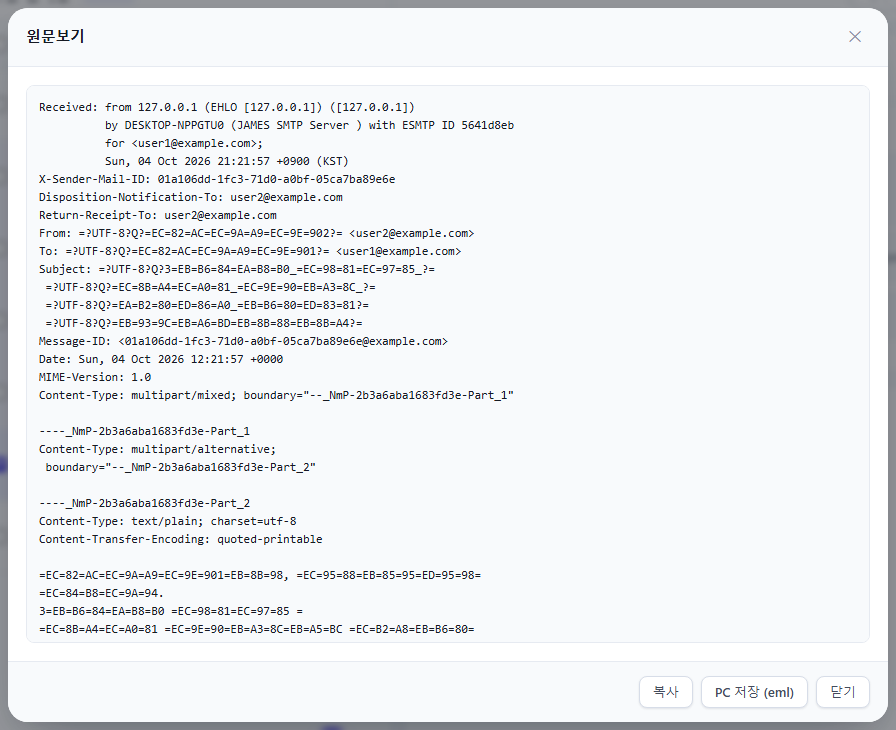

[[원격-이미지-차단]]
=== 원격 이미지 차단

외부 서버의 그림이 들어 있는 메일은 그림을 바로 보여 주지 않습니다. 그림을 불러오는 순간 보낸 사람이 메일을 열었는지 알 수 있기 때문입니다(추적).

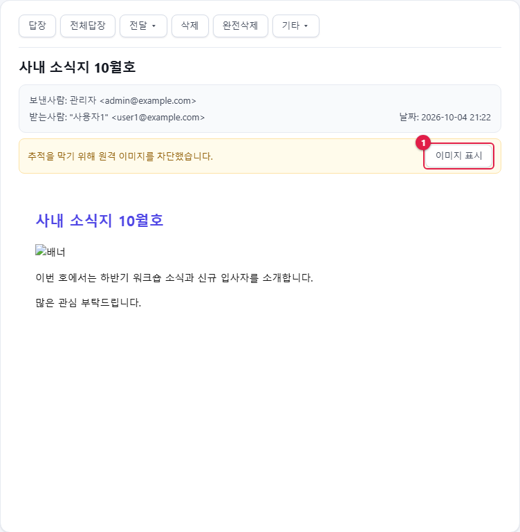

믿을 수 있는 메일이면 ① **이미지 표시**를 누르세요. 그 메일을 보는 동안만 그림이 표시됩니다.

[[연락처-카드vcard]]
=== 연락처 카드(vCard)

`+.vcf+` 연락처 파일이 첨부된 메일은 본문 아래에 연락처 카드로 보여 줍니다. 이름 · 회사 · 전화 · 주소 등이 정리되어 나오고, 전화번호와 메일 주소는 눌러서 바로 쓸 수 있습니다.

[[열-수-없는-메일]]
=== 열 수 없는 메일

[cols="3,2",options="header"]
|===
|안내 |의미

|winmail.dat(TNEF) 첨부는 미리보기를 지원하지 않습니다 |아웃룩 전용 형식입니다. 첨부를 내려받아 확인하세요
|S/MIME 암호화 · 서명 메일은 웹에서 열 수 없습니다 |🔗 인증서를 설정한 썬더버드 · 아웃룩에서 여세요
|===

[[_27-약속메일에-응답하기]]
== 2.7 약속메일에 응답하기

회의 초대 같은 약속메일을 받으면 본문 위에 일시 · 장소 · 내용과 응답 버튼이 나옵니다.

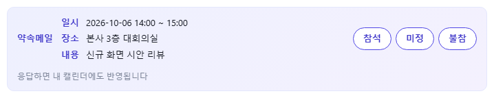

. **참석** · **미정** · **불참** 중 하나를 누릅니다.
. 응답이 보낸 사람에게 전달되고, 내 캘린더에도 일정이 들어갑니다.

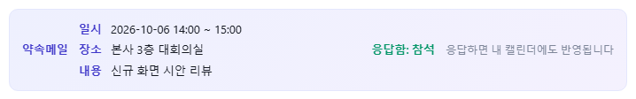

* 보낸 사람은 xref:03-mail-compose.adoc#_39-보낸-메일-수신-확인과-회수[수신 확인]에서 응답 현황을 봅니다.
* 주최자가 일정을 취소하면 **내 캘린더에서 삭제** 버튼이, 참석자가 응답을 보내 오면 **참석 응답을 내 일정에 반영** 버튼이 나옵니다.

[NOTE]
====
🔗 약속메일은 표준 iCalendar 형식이라 썬더버드 · 아웃룩에서 받은 사람도 바로 응답할 수 있습니다.
====

[[_28-수신확인-요청에-답하기]]
== 2.8 수신확인 요청에 답하기

보낸 사람이 수신확인을 요청한 메일을 열면 다음 안내가 나옵니다.

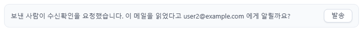

* 읽었다고 알려 주려면 **발송**을 누릅니다. "수신확인을 보냈습니다" 가 표시됩니다.
* 알리고 싶지 않으면 그냥 두면 됩니다. 자동으로 보내지 않습니다.

xref:01-getting-started.adoc[← 1장. 시작하기] · xref:README.adoc[목차] · xref:03-mail-compose.adoc[3장. 메일 쓰기와 발송 →]
