= 3장. 메일 쓰기와 발송
:note-caption: 참고
:caution-caption: 주의
:tip-caption: 알아 두기
:figure-caption!:
:table-caption!:

xref:02-mail-read.adoc[← 2장. 메일 읽기와 관리] · xref:README.adoc[목차] · xref:04-calendar.adoc[4장. 캘린더와 태스크 →]

[[_31-메일쓰기-창-열기]]
== 3.1 메일쓰기 창 열기

[cols="2,2",options="header"]
|===
|방법 |열리는 내용

|메일 목록 오른쪽 아래 **✎** 버튼 |빈 메일
|읽기 화면의 **답장** / **전체답장** |받는 사람과 `+Re:+` 제목, 원래 본문 인용이 채워진 메일
|읽기 화면의 **전달 ▾** |`+Fwd:+` 제목과 원래 본문 · 첨부가 채워진 메일
|임시 보관함 메일의 **이어서 작성** |저장해 둔 내용
|캘린더 일정의 **참석자에게 메일 보내기** |참석자와 제목이 채워진 메일
|===

메일쓰기 창은 화면 가운데에 뜹니다. 제목줄(**메일쓰기**)을 끌어 창을 옮길 수 있습니다.

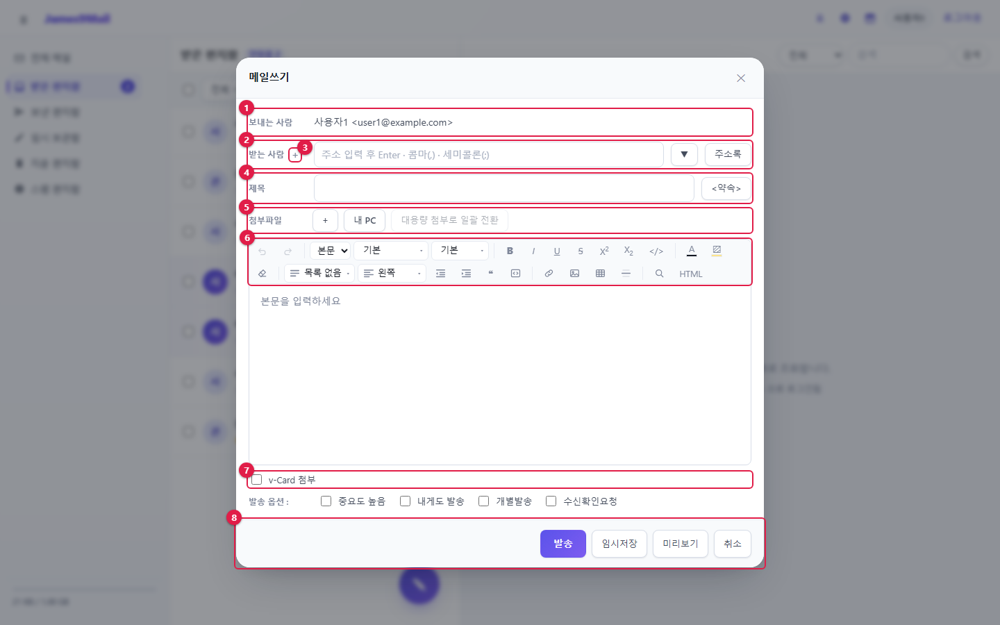

[cols="1,2,3",options="header"]
|===
|번호 |항목 |설명

|① |**보내는 사람** |내 주소. 알리아스 주소가 있으면 골라서 보낼 수 있습니다
|② |**받는 사람** |받는 사람 주소 (<<_32-받는-사람-입력,3.2>>)
|③ |**+** |참조 · 숨은참조 칸을 펼칩니다
|④ |**제목** · **<약속>** |메일 제목, 약속메일 만들기 (<<_36-약속메일-보내기,3.6>>)
|⑤ |**첨부파일** |파일 첨부 (<<_33-파일-첨부,3.3>>)
|⑥ |편집기 도구 |본문 서식 (<<_34-본문-편집기,3.4>>)
|⑦ |서명 · v-Card · 발송 옵션 |(<<_35-서명과-발송-옵션,3.5>>)
|⑧ |**발송** · **임시저장** · **미리보기** · **취소** |(<<_37-미리보기-임시저장-발송,3.7>>)
|===

[[_32-받는-사람-입력]]
== 3.2 받는 사람 입력

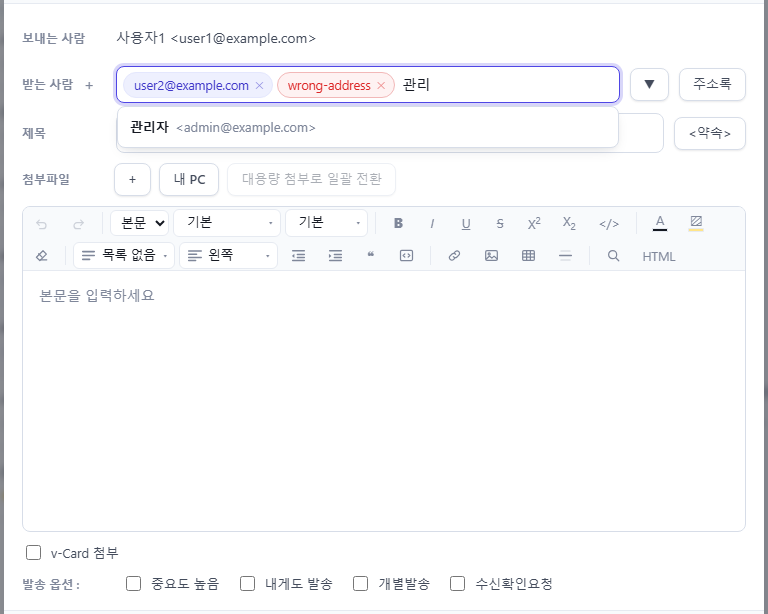

* 주소를 입력하고 **Enter**, **콤마(,)**, **세미콜론(;)** 중 하나를 누르면 주소가 블럭으로 바뀝니다. 여러 주소를 한꺼번에 붙여 넣어도 나뉘어 들어갑니다.
* 주소 형식이 틀리면 블럭이 빨갛게 표시됩니다(그림의 `+wrong-address+`). 블럭의 **×** 로 지웁니다.
* 이름이나 주소 앞부분을 입력하면 주소록과 사내 사용자 중에서 **자동완성** 목록이 뜹니다. 한글은 1자, 영문은 2자부터 찾습니다. ↑↓ 로 고르고 Enter 로 넣습니다.
* 자동완성에서 **그룹**을 고르면 그룹 멤버 전원이 들어갑니다.

**블럭 다루기**

[cols="2,2",options="header"]
|===
|동작 |결과

|블럭 누르기 → Delete / Backspace |지우기
|블럭 두 번 누르기 (또는 F2) |글자로 되돌려 고치기
|블럭 끌기 |순서 바꾸기, 받는 사람 ↔ 참조 ↔ 숨은참조로 옮기기
|빈 칸에서 Backspace |마지막 블럭 고르기 (한 번 더 누르면 지움)
|===

[[참조-숨은참조]]
=== 참조 · 숨은참조

**받는 사람** 옆 **+** 를 누르면 **참조** · **숨은참조** 칸이 열립니다. 숨은참조로 받은 사람은 다른 받는 사람에게 보이지 않습니다.

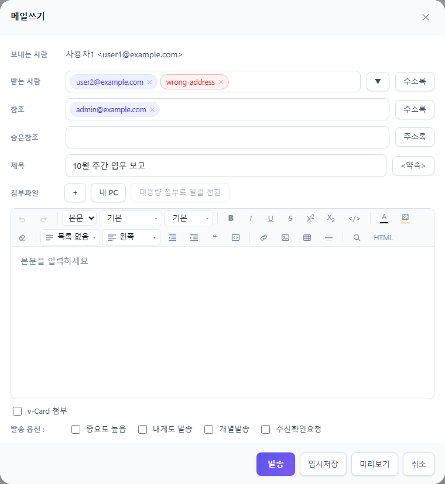

[[최근-발송-주소]]
=== 최근 발송 주소

**▼** 버튼을 누르면 최근에 보낸 주소 10개가 나옵니다. 고르면 받는 사람에 들어갑니다.

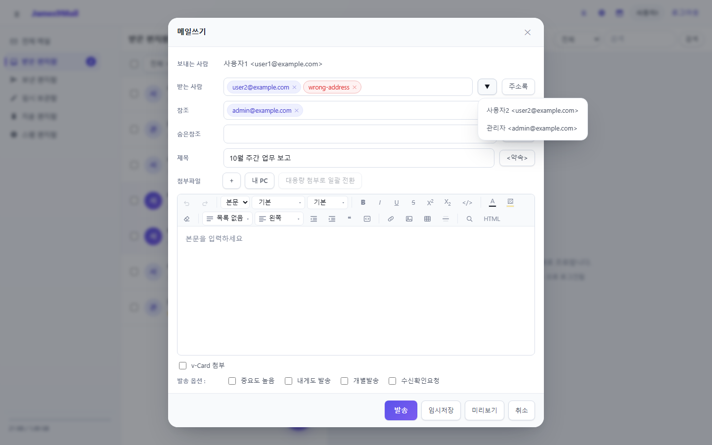

[[주소록에서-고르기]]
=== 주소록에서 고르기

**주소록** 버튼을 누르면 주소록 창이 뜹니다. 받을 사람을 체크하고 **확인**을 누르면 그 버튼이 있던 칸(받는 사람 · 참조 · 숨은참조)에 들어갑니다.

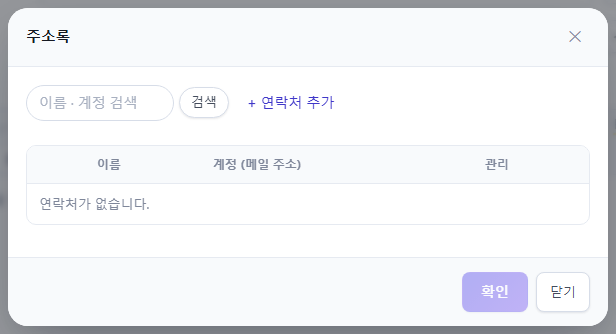

* 위쪽 검색칸으로 이름 · 주소를 찾습니다.
* **+ 연락처 추가**로 이 자리에서 바로 연락처를 등록할 수 있습니다.
* 그룹을 체크하면 멤버 전원이 들어갑니다.

[[_33-파일-첨부]]
== 3.3 파일 첨부

**내 PC**를 눌러 파일을 고르거나, 파일을 메일쓰기 창 위로 끌어다 놓습니다.

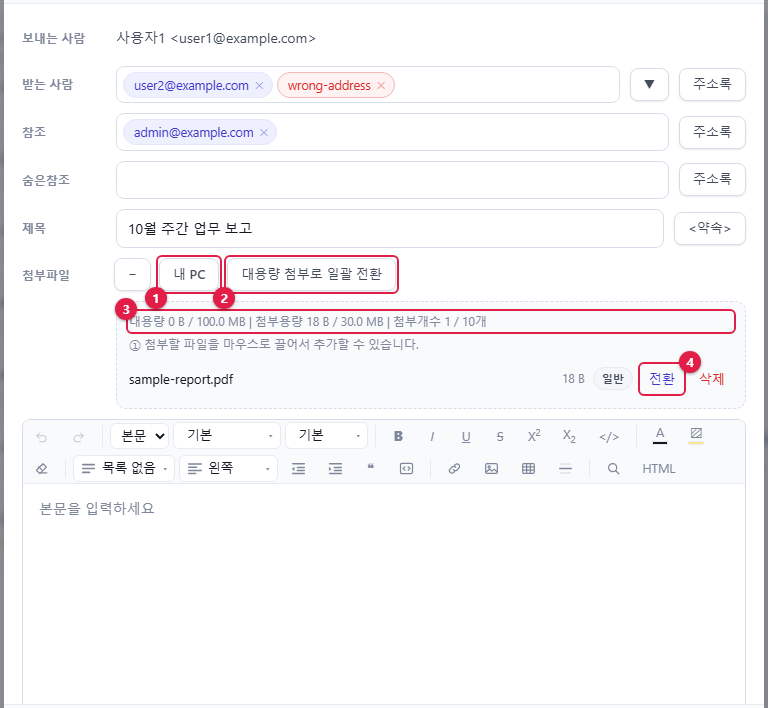

[cols="1,1,2",options="header"]
|===
|번호 |항목 |설명

|① |**내 PC** |파일을 고릅니다(여러 개 가능)
|② |**대용량 첨부로 일괄 전환** |일반 첨부를 모두 대용량 첨부로 바꿉니다
|③ |사용량 |대용량 · 일반 첨부 용량과 첨부 개수 한도
|④ |**전환** |이 파일만 대용량 첨부로 바꿉니다
|===

**일반 첨부와 대용량 첨부**

[cols="1,1,3",options="header"]
|===
|구분 |기본 한도 |받는 사람에게

|일반 |합계 30MB, 10개 |메일에 파일이 붙어 갑니다
|대용량 |한 번에 100MB |본문 끝에 내려받기 링크가 붙습니다. **30일**이 지나면 내려받을 수 없습니다
|===

* 일반 첨부 한도를 넘는 파일은 자동으로 대용량 첨부가 됩니다.
* 한도는 관리자가 바꿀 수 있습니다. 화면의 사용량 표시가 실제 한도입니다.
* 첨부 목록은 **+** / **−** 로 펼치고 접습니다.

[[_34-본문-편집기]]
== 3.4 본문 편집기

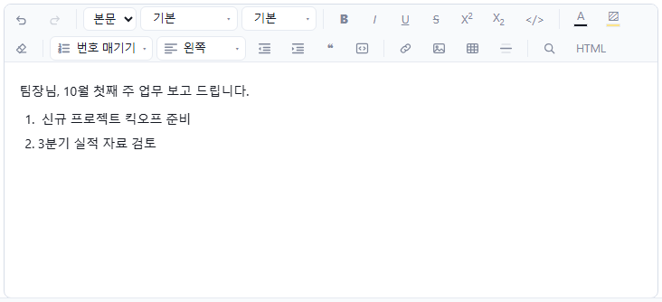

도구 막대에서 다음 서식을 쓸 수 있습니다.

[cols="1,5",options="header"]
|===
|분류 |도구

|편집 |실행 취소(Ctrl+Z), 다시 실행(Ctrl+Shift+Z), 찾기 · 바꾸기(Ctrl+F)
|문단 |본문 / 제목1~6 / 인용 / 코드, 목록(글머리 기호 · 번호 · 체크), 정렬, 들여쓰기 · 내어쓰기
|글자 |글꼴, 글자 크기, 굵게(Ctrl+B), 기울임(Ctrl+I), 밑줄(Ctrl+U), 취소선, 위 · 아래 첨자, 서식 지우기
|색 |글자 색, 형광펜 — 기본 색, 최근 사용한 색, **다른 색…**
|넣기 |링크(Ctrl+K), 이미지, 표, 가로줄
|고급 |**HTML** — HTML 소스를 직접 고칩니다
|===

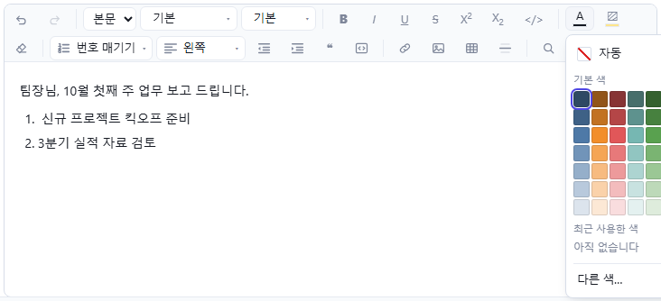

[NOTE]
====
* 그림은 붙여넣기 · 끌어 놓기 · 이미지 버튼으로 본문에 넣습니다. 1MB 가 넘는 사진은 자동으로 줄여 넣습니다. 본문 그림은 합계 6MB 까지입니다. 더 큰 그림은 파일로 첨부하세요.
* 서식 없이 붙여 넣으려면 Ctrl+Shift+V 를 누릅니다.
====

[[_35-서명과-발송-옵션]]
== 3.5 서명과 발송 옵션

[cols="1,3",options="header"]
|===
|항목 |설명

|**서명 첨부** |붙일 서명을 고릅니다. xref:05-settings.adoc#_52-서명관리[서명관리]에서 서명을 켜고 등록해야 보입니다
|**v-Card 첨부** |내 연락처 카드(.vcf)를 붙입니다
|**중요도 높음** |받는 사람 목록에 빨간 **!** 가 표시됩니다
|**내게도 발송** |나에게도 한 통 보냅니다
|**개별발송** |받는 사람마다 따로 보냅니다. 받는 사람끼리 서로의 주소를 볼 수 없습니다
|**수신확인요청** |받는 사람이 메일을 열면 읽었다고 알려 줄지 묻습니다
|===

[NOTE]
====
같은 회사(같은 메일 서버) 사람이 읽었는지는 **수신확인요청**을 체크하지 않아도 <<_39-보낸-메일-수신-확인과-회수,수신 확인>>에서 볼 수 있습니다. 수신확인요청은 외부 메일 주소에 보낼 때 쓸모가 있고, 상대가 거절하면 회신이 오지 않습니다.
====

[[_36-약속메일-보내기]]
== 3.6 약속메일 보내기

회의 초대처럼 받는 사람이 참석 여부를 답할 수 있는 메일입니다.

. 받는 사람과 제목(일정 제목이 됩니다)을 입력합니다.
. **<약속>** 을 누릅니다.
. **시작** · **종료** 일시, **장소**, **내용**을 입력하고 **확인**을 누릅니다.

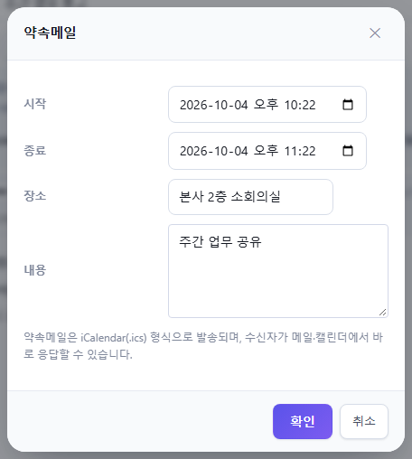

[start=4]
. 제목 아래에 약속 요약이 나옵니다. **수정** · **삭제**로 고칠 수 있습니다.

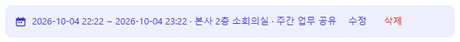

[start=5]
. **발송**합니다. 받는 사람 · 참조가 참석자가 되고, 응답은 <<_39-보낸-메일-수신-확인과-회수,수신 확인>>에서 봅니다.

[NOTE]
====
🔗 약속메일은 iCalendar(.ics) 형식으로 갑니다. 받는 사람이 썬더버드 · 아웃룩을 써도 메일에서 바로 응답할 수 있습니다.
====

[[_37-미리보기-임시저장-발송]]
== 3.7 미리보기, 임시저장, 발송

[cols="1,2",options="header"]
|===
|버튼 |동작

|**미리보기** |받는 사람에게 보일 모양(서명 포함)을 미리 봅니다
|**임시저장** |임시 보관함에 저장하고 창을 닫습니다. 나중에 **이어서 작성**으로 엽니다
|**발송** |메일을 보냅니다
|**취소** |창을 닫습니다
|===

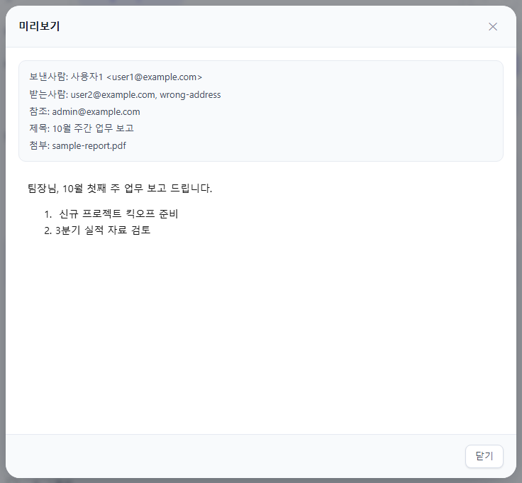

* 받는 사람이 없으면 "받는 사람을 입력하세요" 가 나옵니다.
* 일부 받는 사람에게 보내지 못하면 결과 창에 그 주소가 표시되고, 받은 편지함에 안내메일이 들어옵니다.
* 1분에 60통이 넘게 보내면 잠시 발송이 막힙니다.

[NOTE]
====
🔗 보낸 메일은 보낸 편지함에 저장되므로 썬더버드 · 아웃룩의 보낸 편지함에도 보입니다.
====

[[_38-자동-저장과-이어-쓰기]]
== 3.8 자동 저장과 이어 쓰기

메일을 쓰는 동안 5초마다 내용이 **이 브라우저에** 자동 저장됩니다. 창 아래에 저장 시각이 표시됩니다.

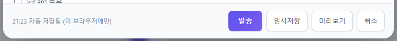

브라우저가 갑자기 닫히거나 실수로 창을 닫아도, 다음에 새 메일을 열면 위쪽에 안내가 나옵니다.

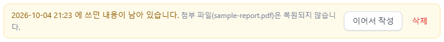

* **이어서 작성** — 쓰던 내용으로 다시 채웁니다.
* **삭제** — 남아 있던 내용을 버립니다.

[CAUTION]
====
* 자동 저장은 이 브라우저에만 남습니다. 다른 PC 에서 이어 쓰려면 **임시저장**을 쓰세요.
* **첨부파일은 자동 저장되지 않습니다.** 이어서 작성한 뒤 다시 첨부하세요.
* 발송하거나 임시저장하면 자동 저장본은 지워집니다.
====

[[답장할-때]]
=== 답장할 때

**답장**을 누르면 받는 사람과 `+Re:+` 제목, 원래 메일 인용이 채워진 창이 열립니다.

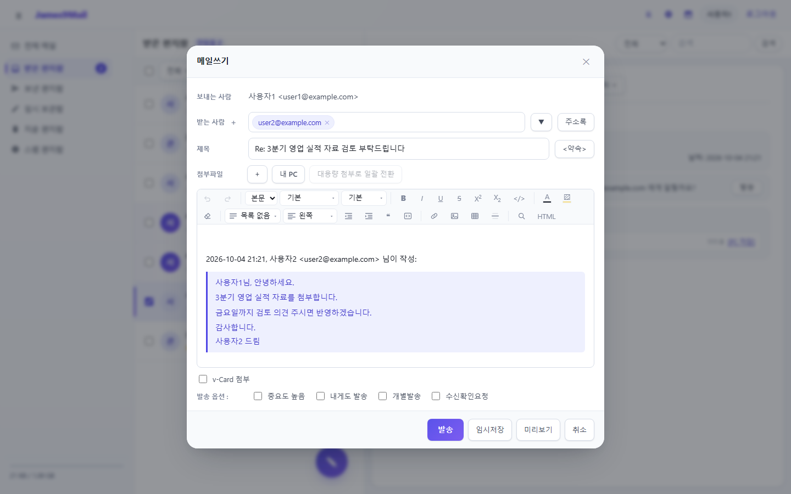

* 내 알리아스 주소로 받은 메일에 답장하면 보내는 사람이 그 알리아스로 자동 선택됩니다.

[[_39-보낸-메일-수신-확인과-회수]]
== 3.9 보낸 메일 수신 확인과 회수

내가 보낸 메일을 누가 언제 읽었는지 보고, 아직 읽지 않은 사람에게서 메일을 회수할 수 있습니다.

. **보낸 편지함**에서 메일을 엽니다.
. 보낸사람 줄 오른쪽의 ① **수신 확인**을 누릅니다.

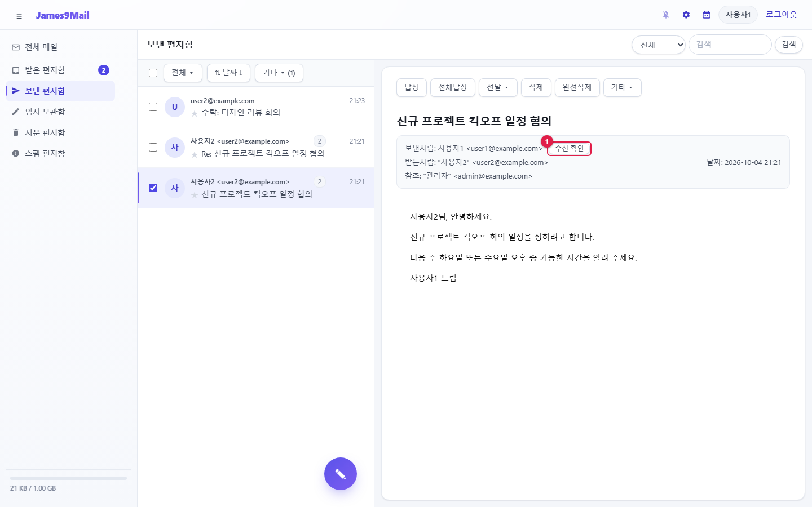

[start=3]
. 받는 사람별 읽은 날짜가 표시됩니다. 아직 읽지 않았으면 `+-+` 입니다.

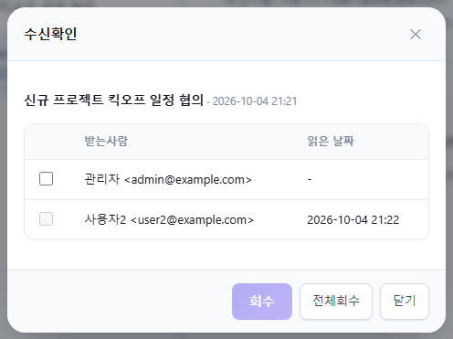

그림에서 사용자2는 읽었고 관리자는 아직 읽지 않았습니다. 그래서 관리자 줄만 체크할 수 있습니다.

**회수하기**

* 회수할 사람을 체크하고 **회수**를 누르면, 그 사람의 편지함에서 메일이 지워집니다.
* **전체회수**는 아직 읽지 않은 사람 전원에게서 회수합니다.

.회수할 수 없는 경우
[NOTE]
====
* 이미 읽은 메일은 회수할 수 없습니다(체크 상자가 비활성).
* 외부 도메인(다른 회사) 받는 사람은 읽었는지 알 수 없고 회수도 할 수 없습니다. "확인 불가 (외부)" 로 표시됩니다.
====

**약속메일의 응답 현황**

약속메일이면 **응답** 열이 더 나오고, 위쪽에 참석 · 미정 · 불참 · 미응답 인원이 요약됩니다.

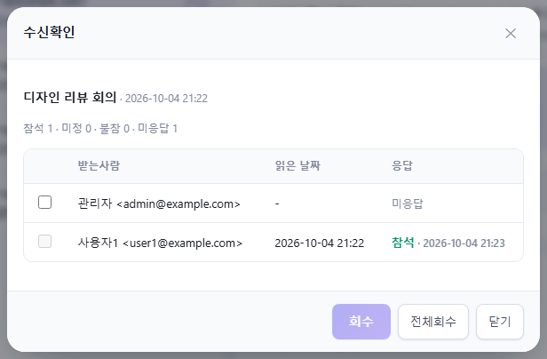

xref:02-mail-read.adoc[← 2장. 메일 읽기와 관리] · xref:README.adoc[목차] · xref:04-calendar.adoc[4장. 캘린더와 태스크 →]
