= 4장. 캘린더와 태스크
:note-caption: 참고
:caution-caption: 주의
:tip-caption: 알아 두기
:figure-caption!:
:table-caption!:

xref:03-mail-compose.adoc[← 3장. 메일 쓰기와 발송] · xref:README.adoc[목차] · xref:05-settings.adoc[5장. 개인환경설정 →]

상단 메뉴의 📅 **캘린더** 버튼을 누르면 캘린더가 열립니다. 메일로 돌아가려면 같은 자리의 ✉ **메일** 버튼을 누릅니다.

[[_41-화면-구성]]
== 4.1 화면 구성

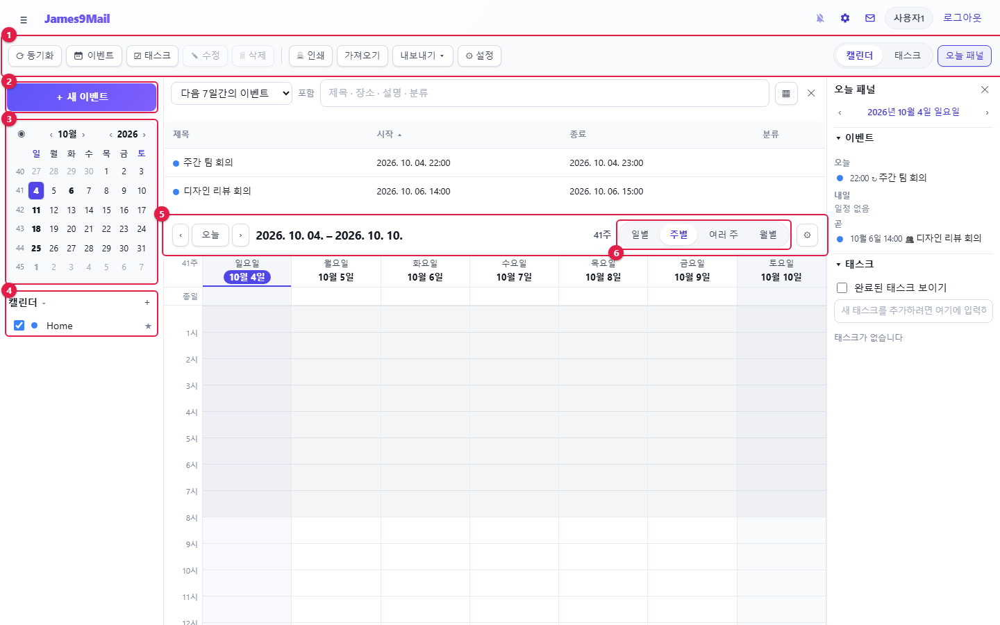

[cols="1,1,5",options="header"]
|===
|번호 |영역 |설명

|① |도구 막대 |**동기화** · **이벤트** · **태스크** · **수정** · **삭제** · **인쇄** · **가져오기** · **내보내기** · **설정**, 오른쪽에 **캘린더 / 태스크** 탭과 **오늘 패널**
|② |**+ 새 이벤트** |새 일정을 만듭니다(태스크 탭에서는 **+ 새 태스크**)
|③ |미니 달력 |날짜를 누르면 그날로 이동합니다. ‹ › 로 달 · 해를 넘깁니다
|④ |캘린더 목록 |체크를 끄면 그 캘린더의 일정이 숨겨집니다. ★ 는 기본 캘린더입니다
|⑤ |보기 막대 |‹ **오늘** › 로 기간 이동, 제목과 주 번호
|⑥ |보기 전환 |**일별** · **주별** · **여러 주** · **월별**
|===

위쪽 표는 **이벤트 목록**이고, 오른쪽은 **오늘 패널**입니다(<<_46-오늘-패널과-이벤트-목록,4.6>>).

**월별 보기**

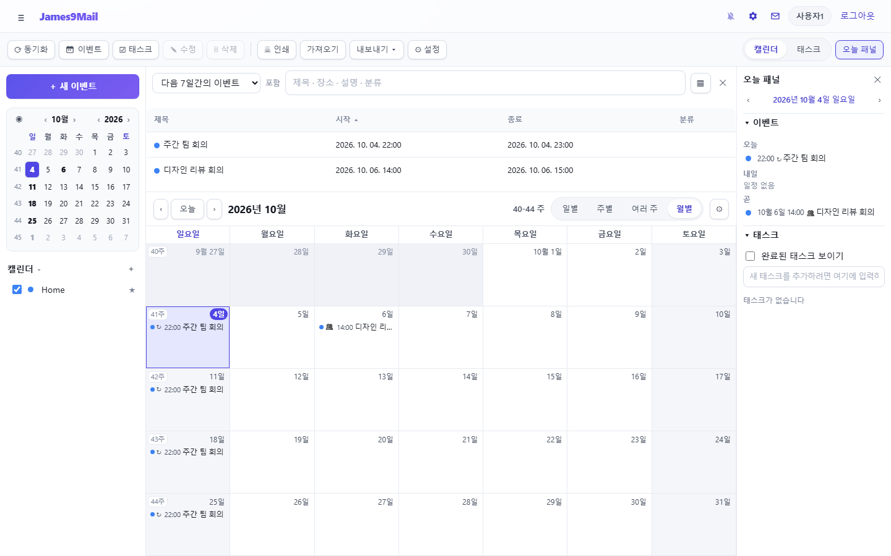

**일별 보기**

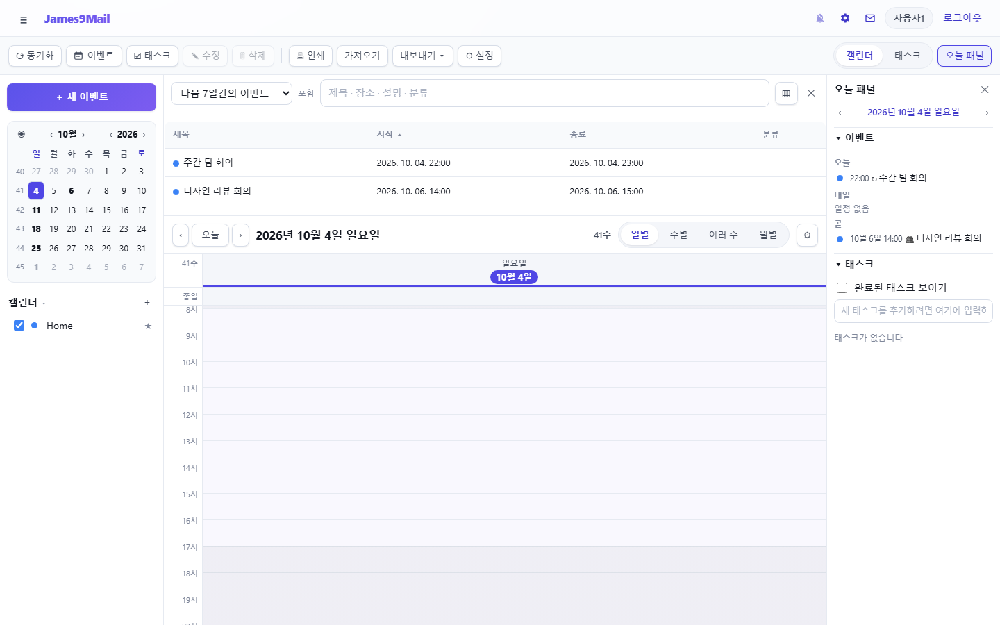

**보기 옵션** — 보기 막대 오른쪽 ⚙ 를 누르면 **근무일만 보기** · **보기에 태스크 표시** · **완료된 태스크 표시** · **이벤트 목록 표시**를 켜고 끌 수 있습니다.

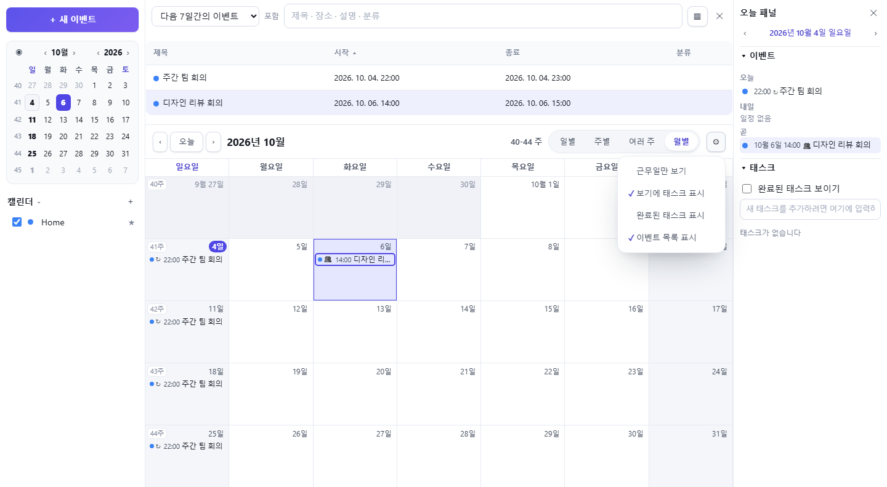

[[_42-일정이벤트-만들기]]
== 4.2 일정(이벤트) 만들기

**방법 1 — 버튼으로**

. **+ 새 이벤트**(또는 도구 막대 **이벤트**, Ctrl+I)를 누릅니다.
. 항목을 입력하고 **저장 후 닫기**를 누릅니다.

**방법 2 — 달력에서 바로**

* 일별 · 주별 보기에서 빈 시간을 **끌면** 그 시간으로 새 일정 창이 열립니다.
* 빈 칸을 **두 번 누르면** 그 시각(30분 단위)에 일정을 만듭니다. 맨 위 **종일** 칸을 두 번 누르면 종일 일정이 됩니다.
* 월별 · 여러 주 보기에서는 날짜 칸을 두 번 누릅니다.

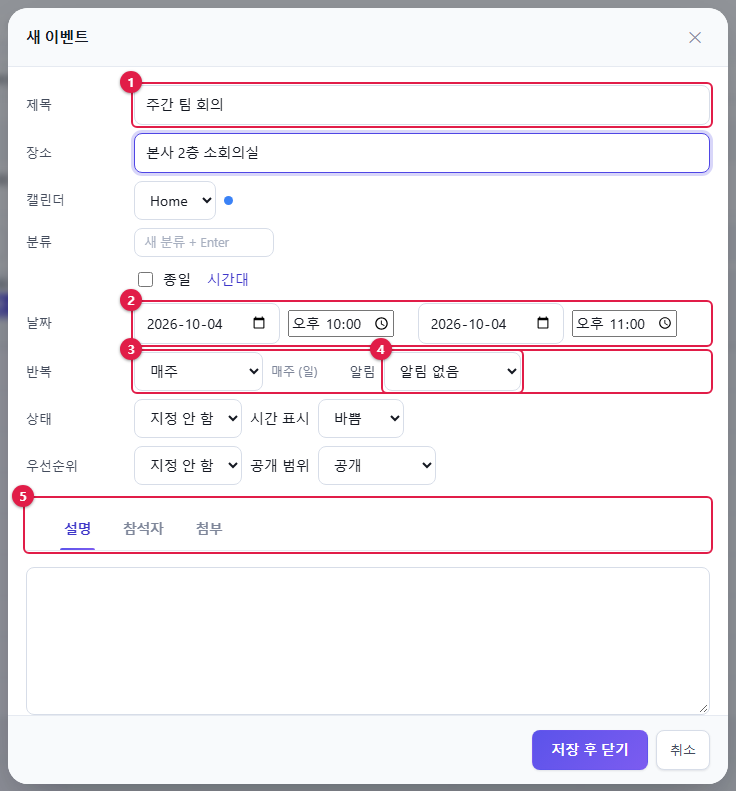

[cols="1,1,5",options="header"]
|===
|번호 |항목 |설명

|① |**제목** · **장소** |일정 이름과 장소. 그 아래 **캘린더**, **분류**(새 분류 이름 입력 후 Enter)
|② |**날짜** |시작 · 종료 날짜와 시각. **종일**을 체크하면 시각이 없어집니다. **시간대**로 다른 시간대를 고를 수 있습니다
|③ |**반복** |반복 안 함 · 매일 · 평일마다 · 매주 · 격주 · 매월 · 매년 · **사용자 정의…**
|④ |**알림** |시작 몇 분/시간/일 전에 알릴지. 여러 개 넣을 수 있습니다
|⑤ |아래 탭 |**설명**(메모 · 링크) · **참석자** · **첨부**(웹 주소)
|===

그 밖에 **상태**(미정 · 확정 · 취소됨), **시간 표시**(바쁨 · 한가함), **우선순위**, **공개 범위**(공개 · 시간만 공개 · 비공개)를 정할 수 있습니다.

[[반복-일정]]
=== 반복 일정

**반복**에서 **사용자 정의…**를 고르면 자세한 규칙을 정할 수 있습니다.

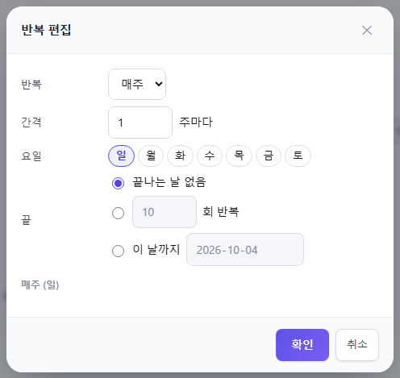

* 반복 단위(매일 · 매주 · 매월 · 매년)와 간격, 요일을 정합니다.
* 매월 · 매년은 "15일" 같은 날짜나 "셋째 화요일" 같은 요일로 정할 수 있습니다.
* **끝**: 끝나는 날 없음 / n회 반복 / 이 날까지

반복 일정을 고치거나 옮기거나 지우면 **이 일정만** · **이 일정과 이후 모든 일정** · **모든 반복 일정** 중 어디까지 적용할지 묻습니다.

[[참석자-초대]]
=== 참석자 초대

**참석자** 탭에서 이름이나 메일 주소를 입력하면 주소록에서 자동완성됩니다. **추가** 또는 **주소록**으로 넣습니다.

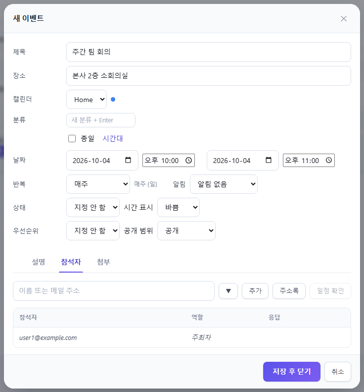

* 참석자마다 역할(필수 참석 · 선택 참석 · 참고용 · 의장)을 정합니다.
* 저장할 때 **참석자에게 초대 메일 보내기**가 체크되어 있으면 초대 메일이 나갑니다. 참석자가 응답하면 **응답** 칸이 바뀝니다.
* **일정 확인**을 누르면 같은 서버 사용자들의 바쁜 시간을 표로 보고, 비는 시간으로 옮길 수 있습니다.
* 참석자가 있는 일정을 옮기거나 지우면 참석자에게 변경 · 취소 메일을 보낼지 묻습니다.

[NOTE]
====
메일로 받은 초대에 **참석**하면 일정이 내 캘린더에 자동으로 들어갑니다(xref:02-mail-read.adoc#_27-약속메일에-응답하기[2장 2.7]).
====

[[_43-일정-고치기-옮기기-지우기]]
== 4.3 일정 고치기 · 옮기기 · 지우기

[cols="1,4",options="header"]
|===
|하고 싶은 일 |방법

|열어서 고치기 |일정을 두 번 누르기, 또는 선택 후 Enter / 도구 막대 **수정**
|다른 시각 · 날짜로 옮기기 |일정을 끌어 놓기
|복사하기 |월별 · 여러 주 보기에서 Ctrl(또는 Alt)을 누른 채 끌기, 또는 Ctrl+C → 날짜 선택 → Ctrl+V
|길이 바꾸기 |일별 · 주별 보기에서 일정의 위 · 아래 끝을 끌기
|지우기 |선택 후 Delete, 또는 도구 막대 **삭제**
|===

일정을 마우스 오른쪽 버튼으로 누르면 메뉴가 나옵니다.

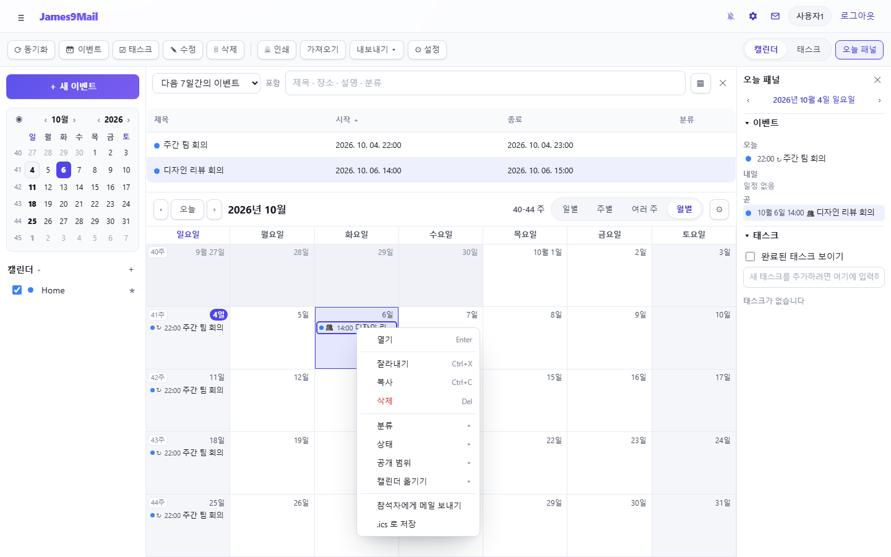

* **열기** · **잘라내기** · **복사** · **삭제**
* **분류** · **상태** · **공개 범위** · **캘린더 옮기기**
* **참석자에게 메일 보내기** — 참석자에게 보낼 메일쓰기 창이 열립니다
* **.ics 로 저장** — 일정을 파일로 내려받습니다

**단축키**: Ctrl+I 새 이벤트, Ctrl+D 새 태스크, Ctrl+PageUp/PageDown 이전/다음 기간, 화살표 날짜 이동, F11 오늘 패널

[NOTE]
====
읽기 전용 캘린더의 일정은 고칠 수 없습니다. 다른 사람이 주최한 일정을 고치면 내 캘린더에만 반영됩니다.
====

[[_44-태스크할-일]]
== 4.4 태스크(할 일)

오른쪽 위 **태스크** 탭을 누릅니다.

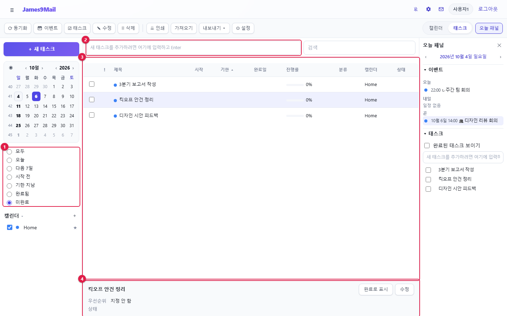

[cols="1,1,3",options="header"]
|===
|번호 |영역 |설명

|① |필터 |모두 · 오늘 · 다음 7일 · 시작 전 · 기한 지남 · 완료됨 · 미완료
|② |빠른 추가 |할 일을 입력하고 Enter 를 누르면 바로 만들어집니다
|③ |태스크 목록 |체크하면 완료됩니다. 머리글을 누르면 정렬합니다
|④ |상세 |고른 태스크의 내용. **완료로 표시** · **수정**
|===

* 시작일 · 기한 · 진행률(%) · 우선순위 · 알림을 넣으려면 **+ 새 태스크**나 **수정**으로 창을 엽니다.
* 기한이 지난 태스크는 목록에서 다른 색으로 표시됩니다.
* 보기 옵션에서 **보기에 태스크 표시**를 켜면 캘린더에도 태스크가 나옵니다.

[[_45-알림]]
== 4.5 알림

일정에 알림을 넣으면 정한 시각에 알림 창이 뜹니다.

* 알림 창에서 **다시 알림…**(5분 뒤 ~ 1주 뒤)으로 미루거나 **닫기**로 끕니다.
* 웹메일 창을 보고 있지 않을 때도 알림을 받으려면 상단 🔔 xref:01-getting-started.adoc#_15-새-메일-알림[새 메일 알림]을 켜 두세요. 바탕화면 알림으로 뜹니다.
* 알림 소리 · 알림 창 · 놓친 알림 표시는 <<_48-캘린더-설정,캘린더 설정>> › **알림**에서 정합니다.

[[_46-오늘-패널과-이벤트-목록]]
== 4.6 오늘 패널과 이벤트 목록

**오늘 패널** — 도구 막대의 **오늘 패널**(F11)을 누르면 오른쪽에 오늘 · 내일 · 곧 다가올 일정과 할 일이 나옵니다. 할 일은 여기서 바로 추가하고 체크할 수 있습니다.

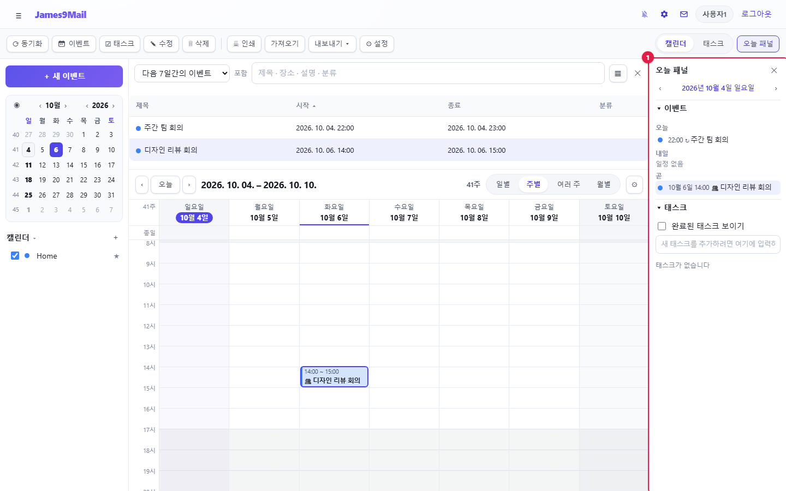

**이벤트 목록** — 달력 위쪽 표입니다. 기간(오늘 · 다음 7일 · 이번 달 …)을 고르고 **포함** 칸에 검색어를 넣으면 제목 · 장소 · 설명 · 분류에서 찾습니다. ▦ 로 보일 열을 고르고, ✕ 로 닫습니다. 다시 보려면 보기 옵션에서 **이벤트 목록 표시**를 켭니다.

[[_47-캘린더-관리]]
== 4.7 캘린더 관리

[[새-캘린더]]
=== 새 캘린더

캘린더 목록 오른쪽 **+** 를 누릅니다.

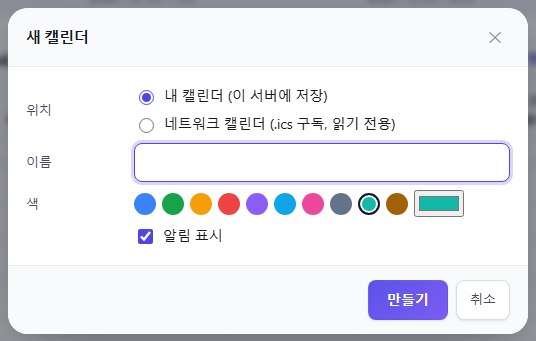

* **내 캘린더 (이 서버에 저장)** — 일정을 직접 넣는 캘린더입니다.
* **네트워크 캘린더 (.ics 구독, 읽기 전용)** — 공휴일 · 다른 서비스의 `+.ics+` 주소를 구독합니다. 새로 고침 간격을 정합니다.
* 이름과 색을 정하고 **만들기**를 누릅니다.

[[캘린더-메뉴]]
=== 캘린더 메뉴

캘린더 이름을 마우스 오른쪽 버튼으로 누르면 메뉴가 나옵니다.

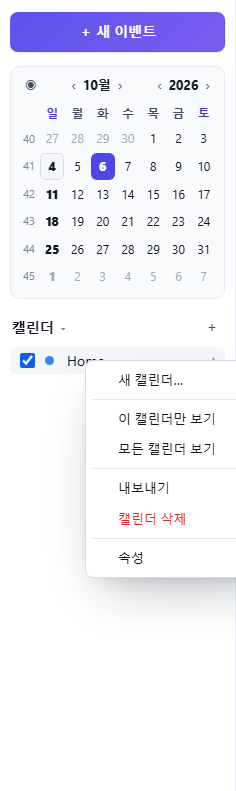

[cols="1,2",options="header"]
|===
|메뉴 |동작

|**이 캘린더만 보기** / **모든 캘린더 보기** |표시할 캘린더를 바꿉니다
|**지금 새로 고침** |네트워크 캘린더를 바로 다시 받습니다
|**내보내기** |캘린더를 `+.ics+` 파일로 내려받습니다
|**기본 캘린더로 지정** |새 일정과 수락한 초대가 들어갈 캘린더
|**캘린더 삭제** |캘린더와 그 안의 모든 일정을 지웁니다
|**속성** |이름 · 색 · 읽기 전용 · 알림 표시, **구독 주소로 게시**
|===

**구독 주소로 게시**를 켜면 로그인 없이 볼 수 있는 `+.ics+` 주소가 생깁니다. 이 주소를 아는 사람은 누구나 일정을 볼 수 있으니 주의하세요. 끄면 주소가 폐기됩니다.

[[가져오기-내보내기-인쇄]]
=== 가져오기 · 내보내기 · 인쇄

* **가져오기** — `+.ics+` 파일을 기본 캘린더로 가져옵니다.
* **내보내기 ▾** — 캘린더를 골라 `+.ics+` 로 내려받습니다. 🔗 썬더버드 · 아웃룩 · 구글 캘린더에서 가져올 수 있습니다.
* **인쇄** — 지금 보이는 달력을 인쇄합니다.
* **동기화** — 네트워크 캘린더를 모두 새로 받습니다.

[[_48-캘린더-설정]]
== 4.8 캘린더 설정

도구 막대 **설정**을 누릅니다.

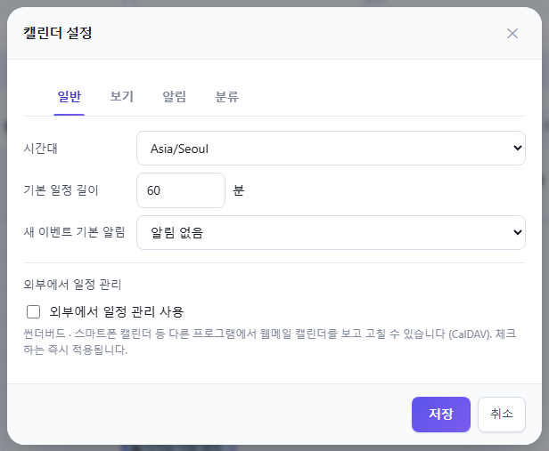

[cols="1,4",options="header"]
|===
|탭 |항목

|**일반** |시간대, 기본 일정 길이, 새 이벤트 기본 알림, **외부에서 일정 관리**(CalDAV)
|**보기** |주 시작 요일, 휴무일, 근무 시간, 한 화면에 보이는 시간 수, 여러 주 보기 주 수, 주 번호 표시
|**알림** |알림 소리, 알림 창 표시, 놓친 알림 표시(최근 7일)
|**분류** |분류 이름과 색 관리
|===

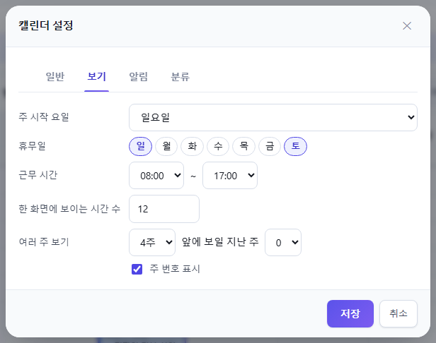

[[외부-프로그램과-일정-연결-caldav]]
== 외부 프로그램과 일정 연결 (CalDAV)

🔗 썬더버드 · 스마트폰 캘린더 등에서 웹메일 캘린더를 함께 쓸 수 있습니다. 한쪽에서 고친 일정은 다른 쪽에도 반영됩니다.

. 도구 막대 **설정** › **일반** 탭에서 ① **외부에서 일정 관리 사용**을 체크합니다. 체크하는 즉시 적용됩니다.

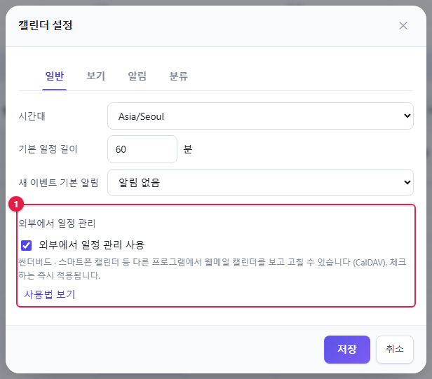

[start=2]
. 연결 방법 안내 창이 뜹니다. 나중에 다시 보려면 **사용법 보기**를 누릅니다.

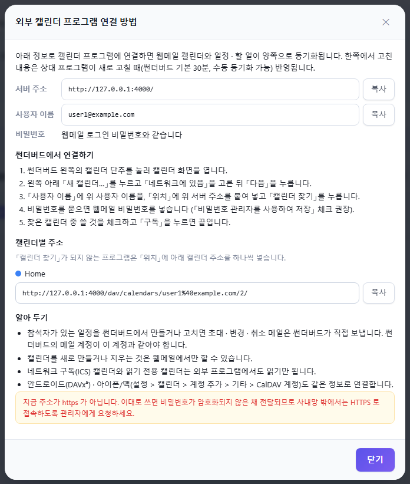

[start=3]
. 안내 창의 **서버 주소**와 **사용자 이름**을 **복사**해 캘린더 프로그램에 넣습니다. 비밀번호는 웹메일 비밀번호와 같습니다.

**썬더버드에서 연결하기**

. 썬더버드 왼쪽의 캘린더 단추를 눌러 캘린더 화면을 엽니다.
. 왼쪽 아래 **새 캘린더…** 를 누르고 **네트워크에 있음**을 고른 뒤 **다음**을 누릅니다.
. **사용자 이름**에 사용자 이름을, **위치**에 서버 주소를 붙여 넣고 **캘린더 찾기**를 누릅니다.
. 비밀번호를 물으면 웹메일 비밀번호를 넣습니다.
. 찾은 캘린더 중 쓸 것을 체크하고 **구독**을 누릅니다.

[TIP]
====
* **캘린더 찾기**가 되지 않는 프로그램은 안내 창의 **캘린더별 주소**를 하나씩 넣습니다.
* 안드로이드는 DAVx⁵, 아이폰 · 맥은 설정 › 캘린더 › 계정 추가 › 기타 › CalDAV 계정으로 같은 정보를 넣어 연결합니다.
* 썬더버드는 기본 30분마다 새로 받아 옵니다. 바로 받으려면 썬더버드에서 동기화하세요.
* 썬더버드에서 참석자가 있는 일정을 만들면 초대 메일은 썬더버드가 보냅니다.
* 캘린더를 만들거나 지우는 것은 웹메일에서만 할 수 있습니다. 네트워크 캘린더와 읽기 전용 캘린더는 외부에서도 읽기만 됩니다.
* 안내 창에 "https 가 아닙니다" 경고가 나오면 비밀번호가 암호화되지 않고 전달됩니다. 관리자에게 HTTPS 접속을 요청하세요.
* 끄면(체크 해제) 외부 프로그램에서 더 이상 접속할 수 없습니다.
====

xref:03-mail-compose.adoc[← 3장. 메일 쓰기와 발송] · xref:README.adoc[목차] · xref:05-settings.adoc[5장. 개인환경설정 →]
