= 5장. 개인환경설정
:note-caption: 참고
:caution-caption: 주의
:tip-caption: 알아 두기
:figure-caption!:
:table-caption!:

xref:04-calendar.adoc[← 4장. 캘린더와 태스크] · xref:README.adoc[목차] · xref:06-faq.adoc[6장. 자주 묻는 질문 →]

상단 메뉴의 ① ⚙ **개인환경설정** 버튼을 누릅니다.

위쪽 탭에서 설정할 항목을 고릅니다.

[cols="2,2",options="header"]
|===
|탭 |설명

|<<_51-개인-정보-관리,개인 정보 관리>> |이름, 사진, 비밀번호, 이 PC 의 메일 캐시
|<<_52-서명관리,서명관리>> |메일 끝에 붙일 서명
|<<_53-주소록,주소록>> |연락처 · 그룹, 가져오기 · 내보내기, 외부 프로그램 연결(CardDAV)
|<<_54-편지함-관리,편지함 관리>> |개인 편지함 만들기 · 이름 바꾸기 · 지우기
|<<_55-자동분류,자동분류>> |조건에 맞는 메일을 원하는 편지함에 자동 저장
|<<_56-부재중-응답,부재중 응답>> |휴가 중 자동 회신
|<<_57-수신거부,수신거부>> |원하지 않는 발신자 차단
|<<_58-포워딩,포워딩>> |받은 메일을 다른 주소로 자동 전달
|<<_59-외부메일,외부메일>> |다른 메일 서비스의 메일 가져오기
|<<_510-메일-업로드,메일 업로드>> |보관해 둔 EML 파일 올리기
|===

[NOTE]
====
🔗 자동분류 · 부재중 응답 · 수신거부 · 포워딩은 **메일 서버에서** 동작합니다. 웹메일을 열어 두지 않아도, 썬더버드 · 아웃룩으로만 메일을 받아도 똑같이 적용됩니다.
====

[[_51-개인-정보-관리]]
== 5.1 개인 정보 관리

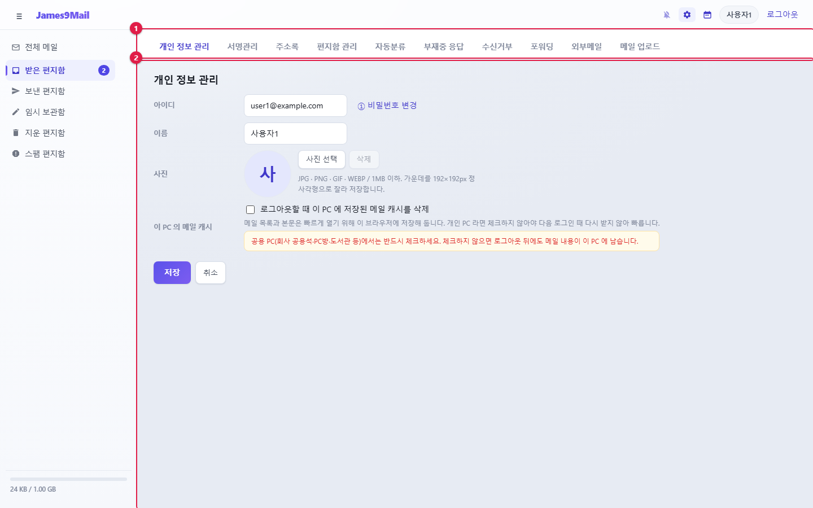

[cols="1,5",options="header"]
|===
|항목 |설명

|**아이디** |바꿀 수 없습니다. 옆의 **① 비밀번호 변경**으로 비밀번호를 바꿉니다
|**이름** |보낸 메일의 발신자 이름, 자동완성, 서명에 쓰입니다(30자까지)
|**사진** |**사진 선택**으로 등록합니다. JPG · PNG · GIF · WEBP, 1MB 이하. 가운데를 정사각형으로 잘라 저장합니다
|**이 PC 의 메일 캐시** |**로그아웃할 때 이 PC 에 저장된 메일 캐시를 삭제** — 체크하는 즉시 이 PC 에만 적용됩니다
|===

이름 · 사진을 바꾼 뒤 **저장**을 누릅니다.

[NOTE]
====
**공용 PC(회사 공용석 · PC방 · 도서관 등)에서는 반드시 메일 캐시 삭제를 체크하세요.** 체크하지 않으면 로그아웃한 뒤에도 메일 내용이 그 PC 에 남습니다.
====

[[비밀번호-변경]]
=== 비밀번호 변경

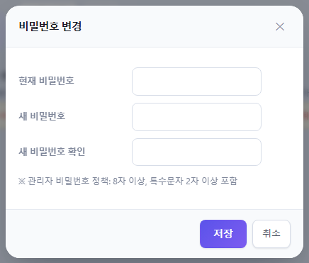

. **현재 비밀번호**, **새 비밀번호**, **새 비밀번호 확인**을 입력합니다.
. **저장**을 누릅니다.

//

* 새 비밀번호는 창에 적힌 정책(기본: **8자 이상, 특수문자 2자 이상**)을 따라야 합니다.
* 비밀번호를 바꾸면 다른 PC · 브라우저의 로그인은 모두 끊어집니다.
* 🔗 썬더버드 · 아웃룩 · 스마트폰에 저장된 비밀번호도 새 비밀번호로 바꿔야 합니다.

[[_52-서명관리]]
== 5.2 서명관리

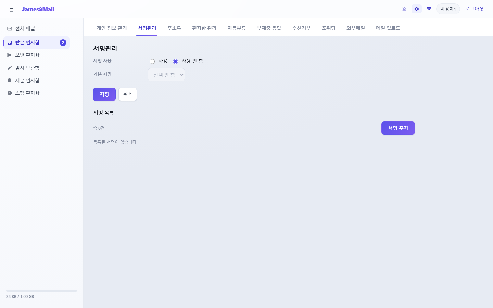

. **서명 사용**을 **사용**으로 고릅니다.
. **서명 추가**를 누르고 서명 이름과 내용을 입력한 뒤 **저장**합니다.

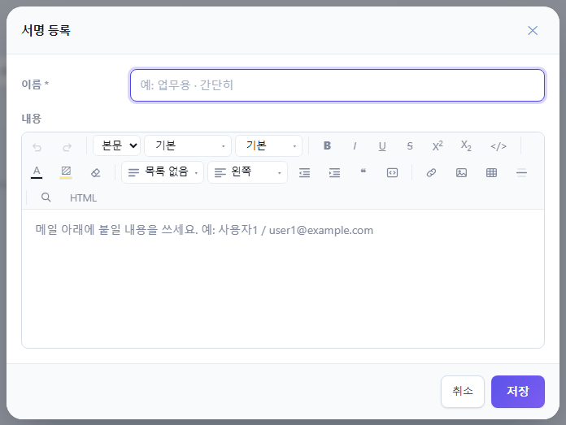

[start=3]
. **기본 서명**에서 메일쓰기 때 자동으로 고를 서명을 정하고 **저장**합니다.

//

* 서명은 여러 개 만들 수 있고, 메일쓰기 창의 **서명 첨부**에서 골라 씁니다.
* 내용에는 메일쓰기와 같은 편집기를 씁니다. 그림 · 표 · 링크도 넣을 수 있습니다.
* 목록에서 서명을 누르면 수정, **삭제**로 지웁니다.

[[_53-주소록]]
== 5.3 주소록

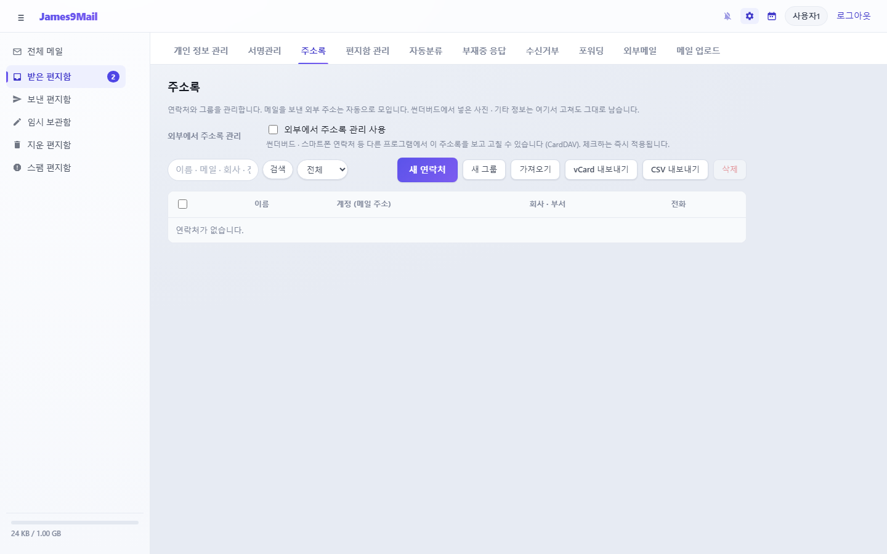

* 메일을 보낸 외부 주소는 주소록에 자동으로 모입니다.
* 검색칸에서 이름 · 메일 · 회사 · 전화로 찾고, **전체 / 연락처 / 그룹**으로 걸러 봅니다.
* 연락처를 누르면 편집 창이 열립니다. 여러 개를 체크하고 **삭제**로 한꺼번에 지울 수 있습니다.

[[새-연락처]]
=== 새 연락처

**새 연락처**를 누릅니다.

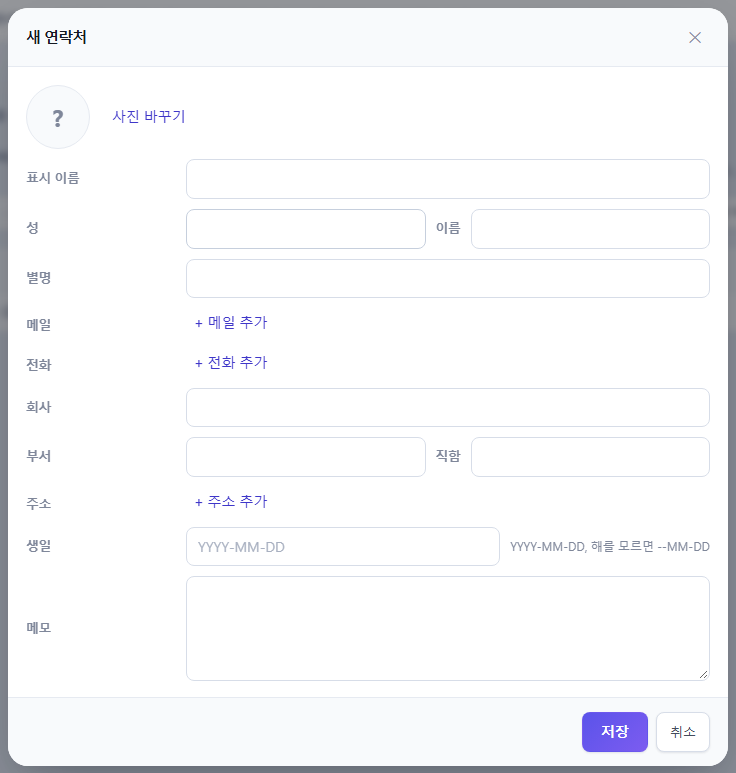

* 표시 이름 · 성 · 이름 · 별명, 메일(여러 개), 전화(휴대폰 · 직장 · 집 · 팩스 …), 회사 · 부서 · 직함, 주소, 생일, 메모를 넣을 수 있습니다.
* 메일이 여러 개면 첫 번째가 **대표** 주소입니다.
* 이름 · 메일 · 전화 중 하나는 꼭 넣어야 합니다.

[[그룹]]
=== 그룹

**새 그룹**을 누르고 그룹 이름을 정한 뒤, **멤버 추가**에서 주소록을 검색하거나 메일 주소를 입력해 멤버를 넣습니다.

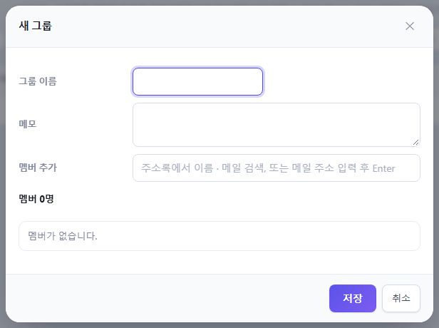

메일쓰기에서 그룹을 고르면 멤버 전원이 받는 사람으로 들어갑니다. 그룹을 지워도 멤버 연락처는 남습니다.

[[가져오기-내보내기]]
=== 가져오기 · 내보내기

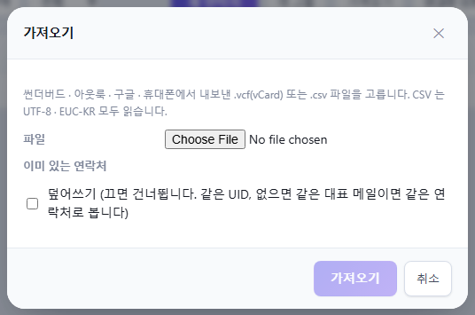

* **가져오기** — 🔗 썬더버드 · 아웃룩 · 구글 · 휴대폰에서 내보낸 `+.vcf+`(vCard) 또는 `+.csv+` 파일을 올립니다. CSV 는 UTF-8 · EUC-KR 모두 읽습니다(10MB 이하).
** **덮어쓰기**를 체크하면 이미 있는 연락처를 새 내용으로 바꾸고, 끄면 건너뜁니다.
* **vCard 내보내기** / **CSV 내보내기** — 주소록 전체를 파일로 내려받습니다.

[[외부-프로그램과-주소록-연결-carddav]]
=== 외부 프로그램과 주소록 연결 (CardDAV)

🔗 썬더버드 · 스마트폰 연락처 등에서 이 주소록을 보고 고칠 수 있습니다.

. **외부에서 주소록 관리 사용**을 체크합니다. 체크하는 즉시 적용되고 연결 방법 안내 창이 뜹니다.
. 안내 창의 **서버 주소**(또는 **주소록 주소**)와 **사용자 이름**을 **복사**해 연락처 프로그램에 넣습니다. 비밀번호는 웹메일 비밀번호와 같습니다.

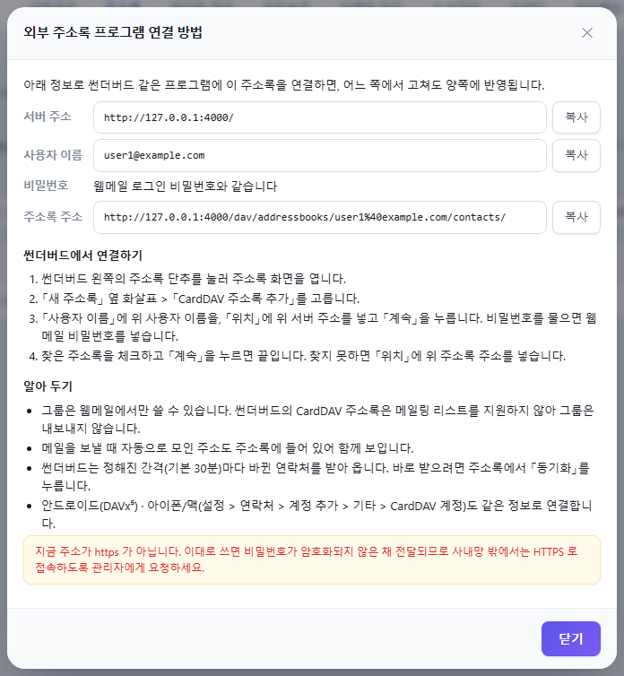

[TIP]
====
* 그룹은 외부 프로그램으로 내보내지 않습니다.
* 메일을 보낼 때 자동으로 모인 주소도 함께 보입니다.
* 썬더버드는 기본 30분마다 받아 옵니다.
* 안드로이드는 DAVx⁵, 아이폰 · 맥은 기본 설정의 계정 추가에서 연결합니다.
* 다시 보려면 **사용법 보기**를 누릅니다.
====

[[_54-편지함-관리]]
== 5.4 편지함 관리

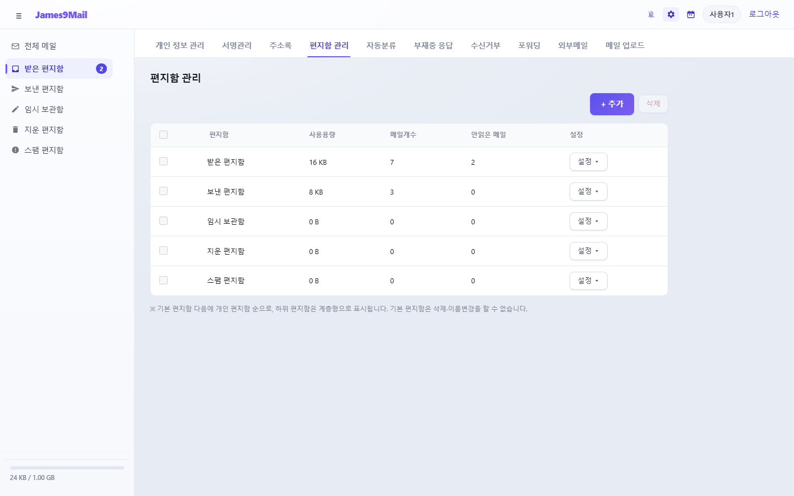

편지함마다 사용 용량 · 메일 개수 · 안 읽은 메일 수가 표시됩니다.

**편지함 만들기** — **+ 추가**를 누르고 이름과 **상위 편지함**(최상위 또는 다른 편지함 아래)을 고른 뒤 **저장**합니다.

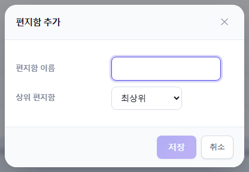

**설정 ▾** 메뉴

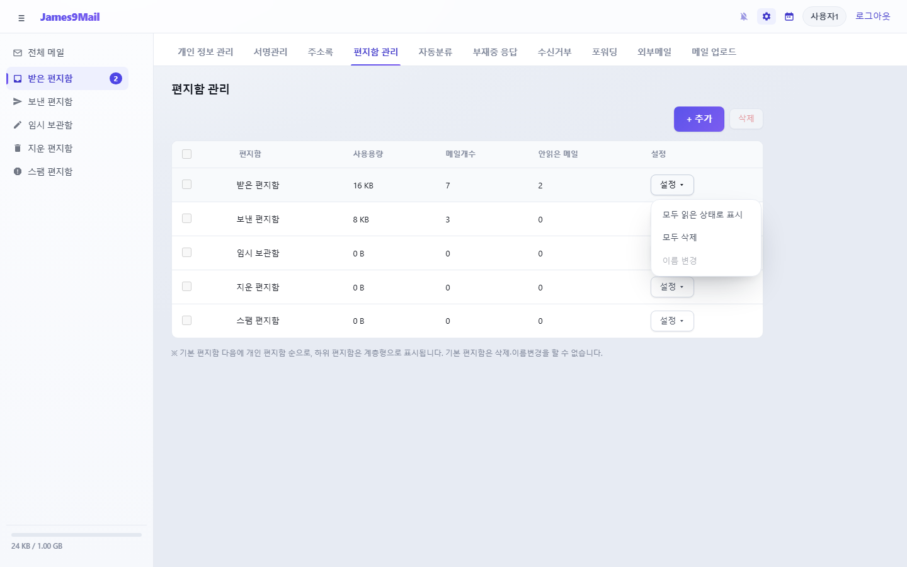

[cols="1,2",options="header"]
|===
|메뉴 |동작

|**모두 읽은 상태로 표시** |편지함의 메일을 모두 읽음으로 바꿉니다
|**모두 삭제** |편지함의 메일을 모두 지웁니다
|**이름 변경** |개인 편지함 이름을 바꿉니다
|===

**편지함 지우기** — 개인 편지함을 체크하고 **삭제**를 누릅니다.

[NOTE]
====
기본 편지함(받은 · 보낸 · 임시 보관 · 지운 · 스팸)은 지우거나 이름을 바꿀 수 없습니다.
====

[[_55-자동분류]]
== 5.5 자동분류

받은 메일 중 조건에 맞는 메일을 원하는 편지함에 자동으로 저장합니다.

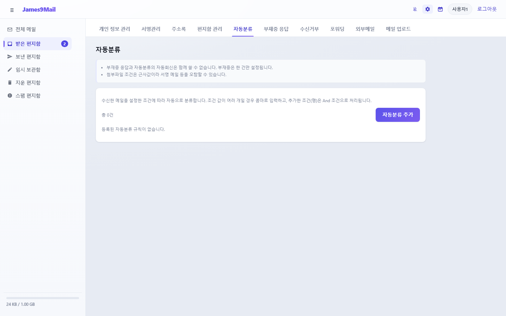

. **자동분류 추가**를 누릅니다.

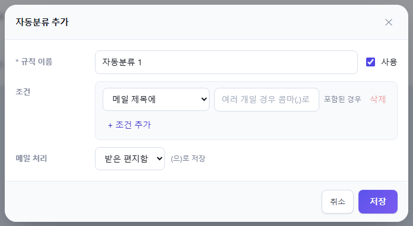

[start=2]
. **규칙 이름**을 입력합니다.
. **조건**을 정합니다.
** 항목: 메일 제목에 / 메일 제목이 / 수신 주소가 / 수신 도메인이 / 발송자 이름에 / 발송 주소가 / 발송 도메인이 / 첨부파일이 있는 메일
** 값이 여러 개면 콤마(,)로 구분합니다. 그중 하나만 맞아도 됩니다.
** **+ 조건 추가**로 조건을 더 넣으면 **모든 조건**이 맞아야 합니다(최대 5개).
. **메일 처리**에서 저장할 편지함을 고릅니다.
. **저장**을 누릅니다.

//

* 목록의 **사용** 체크로 규칙을 잠시 끄고 켤 수 있습니다(바로 적용).
* 규칙은 위에서부터 차례로 확인하고, 처음 맞는 규칙 하나만 적용됩니다.
* **첨부파일이 있는 메일** 조건은 근사값이라 서명 그림만 있는 메일도 걸릴 수 있습니다.

[[_56-부재중-응답]]
== 5.6 부재중 응답

휴가 · 출장 중 받은 메일에 자동으로 답장을 보냅니다.

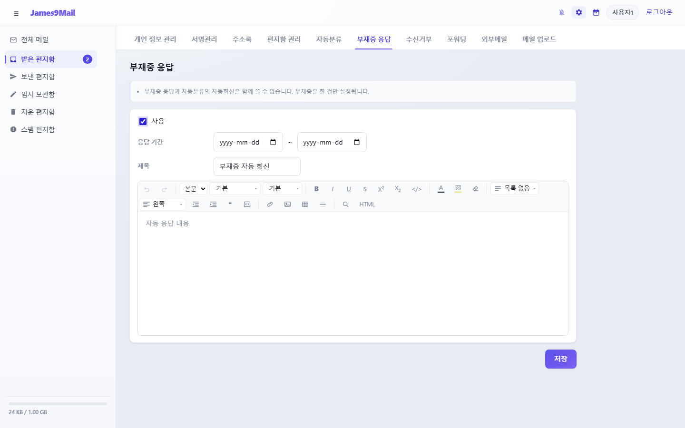

. **사용**을 체크합니다.
. **응답 기간**을 정합니다. 비워 두면 끌 때까지 계속 응답합니다.
. **제목**과 응답 내용을 입력합니다.
. **저장**을 누릅니다.

//

* 같은 사람에게는 3일에 한 번만 자동 응답합니다.
* 부재중 응답은 한 건만 설정할 수 있습니다.

[[_57-수신거부]]
== 5.7 수신거부

지정한 주소나 도메인에서 오는 메일을 차단합니다.

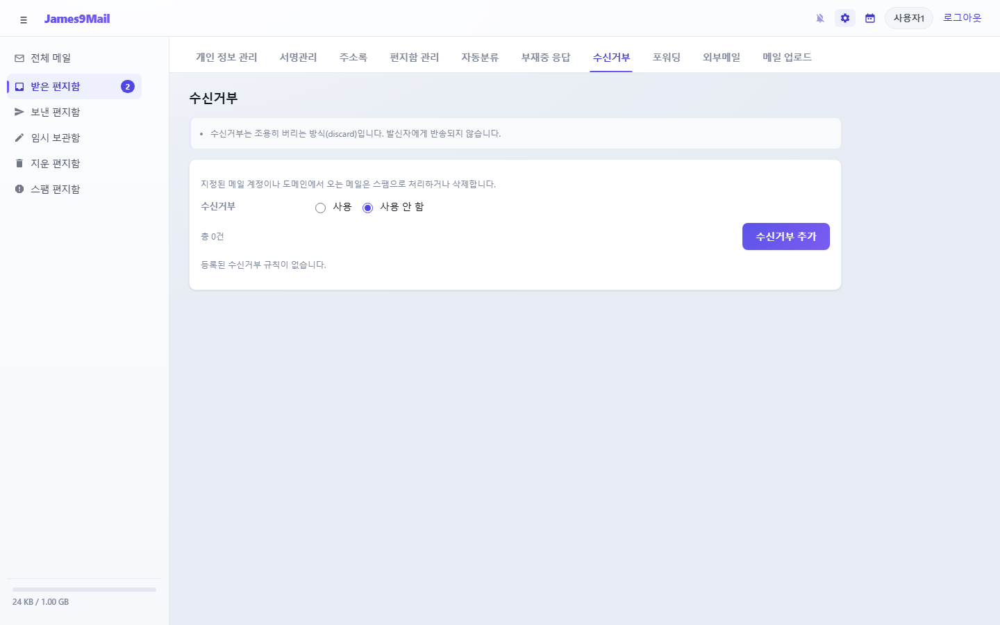

. 위쪽 **수신거부**를 **사용**으로 고릅니다(바로 적용).
. **수신거부 추가**를 누르고 조건(예: **발송 주소가** `+spam@example.org+`, **발송 도메인이** `+example.org+`)을 넣습니다.
. **메일 처리**를 고릅니다: **완전 삭제** · **삭제함에 저장** · **스팸함에 저장**
. **저장**을 누릅니다.

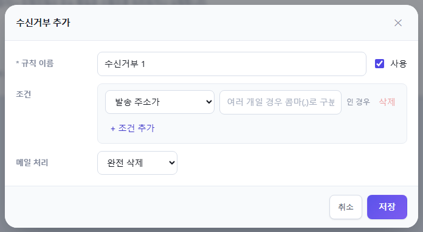

* 차단된 메일은 보낸 사람에게 반송되지 않습니다.
* 수신거부를 사용하면 메일 목록과 읽기 화면에 **스팸차단** 버튼이 나옵니다. 스팸차단한 발신자는 여기에 자동으로 추가됩니다.

[[_58-포워딩]]
== 5.8 포워딩

받은 메일을 다른 메일 주소로 자동 전달합니다.

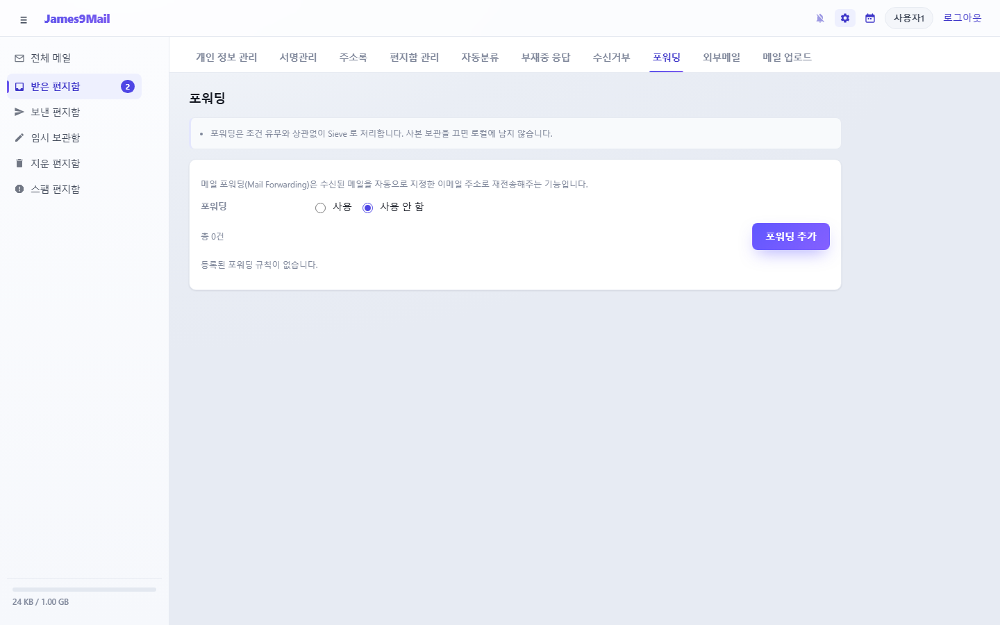

. 위쪽 **포워딩**을 **사용**으로 고릅니다(바로 적용).
. **포워딩 추가**를 누릅니다.

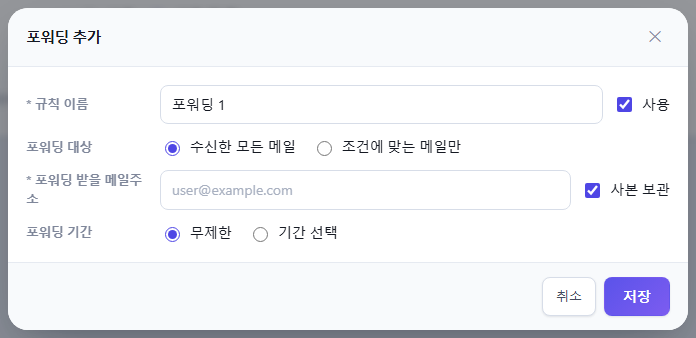

[start=3]
. **포워딩 대상**: **수신한 모든 메일** 또는 **조건에 맞는 메일만**(조건 입력)
. **포워딩 받을 메일주소**를 입력합니다.
** **사본 보관**을 체크하면 내 받은 편지함에도 남습니다. 끄면 전달만 하고 남기지 않습니다.
. **포워딩 기간**: **무제한** 또는 **기간 선택**
. **저장**을 누릅니다.

[[_59-외부메일]]
== 5.9 외부메일

다른 메일 서비스(IMAP 또는 POP3)의 받은 편지함에서 메일을 가져와 내 편지함에 저장합니다.

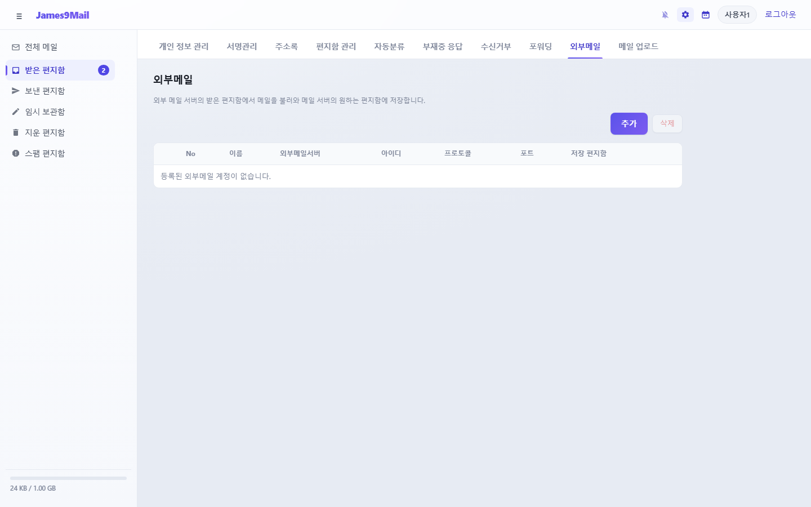

. **추가**를 누릅니다.

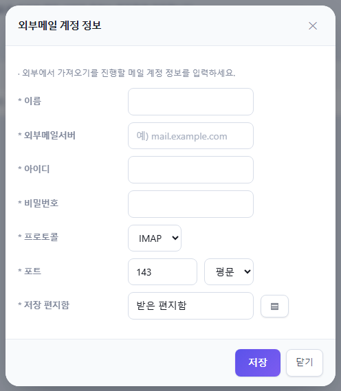

[start=2]
. 이름, 외부메일서버(예: `+mail.example.com+`), 아이디, 비밀번호, 프로토콜(IMAP · POP3), 포트와 보안(평문 · SSL), 저장할 편지함을 입력하고 **저장**합니다.
** 기본 포트: IMAP 143 / 993(SSL), POP3 110 / 995(SSL)
. 목록의 **실행**을 누르면 메일을 가져옵니다. 끝나면 가져온 개수가 표시됩니다.
. **이력**에서 지난 실행 결과를 봅니다.

[TIP]
====
* **자동으로 주기적으로 가져오지 않습니다.** 가져올 때마다 **실행**을 누르세요.
* 한 번에 최근 메일 최대 200통을 가져옵니다. 외부 서버의 메일은 지우지 않습니다.
* 같은 계정을 다시 실행하면 이미 가져온 메일이 또 들어올 수 있습니다.
* 외부 서비스가 앱 비밀번호를 요구하면(예: 2단계 인증 사용) 그 서비스에서 앱 비밀번호를 만들어 넣으세요.
====

[[_510-메일-업로드]]
== 5.10 메일 업로드

PC 나 휴대폰에 보관해 둔 메일(EML 파일)을 원하는 편지함에 올립니다.

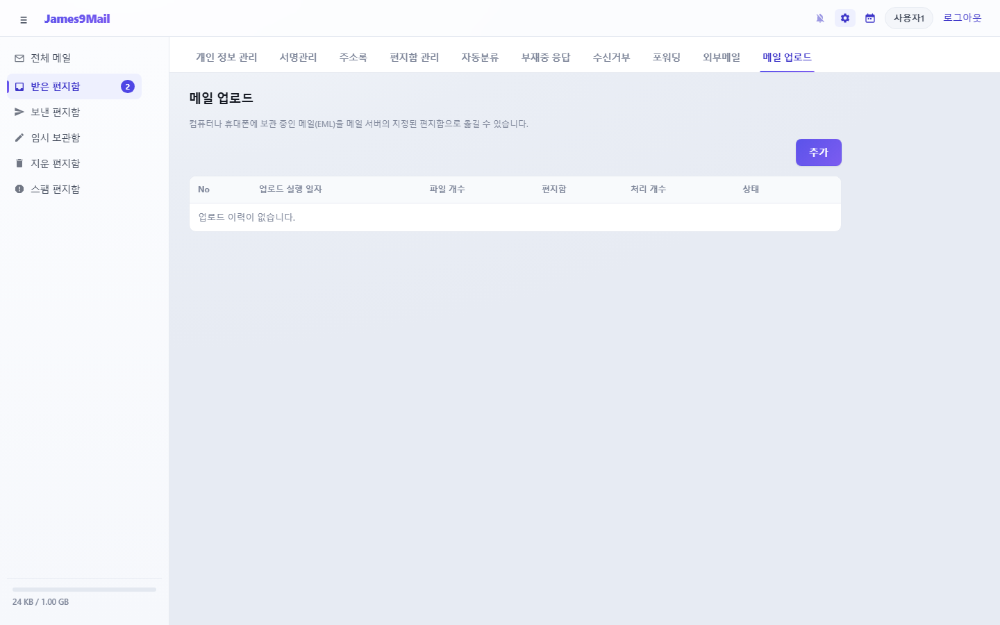

. **추가**를 누릅니다.

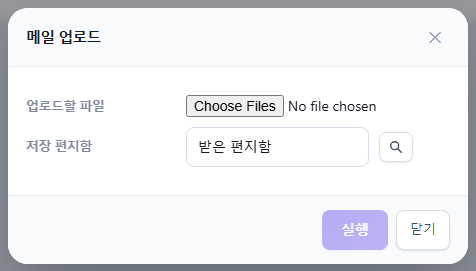

[start=2]
. **업로드할 파일**에서 `+.eml+` 파일을 고릅니다(여러 개 가능).
. **저장 편지함** 옆 버튼으로 편지함을 고릅니다.
. **실행**을 누릅니다. 처리 결과가 이력에 남습니다.

//

* 한 번에 100개, 파일 하나당 50MB 까지 올릴 수 있습니다.
* **EML 형식만** 지원합니다. 🔗 썬더버드에서 메일을 '다른 이름으로 저장'하면 EML 파일이 됩니다. 아웃룩 기본 형식(.msg · .pst)과 mbox 파일은 올릴 수 없습니다.
* 이력을 지워도 올린 메일은 남습니다.

xref:04-calendar.adoc[← 4장. 캘린더와 태스크] · xref:README.adoc[목차] · xref:06-faq.adoc[6장. 자주 묻는 질문 →]
