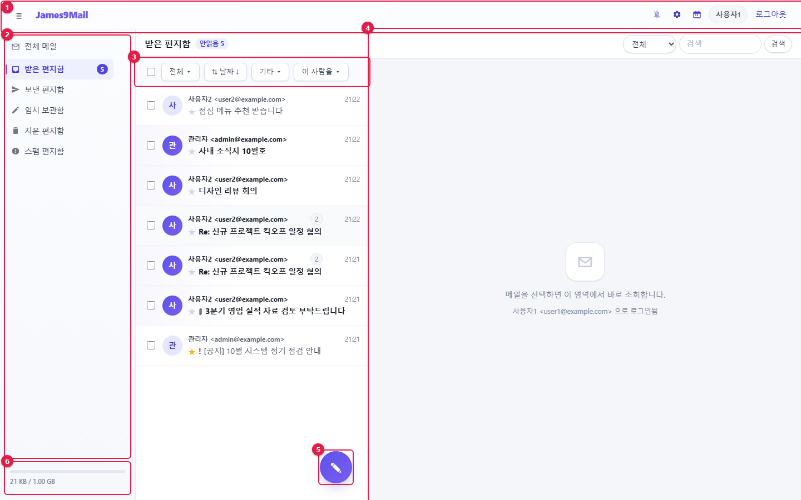

= James9Mail 웹메일 사용자 매뉴얼
:note-caption: 참고
:caution-caption: 주의
:tip-caption: 알아 두기
:figure-caption!:
:table-caption!:

James9Mail 웹메일의 메일 · 캘린더 · 개인환경설정 사용법을 설명합니다.
관리자 메뉴는 xref:admin.adoc[관리자 매뉴얼]에 따로 정리했습니다.

[[목차]]
== 목차

[[사용자-편]]
=== 사용자 편

[cols="3,4",options="header"]
|===
|장 |내용

|xref:01-getting-started.adoc[1장. 시작하기] |로그인, 화면 구성, 상단 메뉴, 새 메일 알림, 오프라인
|xref:02-mail-read.adoc[2장. 메일 읽기와 관리] |편지함, 메일 목록, 검색, 대화 묶기, 메일 읽기, 약속메일 응답
|xref:03-mail-compose.adoc[3장. 메일 쓰기와 발송] |받는 사람 입력, 첨부, 편집기, 발송 옵션, 약속메일, 자동 저장, 수신 확인 · 회수
|xref:04-calendar.adoc[4장. 캘린더와 태스크] |일정 · 반복 · 알림, 태스크, 캘린더 관리, 외부 프로그램 연결(CalDAV)
|xref:05-settings.adoc[5장. 개인환경설정] |개인 정보, 서명, 주소록(CardDAV), 편지함, 자동분류, 부재중, 수신거부, 포워딩, 외부메일, 메일 업로드
|xref:06-faq.adoc[6장. 자주 묻는 질문] |문제 해결
|===

[[관리자-편]]
=== 관리자 편

[cols="1,3",options="header"]
|===
|장 |내용

|xref:admin.adoc[관리자 매뉴얼] |현황, 기본 설정, 사용자 관리, 알리아스 메일, 메일 로그, 수신거부
|===

[[이-매뉴얼을-읽는-방법]]
== 이 매뉴얼을 읽는 방법

* 버튼 · 메뉴 이름은 화면에 보이는 그대로 **굵게** 적었습니다.
* 그림의 빨간 번호(①②③…)는 본문 설명의 번호와 같습니다.
* 그림은 `+user1@example.com+`(사용자1) 테스트 계정으로 찍었습니다. 관리자 화면은 `+admin@example.com+` 입니다.
* 화면 크기는 1440×900 기준입니다. 창이 좁으면 배치가 달라질 수 있습니다(xref:01-getting-started.adoc#_17-화면-크기에-따른-변화[1장 화면 크기에 따른 변화] 참고).

[[썬더버드-아웃룩과-함께-쓰기]]
== 썬더버드 · 아웃룩과 함께 쓰기

웹메일과 썬더버드 · 아웃룩 같은 메일 프로그램은 **같은 메일함**을 봅니다. 어느 쪽에서 읽음 · 별표 · 이동 · 삭제를
해도 다른 쪽에 그대로 반영됩니다. 연동되는 부분은 각 장에서 🔗 표시로 안내합니다.

[cols="1,1,5",options="header"]
|===
|무엇을 |어떻게 연결 |안내 위치

|메일 |IMAP(받기) · SMTP(보내기) |xref:01-getting-started.adoc#썬더버드-아웃룩에서-메일-보기[1장]
|일정 · 태스크 |CalDAV |xref:04-calendar.adoc#외부-프로그램과-일정-연결-caldav[4장 외부 프로그램 연결]
|주소록 |CardDAV |xref:05-settings.adoc#외부-프로그램과-주소록-연결-carddav[5장 주소록]
|===
