= James9Mail 웹메일 관리자 매뉴얼
:note-caption: 참고
:caution-caption: 주의
:tip-caption: 알아 두기
:figure-caption!:
:table-caption!:

xref:README.adoc[← 사용자 매뉴얼 목차]

관리자 계정으로 로그인하면 쓸 수 있는 관리 메뉴를 설명합니다. 메일 · 캘린더 · 개인환경설정 사용법은 xref:README.adoc[사용자 매뉴얼]을 참고하세요.

[[a1-관리자-화면-들어가기]]
== A.1 관리자 화면 들어가기

관리자 계정으로 로그인하면 상단 메뉴에 ① **설정** 버튼이 보입니다. 일반 사용자에게는 보이지 않습니다.

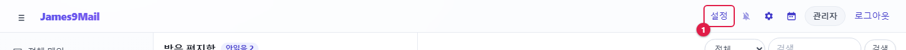

* **설정**을 누르면 관리자 화면이 열립니다. 관리자 화면에서는 같은 자리가 **메일**로 바뀌어 메일 화면으로 돌아갑니다.
* 왼쪽 메뉴: **현황** · **기본 설정** · **사용자 관리** · **알리아스 메일** · **메일 로그** · **수신거부**
* 주소로 바로 열 수도 있습니다: `+#/admin/overview+`, `+#/admin/site+`, `+#/admin/users+`, `+#/admin/aliases+`, `+#/admin/mails+`, `+#/admin/droplist+`
* 관리자가 아닌 계정으로 이 주소에 들어가면 메일 화면으로 돌아갑니다.

[NOTE]
====
개인환경설정(⚙)은 관리자 계정 자신의 설정입니다. 관리자 메뉴와는 다릅니다.
====

[[a2-현황]]
== A.2 현황

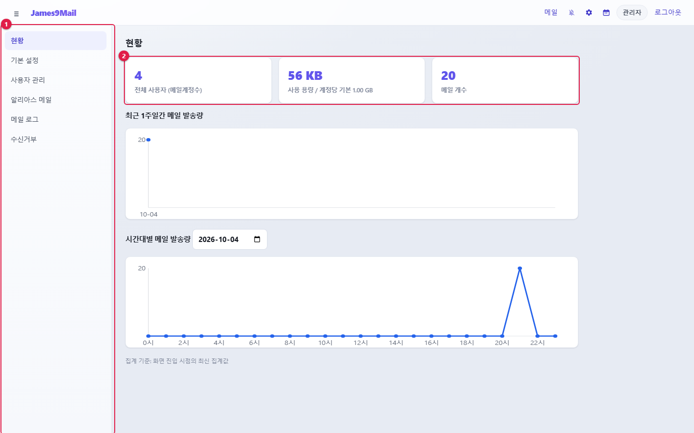

[cols="1,1,3",options="header"]
|===
|번호 |항목 |설명

|① |메뉴 |관리자 메뉴
|② |요약 카드 |**전체 사용자 (메일계정수)**, **사용 용량**(/ 계정당 기본 용량), **메일 개수**
|===

* **최근 1주일간 메일 발송량** — 날짜별 발송 건수 그래프입니다.
* **시간대별 메일 발송량** — 날짜를 고르면 그날의 시간대별 발송 건수를 보여 줍니다.
* 숫자는 화면을 연 시점 기준입니다. 최신 값을 보려면 다시 들어오세요.

[[a3-기본-설정]]
== A.3 기본 설정

사이트 전체에 적용되는 설정입니다.

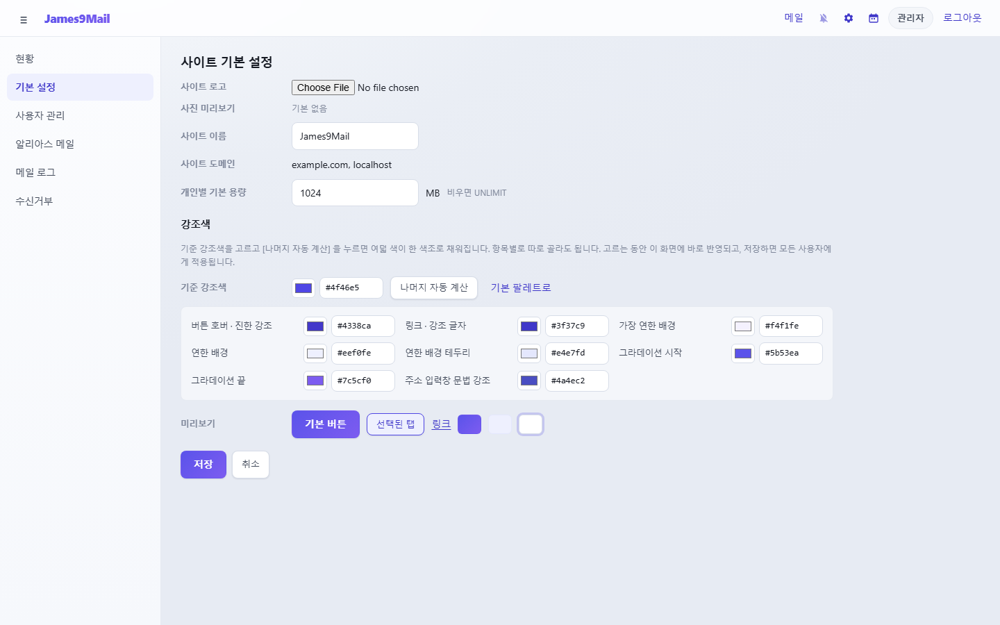

[[사이트-정보]]
=== 사이트 정보

[cols="1,5",options="header"]
|===
|항목 |설명

|**사이트 로고** |상단 왼쪽에 표시할 로고. PNG · JPEG · GIF · WEBP, 2MB 이하(SVG 는 보안상 받지 않습니다). **로고 제거**로 지웁니다
|**사이트 이름** |상단과 브라우저 탭에 표시되는 이름. 비우면 `+James9Mail+`
|**사이트 도메인** |메일 서버에 등록된 도메인(읽기 전용). 도메인 추가는 메일 서버(James) 쪽에서 합니다
|**개인별 기본 용량** |새 계정에 줄 메일함 용량(MB). 비우면 무제한(UNLIMIT)
|===

[NOTE]
====
**개인별 기본 용량**은 **저장한 뒤 새로 만드는 계정**에만 적용됩니다. 기존 계정은 <<할당량-변경,할당량 변경>>으로 바꾸세요. 도메인 할당량이 따로 정해진 도메인에서는 이 기본값이 무시되고 화면에 안내가 나옵니다.
====

[[강조색]]
=== 강조색

웹메일 전체의 버튼 · 링크 · 선택 표시 색을 바꿉니다.

. **기준 강조색**을 고르거나 6자리 색 코드(예: `+#4f46e5+`)를 입력합니다.
. **나머지 자동 계산**을 누르면 나머지 8가지 색이 기준색에 맞춰 채워집니다. 각각 따로 고칠 수도 있습니다.
. **미리보기**에서 버튼 · 탭 · 링크 모양을 확인합니다.
. **저장**을 누릅니다.

//

* 고르는 동안 관리자 화면에 바로 반영됩니다. 저장하지 않고 나가면 원래 색으로 돌아갑니다.
* 저장하면 모든 사용자에게 적용됩니다. 이미 접속한 사용자는 새로 고치면 바뀝니다.
* 기준색이 너무 밝으면 글자가 잘 안 보인다는 경고가 나옵니다.
* **기본 팔레트로**를 누르면 처음 색으로 돌아갑니다.

[NOTE]
====
비밀번호 정책(기본: 8자 이상, 특수문자 2자 이상)과 첨부 한도(일반 30MB · 10개, 대용량 100MB · 30일 보관)는 이 화면에서 바꿀 수 없습니다. 바꿔야 하면 시스템 담당자에게 요청하세요.
====

[[a4-사용자-관리]]
== A.4 사용자 관리

메일 계정을 만들고 관리합니다.

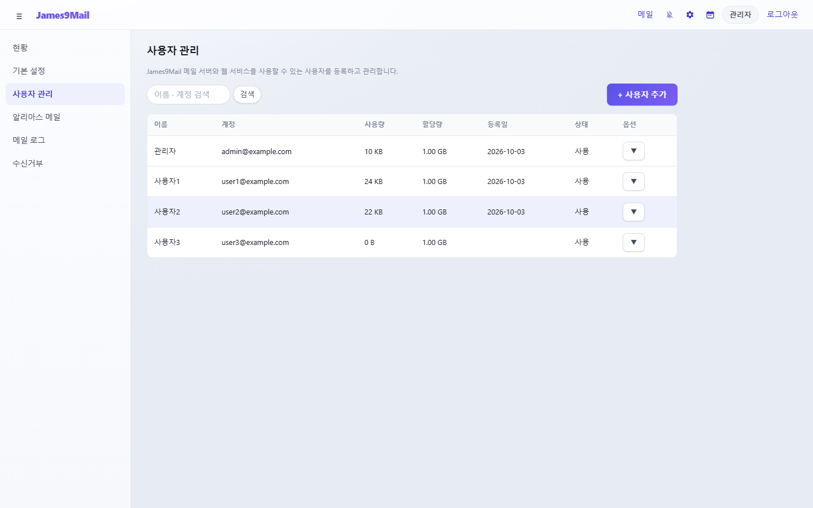

* 위쪽 검색칸으로 이름 · 계정을 찾습니다.
* 목록: 이름 · 계정 · 사용량 · 할당량 · 등록일 · 상태(**사용** / **중지**)
* 행을 누르면 사용자 정보를 고칩니다. 50명씩 보이고 **더보기**로 더 불러옵니다.

[[사용자-추가]]
=== 사용자 추가

**+ 사용자 추가**를 누릅니다.

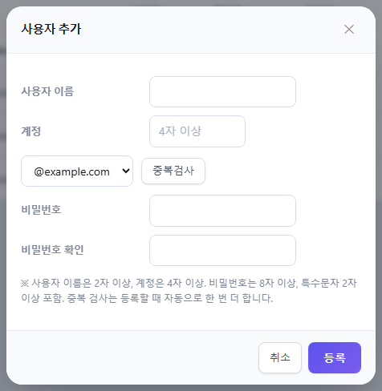

. **사용자 이름**(2자 이상)을 입력합니다.
. **계정**의 앞부분(4자 이상)을 입력하고 도메인을 고른 뒤 **중복검사**를 누릅니다.
. **비밀번호**와 **비밀번호 확인**을 입력합니다(8자 이상, 특수문자 2자 이상).
. **등록**을 누릅니다.

//

* 등록하면 기본 편지함(받은 · 보낸 · 임시 보관 · 지운 · 스팸)이 자동으로 만들어집니다.
* 중복 검사는 등록할 때 한 번 더 자동으로 합니다.

[[사용자-정보-수정]]
=== 사용자 정보 수정

목록에서 사용자를 누릅니다.

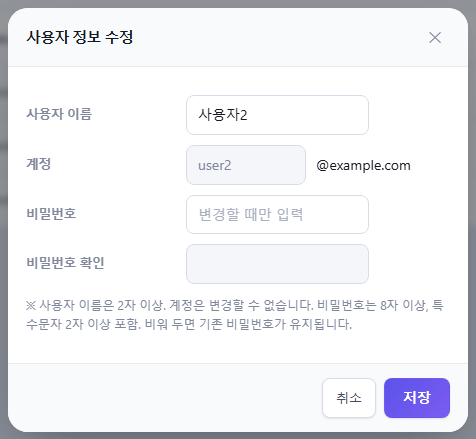

* 이름과 비밀번호를 바꿀 수 있습니다. 계정(메일 주소)은 바꿀 수 없습니다.
* 비밀번호 칸을 비워 두면 기존 비밀번호가 그대로 유지됩니다.
* 비밀번호를 바꾸면 그 사용자의 로그인이 모두 끊어집니다. 🔗 사용자가 썬더버드 · 아웃룩 · 스마트폰에 저장한 비밀번호도 바꿔야 한다고 알려 주세요.

[[옵션-메뉴]]
=== 옵션 메뉴

행 오른쪽 **▼** 를 누릅니다.

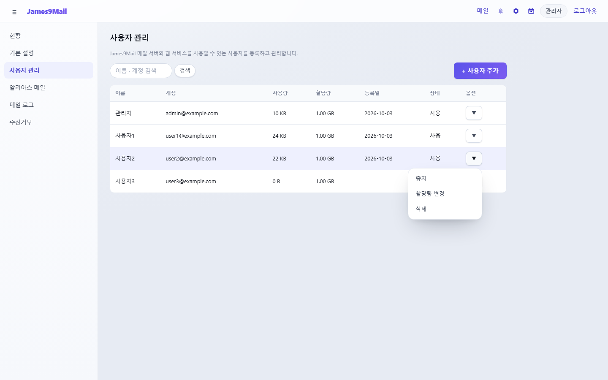

[cols="1,3",options="header"]
|===
|메뉴 |동작

|**중지** / **사용** |계정을 중지하면 로그인할 수 없고, 접속 중인 세션도 바로 끊어집니다
|**할당량 변경** |이 사용자의 메일함 용량을 바꿉니다
|**삭제** |계정과 **모든 메일 · 대용량 첨부 · 설정**을 지웁니다. **복원할 수 없습니다**
|===

[NOTE]
====
퇴사자처럼 메일을 남겨 둬야 하면 **삭제** 대신 **중지**하세요.
====

[[할당량-변경]]
=== 할당량 변경

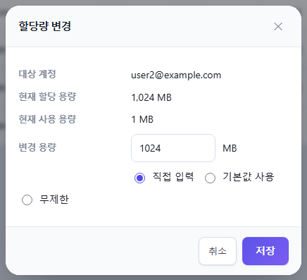

* 현재 할당 용량과 사용 용량이 표시됩니다.
* **직접 입력**(MB) · **기본값 사용**(기본 설정의 개인별 기본 용량) · **무제한** 중 고르고 **저장**합니다.
* 현재 사용 용량보다 작게는 정할 수 없습니다.

[[a5-알리아스-메일]]
== A.5 알리아스 메일

알리아스 메일은 가상의 메일 주소입니다. 알리아스로 온 메일은 지정한 실제 계정들이 받고, 실제 계정은 알리아스 주소로 메일을 보낼 수 있습니다(예: `+sales@+` 로 온 메일을 영업팀 전원이 받기).

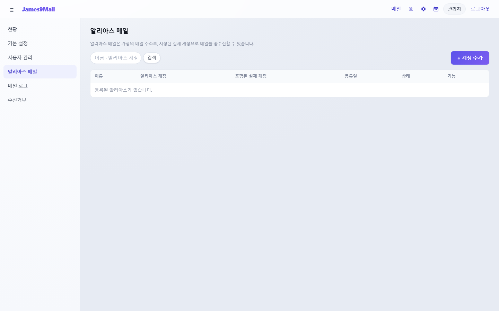

[[알리아스-추가]]
=== 알리아스 추가

**+ 계정 추가**를 누릅니다.

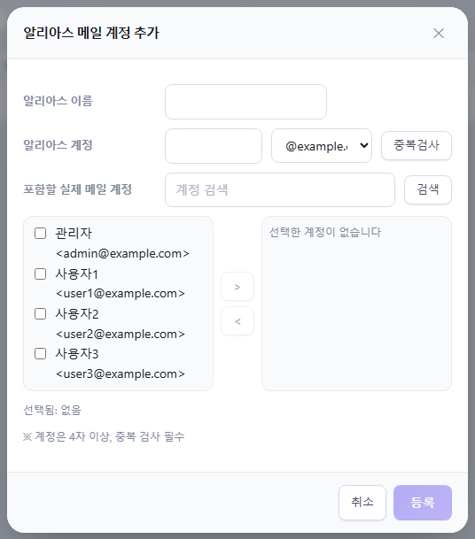

. **알리아스 이름**을 입력합니다.
. **알리아스 계정**(4자 이상)과 도메인을 정하고 **중복검사**를 누릅니다. 실제 계정이나 기존 알리아스와 겹치면 쓸 수 없습니다.
. **포함할 실제 메일 계정**에서 계정을 체크하고 **>** 로 오른쪽에 옮깁니다. 빼려면 오른쪽에서 체크하고 **<** 를 누릅니다.
. **등록**을 누릅니다.

//

* 목록의 이름을 누르면 수정합니다. 알리아스 주소는 바꿀 수 없고 포함할 계정만 바꿀 수 있습니다.
* **▼** 메뉴로 **중지** · **사용** · **삭제**합니다. 알리아스를 지워도 실제 계정에는 영향이 없습니다.
* 포함된 사용자는 메일쓰기의 **보내는 사람**에서 알리아스 주소를 고를 수 있고, 알리아스로 받은 메일에 답장하면 알리아스가 자동으로 골라집니다(xref:03-mail-compose.adoc#답장할-때[사용자 매뉴얼 3.8]).

[[a6-메일-로그]]
== A.6 메일 로그

서버에서 주고받은 메일 기록을 조회합니다.

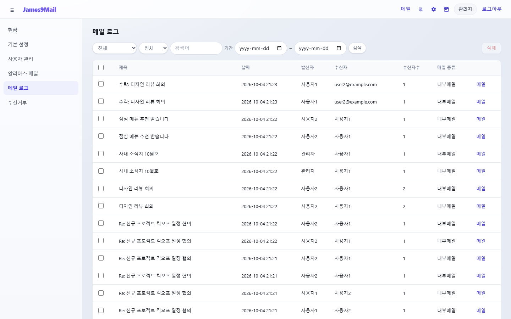

**검색**

[cols="1,2",options="header"]
|===
|항목 |선택지

|종류 |전체 · 내부메일 · 외부로 발송 · 외부에서 수신
|검색 대상 |전체 · 발신자 · 수신자 · 제목
|검색어 · 기간 |검색어와 시작일 ~ 종료일
|===

조건을 정하고 **검색**을 누릅니다. 50건씩 보이고 **더보기**로 더 불러옵니다.

**메일 내용 보기** — 행 끝의 **메일**을 누르면 메일 내용과 첨부를 볼 수 있고, **PC 저장 (eml)** 로 내려받을 수 있습니다.

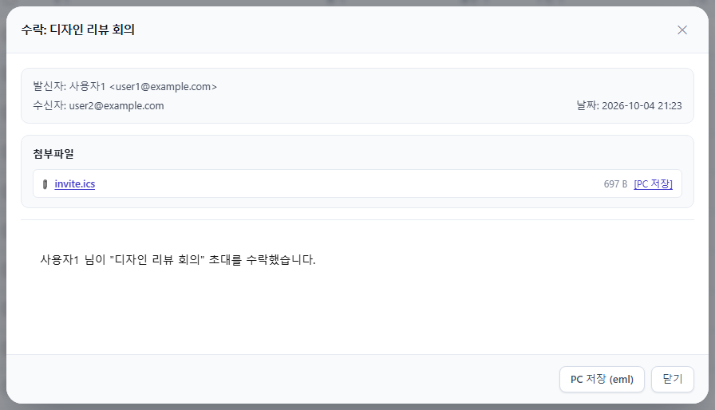

**메일 삭제** — 행을 체크하고 **삭제**를 누르면, 그 메일을 **모든 수신자의 편지함에서 첨부까지 완전 삭제**합니다. 잘못 보낸 메일이나 악성 메일을 일괄로 지울 때 씁니다. **복원할 수 없습니다.** 한 번에 200통까지 지울 수 있습니다.

[NOTE]
====
메일 로그의 메일 보기와 삭제는 사용자 개인 메일에 접근하는 기능입니다. 회사 규정에 따라 필요한 경우에만 사용하세요.
====

[[a7-수신거부-전체]]
== A.7 수신거부 (전체)

지정한 계정이나 도메인에서 오는 메일을 **서버 전체에서** 차단합니다. 사용자 개인의 xref:05-settings.adoc#_57-수신거부[수신거부]와 별개입니다.

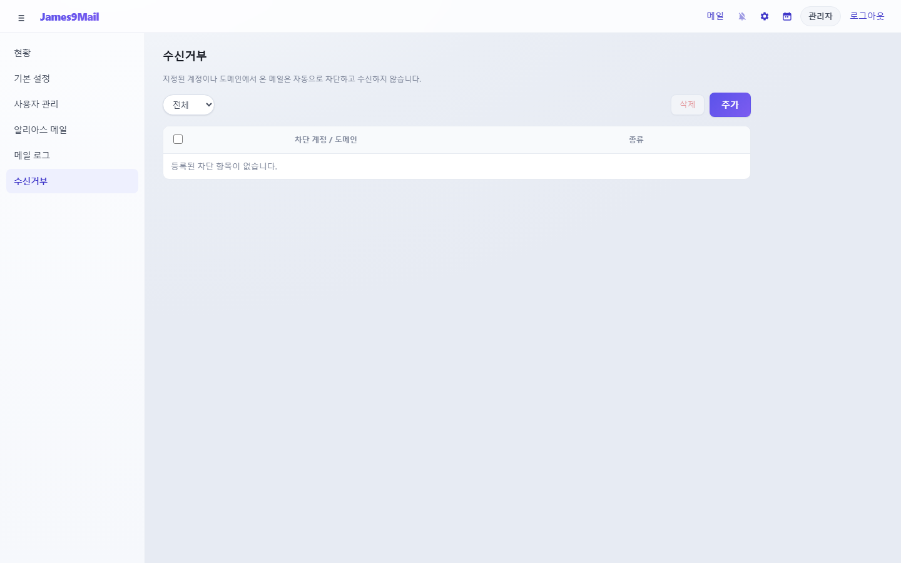

. **추가**를 누릅니다.
. 차단할 메일 주소(`+test@example.com+`) 또는 도메인(`+example.com+`)을 입력하고 **저장**합니다. 입력값을 보고 계정인지 도메인인지 자동으로 구분합니다.

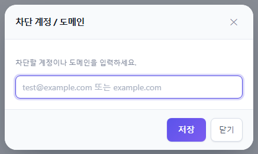

* 위쪽 필터로 **전체 · 도메인 · 계정**을 걸러 봅니다.
* 항목을 체크하고 **삭제**를 누르면 차단이 풀립니다.

[[a8-관리자가-알아-둘-점]]
== A.8 관리자가 알아 둘 점

[cols="1,8",options="header"]
|===
|항목 |내용

|비밀번호 분실 |사용자 정보 수정에서 새 비밀번호를 정해 주고, 사용자가 로그인한 뒤 직접 바꾸도록 안내합니다
|메일 프로그램 연결 |🔗 썬더버드 · 아웃룩용 IMAP · SMTP 서버 주소와 포트는 사용자 매뉴얼에 없습니다. 사내 안내에 따로 알려 주세요. 일정(CalDAV) · 주소록(CardDAV) 연결 정보는 사용자가 웹메일 안내 창에서 복사할 수 있습니다
|HTTPS |웹메일을 http 로 열면 CalDAV · CardDAV 안내 창에 비밀번호가 암호화되지 않는다는 경고가 나옵니다. 사내망에서도 HTTPS 를 권장합니다
|외부메일 |사용자의 외부메일 가져오기는 자동 주기 실행이 없고, 사용자가 **실행**을 눌러야 합니다
|===

xref:README.adoc[← 사용자 매뉴얼 목차]
